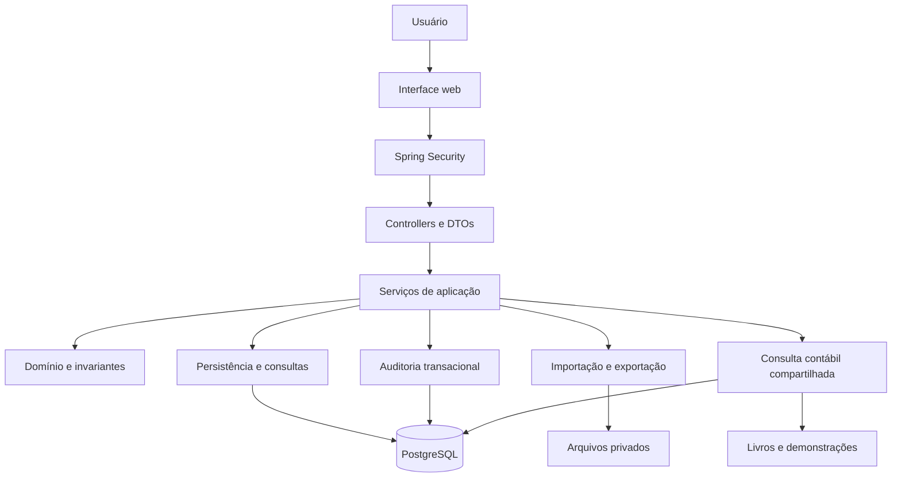
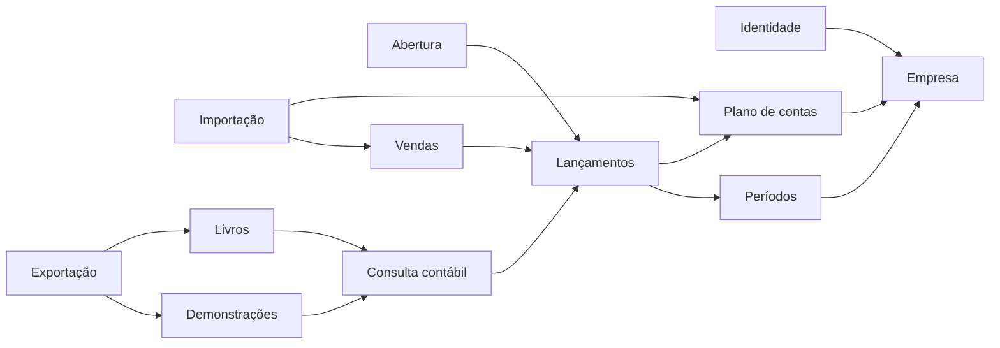
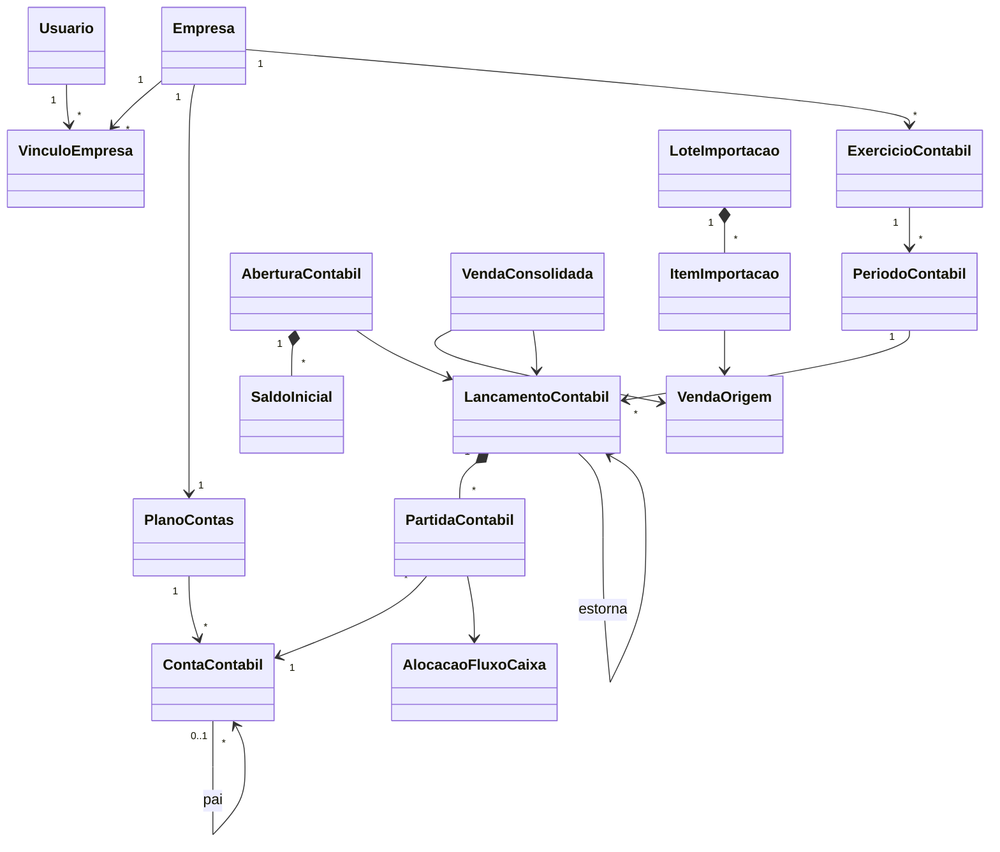
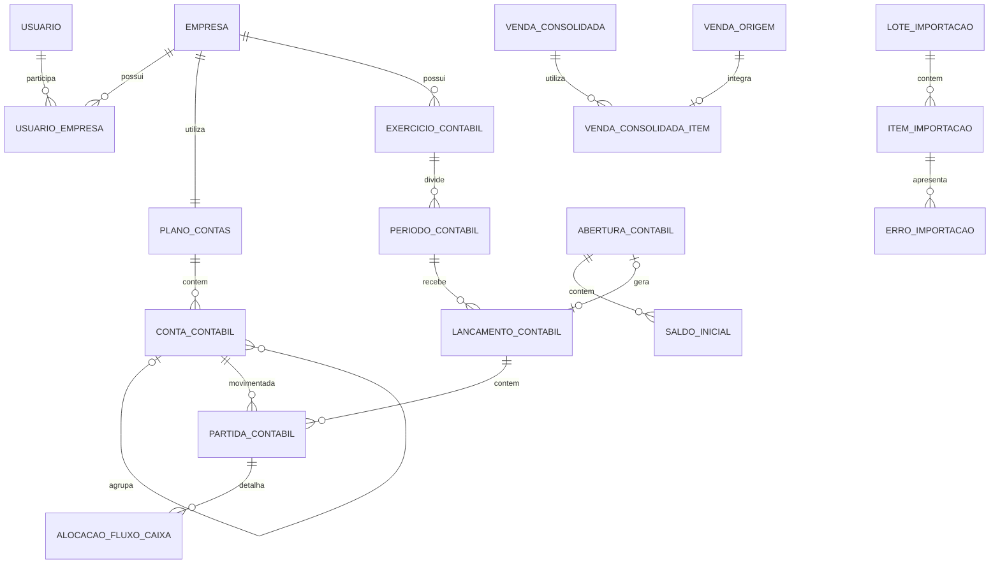
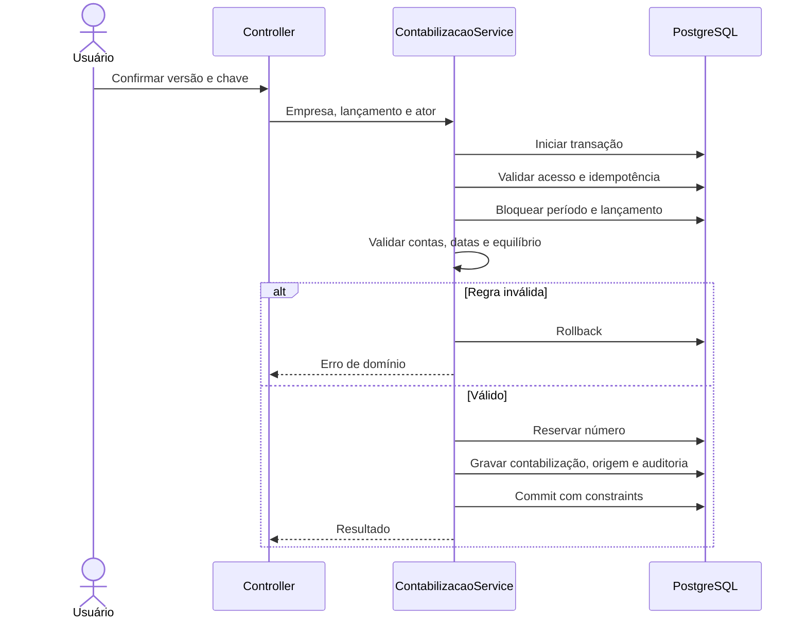
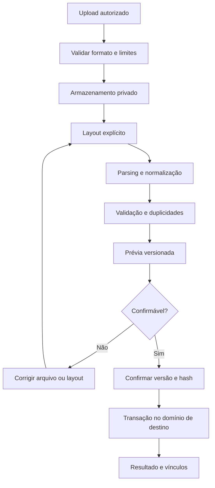
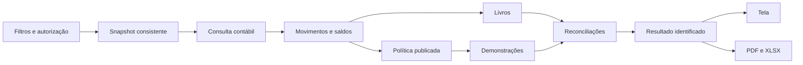
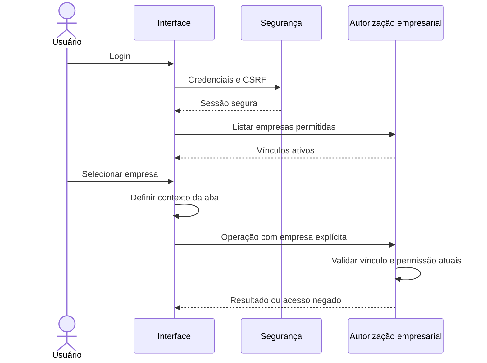

# Planejamento técnico do Sistema de Contabilidade — v1.0

**Agente efetivamente acionado para o planejamento: PLANEJADOR**, em `/root/planejador`. Desenvolvedor, Testador e Auditor não foram acionados na etapa de planejamento.

Proposta arquitetural **v1.0 para revisão**, elaborada pelo Planejador. Na etapa de análise, nenhum arquivo foi criado ou modificado. Não foram executados testes, aplicação, containers, migrações ou SQL. Este documento foi registrado posteriormente por solicitação explícita do usuário.

Pela extensão da missão, esta apresentação constitui a **primeira parte da especificação**: diagnóstico, decisões prioritárias, arquitetura, núcleo contábil, modelo de dados, contratos principais e sequência de trabalho. O detalhamento exaustivo por classe, operação da API, tela e tarefa ainda precisa ser consolidado antes da aprovação integral do desenvolvimento.

# Índice da especificação

| Parte | Conteúdo | Situação nesta entrega |
|---|---|---|
| A | Diagnóstico real do repositório | Apresentado |
| B | Arquitetura, pacotes e dependências | Apresentado |
| C | Classes Java e relacionamentos | Catálogo principal; fichas completas pendentes |
| D | Banco, integridade e migrações | Modelo proposto; dicionário completo pendente |
| E | Motor contábil e processos | Regras principais apresentadas |
| F | APIs e interface | Contratos e fluxos principais; catálogo completo pendente |
| G | Segurança, testes e operação | Estratégia apresentada |
| H | Roadmap e backlog | Fases e primeiras tarefas detalhadas |
| I | Riscos e decisões pendentes | Apresentado |

# Parte A — Diagnóstico do projeto existente

## A.1. Base examinada

O Planejador inspecionou:

- `AGENTS.md`, `.codex/config.toml` e `.codex/FLUXO-DA-EQUIPE.md`.
- Todo o código em `src/main/java`.
- Configurações em `src/main/resources`.
- Estrutura de `src/test/java`.
- `pom.xml`, `compose.yaml`, `Dockerfile`, `README.md` e `.gitignore`.
- Histórico e estado Git.
- Documento preexistente `docs/PLANO_DESENVOLVIMENTO.md`, considerado uma proposta anterior, sem presumir aprovação.

HEAD analisado:

```text
19ae7da4f90e9b55ce17b94e33c2d74b307bca6d
```

Estado Git informado pelo Planejador, preservado ao final:

```text
?? .codex/
?? AGENTS.md
?? docs/
```

O conteúdo de `.env` não foi lido.

## A.2. Estrutura implementada

```text
src/
├── main/
│   ├── java/org/example/
│   │   ├── Main.java
│   │   └── StatusController.java
│   └── resources/
│       └── application.properties
└── test/
    └── java/                  # sem testes encontrados
```

| Área | Evidência | Situação |
|---|---|---|
| Inicialização | `Main` com `@SpringBootApplication` | Implementada |
| Endpoint de status | `GET /api/status`, resposta textual | Implementado |
| Java/Spring | Java 21 e Spring Boot 3.5.7 | Configurados |
| Web/JPA/PostgreSQL | Dependências presentes | Fundação parcial |
| PostgreSQL Docker | `postgres:17-alpine`, volume nomeado e healthcheck | Configuração existente |
| Dockerfile | Build Maven e runtime Java 21 | Existente |
| Testes | Starter de testes, sem classes de teste | Ausentes |
| Domínio contábil | Nenhuma entidade, serviço ou repository encontrado | Precisa ser criado |
| Segurança | Sem autenticação/autorização implementadas | Precisa ser criada |
| Migrações | Nenhuma encontrada | Precisam ser planejadas |
| Frontend | Nenhum encontrado | Precisa ser criado |
| Pipeline | Nenhum arquivo versionado encontrado | Precisa ser definido |
| README | Apenas identificação do projeto | Documentação insuficiente |

O endpoint de status não comprova saúde do banco. A ausência de entidades no código também não comprova que o PostgreSQL esteja vazio: o esquema real não foi acessado.

O histórico contém `Initial commit` e duas mensagens `Forçando build no pipeline`. Isso não demonstra adoção de Conventional Commits nem comprova um pipeline operacional.

## A.3. Problemas e riscos imediatos

| Achado | Consequência | Tratamento proposto |
|---|---|---|
| `ddl-auto=update` | Inicialização pode modificar esquema existente | Diagnosticar banco antes de iniciar; adotar Flyway e posteriormente `validate` |
| Credenciais literais no Compose | Exposição de segredo em configuração | Externalização e avaliação de rotação em tarefa autorizada; valores omitidos |
| `show-sql=true` | Volume e exposição desnecessária em produção | Configuração por ambiente e logs sanitizados |
| Dockerfile ignora testes no empacotamento | Artefato pode ser produzido sem validação | Pipeline obrigatório antes da construção da imagem |
| Ausência de testes | Sem evidência de integridade ou regressão | Testes desde a fundação |
| Ausência de autorização | Recursos futuros ficariam expostos sem uma base segura | Identidade e isolamento antes dos módulos contábeis |
| Grafias históricas diferentes no Docker | Possibilidade de criar/apontar outro volume | Inventário por labels e montagens antes de normalizar |
| Plano anterior não rastreado | Risco de confundir proposta com implementação | Aprovação explícita por versão e tarefa |

A base é pequena. A evolução deve preservar `Main` e o escaneamento sob `org.example`, com refatoração limitada ao necessário.

## A.4. Dependências propostas

Todas dependem de aprovação e verificação de compatibilidade com Spring Boot 3.5.7.

| Finalidade | Proposta |
|---|---|
| Segurança | Spring Security |
| Validação | Spring Boot Validation |
| Migrações | Flyway e suporte PostgreSQL |
| Observabilidade | Actuator |
| XLSX | Apache POI |
| CSV | Apache Commons CSV |
| PDF | Apache PDFBox, sujeito à avaliação de layout |
| Contrato REST | Springdoc/OpenAPI compatível |
| Integração | Testcontainers PostgreSQL/JUnit |
| Segurança em testes | `spring-security-test` |
| Limites arquiteturais | ArchUnit |
| Frontend | Angular |
| Testes de interface | Testing Library e Playwright |

A referência Netlify não retornou conteúdo utilizável na pesquisa. As telas desta proposta derivam dos seus requisitos; o inventário observado da referência permanece pendente.

# Parte B — Arquitetura e organização do código

## B.1. Recomendação

**Monólito modular, API REST, PostgreSQL compartilhado com isolamento por empresa e frontend na mesma origem.**

A recomendação considera:

- Necessidade de atomicidade entre lançamento, partidas, origem e auditoria.
- Pequeno estágio atual do projeto.
- Ausência de evidência que justifique distribuição.
- Facilidade de testar transações e manter regras consistentes.
- Possibilidade de evolução por módulos.

Microsserviços, event sourcing, mensageria e bancos separados por leitura não são propostos para a primeira versão.



## B.2. Responsabilidades

| Componente | Responsabilidade |
|---|---|
| Controller | Contrato HTTP, validação estrutural e chamada de caso de uso |
| Service de aplicação | Autorização, transação e coordenação do caso de uso |
| Entity | Estado persistente e invariantes locais |
| Value Object | Conceito imutável validado |
| Repository | Persistência e consultas do agregado |
| Consulta especializada | Projeções e agregações eficientes |
| DTO | Entrada/saída explícita da API |
| Mapper | Conversão estrutural de campos permitidos |
| Validator/política | Regra nomeada e reutilizável |
| Exportador | Transformação de resultado calculado em arquivo |

Controllers não somam partidas, escolhem contrapartidas ou acessam repositories diretamente.

Interfaces serão usadas em fronteiras úteis — parsers, armazenamento, exportadores e consultas — sem criar uma interface artificial para cada serviço.

## B.3. Estrutura proposta

```text
src/main/java/org/example/
├── Main.java
├── StatusController.java
├── empresa/
│   ├── api/
│   ├── aplicacao/
│   ├── dominio/
│   └── persistencia/
├── identidade/
│   ├── api/
│   ├── aplicacao/
│   ├── dominio/
│   └── persistencia/
├── planocontas/
│   ├── api/
│   ├── aplicacao/
│   ├── dominio/
│   └── persistencia/
├── periodo/
│   ├── api/
│   ├── aplicacao/
│   ├── dominio/
│   └── persistencia/
├── lancamento/
│   ├── api/
│   ├── aplicacao/
│   ├── dominio/
│   └── persistencia/
├── abertura/
│   ├── api/
│   ├── aplicacao/
│   ├── dominio/
│   └── persistencia/
├── venda/
│   ├── api/
│   ├── aplicacao/
│   ├── dominio/
│   └── persistencia/
├── importacao/
│   ├── api/
│   ├── aplicacao/
│   ├── dominio/
│   ├── infraestrutura/
│   └── persistencia/
├── consultacontabil/
│   ├── aplicacao/
│   ├── modelo/
│   └── persistencia/
├── livros/
│   ├── api/
│   ├── aplicacao/
│   └── modelo/
├── demonstracao/
│   ├── api/
│   ├── aplicacao/
│   ├── dominio/
│   ├── modelo/
│   └── persistencia/
├── exportacao/
│   ├── api/
│   ├── aplicacao/
│   ├── dominio/
│   ├── infraestrutura/
│   └── persistencia/
├── auditoria/
│   ├── api/
│   ├── aplicacao/
│   ├── dominio/
│   └── persistencia/
├── configuracao/
└── shared/
    ├── dominio/
    ├── seguranca/
    ├── api/
    ├── idempotencia/
    └── arquivo/
```

`shared` será restrito a conceitos realmente transversais. Regras de vendas, lançamentos e demonstrações permanecem nos módulos responsáveis.



Regras de dependência:

- Abertura e vendas contabilizam pelo motor.
- Demonstrações usam partidas contabilizadas.
- Exportadores recebem resultados calculados.
- Domínio não conhece HTTP ou configuração.
- Auditoria não chama serviços de domínio de volta.
- ArchUnit verificará ciclos e acessos proibidos.

# Parte C — Projeto principal das classes Java

## C.1. Regras comuns

Entidades empresariais terão:

```java
UUID id;
UUID empresaId;
Instant criadoEm;
UUID criadoPor;
```

Entidades editáveis também terão versão otimista e atualização auditada.

- Datas contábeis: `LocalDate`.
- Auditoria: `Instant`.
- Dinheiro: `BigDecimal` encapsulado em objeto de valor.
- Empresa e autoria são determinadas pelo servidor.
- Consultas são realizadas por empresa e identificador.
- Entidades JPA não são serializadas diretamente.

## C.2. Catálogo principal

Os pacotes abaixo são relativos a `org.example`.

| Classe/pacote | Categoria e atributos centrais | Responsabilidade e invariantes |
|---|---|---|
| `empresa.dominio.Empresa` | Entity: razão social, documento, moeda, fuso e situação | Contexto empresarial; inativação preserva histórico |
| `identidade.dominio.Usuario` | Entity global: nome, email normalizado, hash e situação | Identidade; hash nunca exposto |
| `identidade.dominio.VinculoEmpresa` | Entity: usuário, empresa, papéis e situação | Autorização empresarial; vínculo único |
| `identidade.dominio.Papel` | Enum/conjunto de permissões | Agrupar permissões por empresa |
| `identidade.dominio.Permissao` | Enum | Ações explícitas, inclusive contabilizar e reabrir |
| `planocontas.dominio.PlanoContas` | Entity: nome, modelo de origem e versão | Plano operacional da empresa |
| `planocontas.dominio.ContaContabil` | Entity: pai, código, nome, natureza, tipo, classificação e vigência | Hierarquia sem ciclos; somente analíticas recebem partidas |
| `planocontas.dominio.CodigoConta` | Value Object textual | Preservar zeros e estrutura do código |
| `planocontas.dominio.ModeloPlano` | Aggregate versionado | Modelo publicado imutável, copiado para a empresa |
| `periodo.dominio.ExercicioContabil` | Entity: início, fim e estado | Exercício sem sobreposição |
| `periodo.dominio.PeriodoContabil` | Entity: exercício, intervalo e estado | Janela permitida de escrituração |
| `periodo.dominio.FechamentoPeriodo` | Entity imutável | Histórico de fechamento/reabertura e aprovações |
| `lancamento.dominio.LancamentoContabil` | Aggregate: data, número, histórico, estado, origem e partidas | Transição controlada de rascunho para contabilizado |
| `lancamento.dominio.PartidaContabil` | Entity filha: conta, lado, valor e ordem | Valor positivo; mesma empresa; sem edição isolada |
| `lancamento.dominio.ComposicaoLancamento` | Value Object | Calcular débitos, créditos e diferença |
| `abertura.dominio.AberturaContabil` | Aggregate: corte, saldos, aprovação e lançamento | Processo rastreável de implantação |
| `abertura.dominio.SaldoInicial` | Entity filha: conta, lado e valor | Uma posição inicial por conta |
| `venda.dominio.VendaOrigem` | Entity: referência, competência, valores e hash | Fonte rastreável e deduplicada |
| `venda.dominio.VendaConsolidada` | Aggregate: fontes, regra, totais e lançamento | Conferência e contabilização da consolidação |
| `venda.dominio.RegraContabilVenda` | Entity versionada | Política aprovada de conversão em partidas |
| `importacao.dominio.LoteImportacao` | Aggregate: arquivo, layout, estado, prévia e contadores | Máquina de estados e recuperação |
| `importacao.dominio.ItemImportacao` | Entity filha: linha, dados normalizados e resultado | Validação por linha e vínculo de origem |
| `importacao.dominio.ErroImportacao` | Entity filha | Campo, linha, código e mensagem segura |
| `importacao.dominio.LayoutImportacao` | Entity versionada | Mapeamento explícito de datas, números e colunas |
| `demonstracao.dominio.PoliticaDemonstracao` | Aggregate versionado | Apresentação e classificação por vigência |
| `demonstracao.dominio.MapeamentoConta` | Entity | Relacionar conta e linha sem dupla classificação |
| `demonstracao.dominio.AlocacaoFluxoCaixa` | Entity | Semântica dos movimentos de caixa para DFC |
| `demonstracao.dominio.AjusteDfc` | Entity | Ajustes suportados do método indireto |
| `auditoria.dominio.EventoAuditoria` | Entity imutável | Autoria, ação, alvo, motivo e correlação |
| `exportacao.dominio.PedidoExportacao` | Entity | Job, snapshot, arquivo privado e expiração |
| `shared.idempotencia.RegistroIdempotencia` | Entity | Uma operação financeira por chave/payload |
| `shared.dominio.Dinheiro` | Value Object | Escala, moeda e operações exatas |
| `shared.dominio.IntervaloDatas` | Value Object | Intervalo válido |
| `shared.seguranca.Ator` | Record | Identidade autenticada e contexto seguro |

### Entidades versus resultados

`LivroDiario`, `LivroRazao`, `BalanceteVerificacao`, `BalancoPatrimonial`, `DemonstracaoResultado` e `DemonstracaoFluxoCaixa` serão **resultados calculados**.

`EstornoContabil` não precisa ser uma entidade independente: será um lançamento de tipo `ESTORNO`, ligado ao original.

## C.3. Assinaturas principais propostas

```java
LancamentoResponse criarRascunho(
    UUID empresaId,
    LancamentoRequest request,
    Ator ator);

LancamentoResponse contabilizar(
    UUID empresaId,
    UUID lancamentoId,
    ConfirmarRequest request,
    Ator ator);

LancamentoResponse estornar(
    UUID empresaId,
    UUID originalId,
    EstornoRequest request,
    Ator ator);

void exigir(
    UUID empresaId,
    Permissao permissao,
    Ator ator);

SaldoConta calcular(
    BigDecimal saldoAnterior,
    BigDecimal debitos,
    BigDecimal creditos,
    NaturezaConta natureza);
```

Fronteira compartilhada de leitura:

```java
public interface ConsultaContabil {
    Page<ExtratoPartida> consultarDiario(
        UUID empresaId, FiltroDiario filtro);

    List<MovimentoConta> agregarMovimentos(
        UUID empresaId, FiltroContabil filtro);

    List<SaldoConta> saldosEm(
        UUID empresaId, LocalDate data);

    boolean possuiMovimentacao(
        UUID empresaId, UUID contaId);
}
```

Contratos de persistência sempre delimitados:

```java
Optional<LancamentoContabil> findByEmpresaIdAndId(
    UUID empresaId, UUID id);
```

## C.4. Relacionamentos principais



A exigência mínima de duas partidas aplica-se ao lançamento contabilizado; rascunhos podem estar incompletos.

# Parte D — Modelo PostgreSQL

## D.1. Convenções propostas

| Informação | Tipo |
|---|---|
| Identificador | `uuid` |
| Valor contábil | `numeric(19,2)` |
| Taxa/intermediário aprovado | `numeric(19,8)` |
| Data contábil | `date` |
| Auditoria | `timestamptz` |
| Versão otimista | `bigint` |
| Estado | `varchar` com restrição |
| Layout/dados normalizados | `jsonb`, validado |
| Hash | SHA-256 |

Tabelas empresariais terão `empresa_id NOT NULL` e:

```text
UNIQUE (empresa_id, id)
```

Referências empresariais usarão FKs compostas:

```text
(empresa_id, conta_id)
    → conta_contabil(empresa_id, id)

(empresa_id, lancamento_id)
    → lancamento_contabil(empresa_id, id)
```

Isso impede, no banco, uma partida da empresa A de apontar para uma conta da empresa B.

## D.2. Tabelas previstas

| Grupo | Tabelas |
|---|---|
| Empresas e identidade | `empresa`, `usuario`, `usuario_empresa`, `usuario_empresa_papel`, `preferencia_usuario` |
| Plano | `plano_contas`, `conta_contabil`, `modelo_plano`, `modelo_conta` |
| Calendário | `exercicio_contabil`, `periodo_contabil`, `fechamento_periodo` |
| Escrituração | `sequencia_lancamento`, `lancamento_contabil`, `partida_contabil` |
| Abertura | `abertura_contabil`, `saldo_inicial` |
| Vendas | `regra_contabil_venda`, `venda_origem`, `venda_consolidada`, `venda_consolidada_item` |
| Importação | `layout_importacao`, `lote_importacao`, `item_importacao`, `erro_importacao` |
| Demonstrações | `politica_demonstracao`, `linha_demonstracao`, `mapeamento_conta`, `alocacao_fluxo_caixa`, `ajuste_dfc` |
| Controle | `evento_auditoria`, `registro_idempotencia`, `pedido_exportacao` |

## D.3. Estrutura central

**`lancamento_contabil`**

- Empresa, período e exercício.
- Número atribuído na contabilização.
- Data contábil e histórico.
- Estado, tipo e origem.
- Identificador da origem.
- Referências de estorno/correção.
- Autoria e instante de contabilização.
- Versão otimista.

Restrições:

- Número único por empresa/exercício.
- Um estorno integral por original no fluxo inicial.
- Referências da mesma empresa.
- Índice por empresa/data/número/ID.

**`partida_contabil`**

- Empresa e lançamento.
- Ordem.
- Conta.
- Lado D/C.
- Valor.
- Complemento.

Restrições:

- `valor > 0`.
- Lado válido.
- Ordem única dentro do lançamento.
- FKs compostas.
- Índices por empresa/conta/lançamento.

A igualdade entre débitos e créditos não cabe em um simples `CHECK` de linha. Propõe-se validação no domínio e avaliação de **constraint trigger diferido**, com teste real em PostgreSQL. A documentação distingue constraints de linha e mecanismos de trigger. [Constraints PostgreSQL 17](https://www.postgresql.org/docs/17/ddl-constraints.html), [CREATE TRIGGER](https://www.postgresql.org/docs/17/sql-createtrigger.html).



## D.4. Histórico, exclusão e saldos

- `ON DELETE RESTRICT` em referências contábeis.
- Empresa, conta movimentada e lançamento contabilizado não serão removidos fisicamente.
- Políticas publicadas serão imutáveis.
- Retenção será definida com contador e responsável por privacidade.
- Arquivos temporários poderão expirar sem apagar a evidência necessária.

**Fonte de verdade dos saldos: partidas contabilizadas.**

Inicialmente, saldos serão calculados por agregação SQL. Materialização diária/mensal será considerada somente após medição, com reconstrução e reconciliação verificáveis.

## D.5. Flyway e banco existente

Sequência proposta, ainda não executada:

1. Inventariar esquema e identidade dos volumes.
2. Identificar dados a preservar.
3. Obter autorização específica para backup.
4. Ensaiar restauração isolada.
5. Definir migrações e baseline a partir do esquema real.
6. Testar banco vazio e cópia restaurada.
7. Migrar configuração para `ddl-auto=validate`.
8. Validar em homologação.
9. Apresentar scripts e recuperação antes da autorização de produção.

Baseline não verifica equivalência do esquema existente. Não usar `baseline-on-migrate` para contornar um banco desconhecido. [Flyway Baseline](https://documentation.red-gate.com/flyway/reference/commands/baseline).

A normalização dos nomes Docker exige inventário por labels e montagens. Renomear diretório e executar Compose pode selecionar outro volume. Nenhuma exclusão ou recriação faz parte desta etapa.

# Parte E — Motor contábil e processos

## E.1. Invariantes

1. Pelo menos duas partidas em cada lançamento contabilizado.
2. Total exato de débitos igual ao total exato de créditos.
3. Cada partida possui um lado e valor positivo.
4. Empresa única entre lançamento, contas, período e origem.
5. Conta analítica, vigente e permitida na data.
6. Data pertencente a período aberto.
7. Contabilizado não pode ser editado ou excluído.
8. Estorno preserva original e autoria.
9. Confirmação repetida não gera efeito adicional.
10. Livros oficiais usam somente contabilizados.
11. Original e estorno entram conforme suas respectivas datas.
12. Todas as origens usam o mesmo motor.
13. Fechamento concorrente não permite contabilização indevida.
14. Seleção de empresa na interface não concede autorização.

## E.2. Múltiplas partidas e valores

Exemplo válido:

```text
D Clientes       900,00
D Caixa          100,00
C Receita      1.000,00
```

Será um lançamento com três partidas.

Política inicial proposta:

- BRL e duas casas contábeis.
- Construção de `BigDecimal` por string.
- Casas excedentes na entrada rejeitadas.
- Nenhuma tolerância para desequilíbrio.
- Arredondamento intermediário explicitado por política.
- Resíduo de rateio distribuído deterministicamente.
- Negativos não entram como partidas; o lado representa o movimento.
- Saldos contrários à natureza permanecem visíveis.

Fórmula canônica:

```text
saldoAssinado = débitos − créditos

saldoFinal =
    saldoAnterior + débitosDoPeríodo − créditosDoPeríodo
```

## E.3. Contabilização e concorrência



- Numeração por empresa/exercício.
- Nunca usar `max(numero)+1`.
- Versão otimista para edição de rascunhos.
- Bloqueios coordenados para contabilização, estorno e fechamento.
- Chave idempotente única por empresa/operação.
- Mesma chave com conteúdo diferente produz conflito.

## E.4. Estornos e correções

MVP proposto: **estorno integral e novo lançamento corrigido**.

- Novo lançamento com partidas invertidas.
- Motivo e referência obrigatórios.
- Data válida em período aberto.
- Um estorno integral por original.
- Original permanece nos livros.
- Período encerrado não é reaberto automaticamente.
- Correção liga original, estorno e substituto.

Formalidades e tratamento extemporâneo precisam de homologação contábil, considerando a ITG 2000 e normas aplicáveis. [Catálogo de normas específicas do CFC](https://cfc.org.br/tecnica/normas-brasileiras-de-contabilidade/normas-especificas/).

## E.5. Plano de contas

- Hierarquia por referência explícita.
- Código textual, sem inferir classificação pelo primeiro dígito.
- Sintéticas agregam; analíticas recebem movimentos.
- Sem ciclos.
- Modelo padrão copiado de versão publicada.
- Conta movimentada não muda livremente de natureza, tipo ou posição histórica.
- Inativação preserva consulta dos movimentos anteriores.
- Contas retificadoras terão classificação explícita.
- BP/DRE usarão mapeamentos versionados.
- DFC exigirá identificação de caixa/equivalentes e semântica dos movimentos.

## E.6. Abertura

1. Definir data de corte.
2. Digitar/importar saldos por conta analítica.
3. Validar contas e equilíbrio.
4. Conferir compatibilidade com movimentos existentes.
5. Aprovar.
6. Gerar lançamento pelo motor.
7. Vincular saldos e origem.

Não será criada contrapartida automática para esconder diferença.

Implantação no meio do exercício, conta transitória e tratamento de resultados precisam de decisão contábil. Correção posterior usa estorno e substituição rastreável.

## E.7. Vendas e importação

Venda consolidada agregará fontes da mesma empresa. Não representa consolidação societária.

- Regra contábil publicada e versionada.
- Memória de cálculo.
- Distinção entre competência, recebível e recebimento.
- Referência externa para deduplicação.
- Aprovação antes da contabilização.
- Fontes vinculadas ao lançamento.
- Tributos não serão inferidos sem política aprovada.



Proposta inicial:

- CSV e XLSX.
- Sem macros, fórmulas executadas ou links externos.
- Limites preliminares: 10 MiB, 20 mil linhas e 50 colunas.
- Limites adicionais para descompactação e quantidade de células.
- Datas e separadores ambíguos rejeitados.
- Upload fora de transação longa.
- Prévia sem escrituração.
- Confirmação integral do lote limitado.
- Importar vendas cria fontes; contabilização é etapa independente.
- Arquivos e erros exigem autorização empresarial.

## E.8. Livros e demonstrações

| Relatório | Regra central |
|---|---|
| Diário | Lançamentos completos, ordenação estável e totais do filtro inteiro |
| Razão | Saldo anterior + movimentos = saldo final |
| Balancete | Sem dupla contagem de sintéticas; igualdade global |
| BP | Ativo = Passivo + PL; resultado corrente sem duplicação |
| DRE | Competência e tratamento explícito dos lançamentos técnicos de encerramento |
| DFC direta | Movimentos efetivos de caixa classificados por atividade |
| DFC indireta | Resultado ajustado por itens sem caixa, capital de giro e demais efeitos |

**DFC direta:** lançamentos compostos exigem alocações explícitas; não é seguro inferir uma única contrapartida do caixa.

**DFC indireta:** balanços comparativos e DRE podem ser insuficientes. Serão necessários ajustes suportados e identificação de operações não monetárias. A política deve observar o CPC 03 aplicável. [CPC 03 (R2)](https://www.cpc.org.br/Arquivos/Documentos/183_CPC_03_R2_rev%2024.pdf).



# Parte F — API e interface web

## F.1. Contrato comum

Prefixo: `/api/v1`.

Contexto empresarial:

```text
/api/v1/empresas/{empresaId}/...
```

- Dinheiro em string decimal.
- Datas ISO.
- DTOs explícitos.
- Paginação com limite e ordenação permitida.
- Totais independentes da página.
- `Idempotency-Key` em confirmações financeiras.
- Versão esperada nas alterações.
- Erros `application/problem+json`.
- OpenAPI com exemplos e erros documentados.

Códigos previstos: `200`, `201`, `202`, `204`, `400`, `401`, `403`, `404`, `409`, `413`, `415`, `422`, `429` e `503`.

## F.2. Operações principais

| Recurso | Operações |
|---|---|
| Sessão | Login, consultar sessão, CSRF e logout |
| Empresas | Criar, consultar, atualizar, inativar e listar permitidas |
| Vínculos | Associar usuário, alterar papéis e revogar |
| Contas | Consultar árvore, criar, atualizar com restrições e inativar |
| Modelos | Consultar, simular aplicação e confirmar |
| Períodos | Consultar, fechar e reabrir |
| Exercícios | Criar, simular encerramento e encerrar |
| Lançamentos | Rascunho, consulta, atualização, cancelamento, contabilização e estorno |
| Aberturas | Rascunho, validação, aprovação e contabilização |
| Vendas | Fontes, regras, prévia, aprovação e consolidação |
| Importações | Upload, mapeamento, prévia, erros, confirmação e cancelamento |
| Livros | Diário, Razão e Balancete |
| Demonstrações | BP, DRE, DFC e políticas |
| DFC | Pendências, alocações e ajustes suportados |
| Exportações | Solicitação, estado e download autorizado |
| Auditoria | Consulta filtrada |

Exemplos:

```text
POST /empresas/{empresaId}/lancamentos
POST /empresas/{empresaId}/lancamentos/{id}/contabilizacao
POST /empresas/{empresaId}/lancamentos/{id}/estornos

POST /empresas/{empresaId}/importacoes
GET  /empresas/{empresaId}/importacoes/{id}/previa
POST /empresas/{empresaId}/importacoes/{id}/confirmacao

GET /empresas/{empresaId}/livros/razao
GET /empresas/{empresaId}/demonstracoes/dfc
```

## F.3. Frontend recomendado

Proposta: **React + TypeScript + Vite**, servido na mesma origem do backend.

Thymeleaf simplifica implantação, mas as grades de partidas, prévias e classificações favorecem uma interface interativa. A escolha deve considerar familiaridade da equipe.

```text
frontend/src/
├── app/
│   ├── rotas/
│   ├── providers/
│   └── layout/
├── features/
│   ├── sessao/
│   ├── empresas/
│   ├── contas/
│   ├── periodos/
│   ├── lancamentos/
│   ├── abertura/
│   ├── vendas/
│   ├── importacoes/
│   ├── livros/
│   ├── demonstracoes/
│   ├── usuarios/
│   └── auditoria/
└── shared/
    ├── api/
    ├── componentes/
    ├── formularios/
    ├── decimal/
    └── acessibilidade/
```

Componentes centrais:

- Seletor e cabeçalho da empresa.
- Filtro de período.
- Campo monetário decimal.
- Seletor e árvore de contas.
- Grade de múltiplas partidas.
- Resumo de equilíbrio.
- Tabela paginada.
- Prévia de importação.
- Painel de erros e pendências.
- Confirmação de operação crítica.
- Visualizador e exportador de relatórios.

Todas as telas terão estados de carregamento, vazio, sucesso, erro, sessão expirada e conflito de versão.

Trocar empresa cancela requisições pendentes e separa caches. Duas abas poderão trabalhar com empresas diferentes.



# Parte G — Segurança, testes e operação

## G.1. Segurança proposta

- Spring Security com sessão.
- HTTPS.
- Cookies `HttpOnly`, `Secure` e `SameSite` adequado.
- Proteção CSRF.
- Rotação da sessão no login.
- Expiração e logout efetivos.
- Senhas com hash adaptativo.
- Limites de tentativas e uploads.
- Reautorização na confirmação de jobs e downloads.
- Segredos fora do código.
- Usuário do banco sem DDL em produção.

A configuração de SPA deve seguir o comportamento da versão compatível do Spring Security. [CSRF no Spring Security 6.5](https://docs.spring.io/spring-security/reference/6.5/servlet/exploits/csrf.html).

## G.2. Papéis iniciais

| Ação | Administrador | Contador | Operador | Consulta | Auditor |
|---|---:|---:|---:|---:|---:|
| Gerir vínculos | Sim | Não | Não | Não | Não |
| Manter plano/políticas | Delegável | Sim | Não | Não | Não |
| Preparar lançamentos | Delegável | Sim | Sim | Não | Não |
| Contabilizar/estornar | Permissão específica | Sim | Não | Não | Não |
| Aprovar abertura | Permissão específica | Sim | Não | Não | Não |
| Fechar/reabrir | Permissão específica | Específica | Não | Não | Não |
| Consultar livros | Sim | Sim | Conforme acesso | Sim | Sim |
| Consultar auditoria | Limitado | Delegável | Não | Não | Sim |

Administração técnica não concede automaticamente poderes contábeis.

Dupla aprovação é proposta para abertura, reabertura e encerramento, sujeita à sua decisão.

## G.3. Transações e falhas

| Cenário | Comportamento |
|---|---|
| Débitos diferentes de créditos | Rejeição; nenhuma contabilização |
| Conta de outra empresa | Rejeição sem vazamento |
| Período fechado | Conflito de estado |
| Confirmação repetida | Um efeito financeiro |
| Mesma chave com payload diferente | Conflito idempotente |
| Queda antes do commit | Rollback |
| Queda após commit | Retentativa recupera resultado |
| Falha na auditoria financeira | Rollback do fato |
| Arquivo inválido | Erros sem partidas |
| Classificação incompleta | Emissão validada bloqueada |
| Banco indisponível | Erro seguro e recuperável |

## G.4. Estratégia de testes

- JUnit 5 para domínio.
- MockMvc para API e segurança.
- Mockito em fronteiras.
- Testcontainers com PostgreSQL 17 para constraints, SQL, locks e migrações.
- ArchUnit para dependências.
- Testes de componentes e Playwright para interface.

H2 não será usado como comprovação do comportamento PostgreSQL.

### Fixture matemática

| Evento | Débito | Crédito |
|---|---|---|
| Abertura | Caixa 10.000 | Capital 10.000 |
| Venda a prazo | Clientes 1.000 | Receita 1.000 |
| Recebimento | Caixa 600 | Clientes 600 |
| Despesa paga | Despesa 200 | Caixa 200 |
| Equipamento | Imobilizado 500 | Caixa 500 |
| Empréstimo | Caixa 2.000 | Empréstimos 2.000 |
| Transferência | Banco 1.000 | Caixa 1.000 |

Resultados esperados:

| Verificação | Resultado |
|---|---:|
| Caixa | 10.900 devedor |
| Banco | 1.000 devedor |
| Clientes | 400 devedor |
| Imobilizado | 500 devedor |
| Total de saldos devedores | 13.000 |
| Total de saldos credores | 13.000 |
| Lucro | 800 |
| Ativo | 12.800 |
| Passivo + PL | 2.000 + 10.800 |
| DFC operacional | +400 |
| DFC investimento | −500 |
| DFC financiamento | +2.000 |
| Caixa/equivalentes final | 11.900 |

A transferência interna não altera o total da DFC.

Testes também cobrirão:

- Múltiplas partidas.
- Zero, negativo e escala excessiva.
- Estorno em data posterior.
- Corrida entre contabilização e fechamento.
- Dupla confirmação.
- Empresa cruzada.
- Falha transacional.
- Arquivos maliciosos e duplicados.
- Relatório paginado com totais completos.
- Migração de banco vazio e cópia restaurada.
- Troca de empresa com resposta atrasada.

Uma tarefa será considerada verificada quando seus critérios tiverem evidências reais, na mesma versão analisada, sem falhas inexplicadas.

## G.5. Operação

Metas iniciais propostas, dependentes de massa e concorrência acordadas:

- Consultas comuns: p95 até 500 ms.
- Contabilização: p95 até 1 s.
- Relatório anual: até 10 s no cenário de homologação; acima disso, job.
- Backups com restauração ensaiada.
- RPO/RTO definidos antes da produção.
- Logs estruturados e sanitizados.
- Liveness/readiness distintas.
- Métricas de latência, falhas, locks, pool e jobs.
- Pipeline com testes antes do pacote/imagem.

Esses valores são propostas de benchmark, não desempenho já comprovado.

# Parte H — Roadmap e primeiras tarefas

## H.1. Sequência recomendada

| Fase | Entrega | Dependência principal |
|---|---|---|
| F0 | Perfil contábil, decisões e diagnóstico seguro | Aprovação de escopo |
| F1 | Migrações, identidade, empresas, isolamento e auditoria | Banco conhecido |
| F2 | Plano, modelos, exercícios e períodos | Fundação segura |
| F3 | Rascunhos, contabilização, idempotência e estorno | Contas e calendário |
| F4 | Abertura, Diário, Razão e Balancete | Motor íntegro |
| F5 | Vendas, CSV/XLSX, prévia e confirmação | Motor e contratos de origem |
| F6 | Políticas, BP, DRE e DFC direta | Classificação homologada |
| F7 | DFC indireta, encerramento e exportações completas | Dados e políticas adicionais |
| F8 | Carga, recuperação, CI e preparação de implantação | Evidências funcionais |

Segurança, interface e testes acompanham cada fase.

### MVP proposto

- Autenticação e múltiplas empresas.
- Plano de contas e modelo padrão.
- Exercícios e períodos.
- Lançamentos compostos.
- Estorno integral.
- Abertura.
- Diário, Razão e Balancete.
- Interface correspondente.
- Auditoria, migrações e testes.

BP/DRE podem entrar no MVP se isso for prioritário, ampliando a primeira entrega e exigindo homologação das políticas.

## H.2. Primeiras tarefas propostas

Todas possuem como definição de pronto: critérios atendidos, evidências verificáveis, revisão correspondente e aprovação final do usuário. Operações de banco, commits e pushes exigem autorizações próprias.

| ID | Objetivo, escopo e entradas/saídas | Dependências | Aceite e verificação |
|---|---|---|---|
| **ARQ-01 — Inventário funcional** | Examinar referência e requisitos; produzir matriz de telas observadas, propostas e lacunas | Acesso à referência | Nenhuma funcionalidade inventada como observada; revisão pelo usuário |
| **ARQ-02 — Perfil contábil** | Definir portes, regime contábil, moeda, exercício e regras de homologação | Profissional responsável | Decisões explícitas e fixture aprovada |
| **ARQ-03 — Decisões técnicas** | Registrar futuramente ADRs de módulos, frontend e autenticação | ARQ-02 | Alternativas, custos e limites revisados |
| **DB-01 — Diagnóstico do banco** | Inspeção somente leitura de esquema, projeto Compose e volumes; inventário sanitizado | Autorização adequada | Destino comprovado; nenhuma alteração |
| **DB-02 — Recuperação** | Preparar backup e restauração em cópia isolada | DB-01 e autorização específica | Restauração demonstrada sem tocar no original |
| **DB-03 — Migrações** | Planejar e depois implementar Flyway, cadeia inicial e validação do esquema | DB-02 e plano aprovado | Banco vazio e cópia evoluem corretamente |
| **BE-01 — Erros e validação** | `shared.api`, validação e `ProblemDetail` | ADRs aprovados | Contratos 400/422; sem detalhes internos |
| **BE-02 — Dinheiro e datas** | `Dinheiro` e `IntervaloDatas` | Política monetária | Escala, moedas, arredondamento e limites testados |
| **BE-03 — Sessão e CSRF** | `identidade` e `configuracao` | Fundação de banco | Login/logout/expiração/CSRF verificados |
| **BE-04 — Empresa e vínculo** | Criação atômica da empresa e primeiro vínculo | BE-03 | Sem empresa órfã; listagem apenas autorizada |

A continuação do backlog deverá decompor plano de contas, calendário, motor, livros, importação, demonstrações e frontend com o mesmo nível de contrato e arquivos exclusivos.

## H.3. Passagem de trabalho

Cada tarefa receberá:

```text
Plano e versão:
Aprovação explícita:
ID e objetivo:
Dependências:
Base Git e alterações locais:
Arquivos exclusivos:
Entradas e saídas:
Regras e permissões:
Critérios de aceite:
Testes obrigatórios:
Riscos e pendências:
Evidências:
Próximo responsável:
```

Fluxo obrigatório:

**Planejador → aprovação do usuário → Desenvolvedor → Testador → Auditor → aprovação final do usuário.**

Falhas retornam ao responsável. Mudança de escopo volta ao planejamento. Nenhum especialista aprova a própria entrega.

# Parte I — Riscos e decisões pendentes

## I.1. Riscos principais

| Risco | Probabilidade/impacto | Mitigação |
|---|---|---|
| Banco existente desconhecido | Alta/crítico | Inventário, backup e cópia restaurada |
| Volume Docker incorreto | Média/crítico | Labels/montagens e normalização aprovada |
| Alteração por Hibernate | Alta/crítico | Evitar inicialização; migrar para validação |
| Vazamento empresarial | Média/crítico | Autorização, FKs compostas e testes adversariais |
| Contabilização duplicada | Média/crítico | Idempotência e unicidade de origem |
| Classificação incorreta | Alta/alto | Políticas versionadas e contador |
| DFC sem dados suficientes | Alta/alto | Alocações e ajustes suportados |
| Reclassificação histórica | Média/alto | Imutabilidade e vigência |
| Arquivo hostil | Média/alto | Quarentena, limites e parsing seguro |
| Escopo excessivo | Alta/alto | Entregas verticais pequenas |
| Recuperação inadequada | Média/crítico | Restauração ensaiada e RPO/RTO |
| Norma inadequada ao perfil | Alta/alto | Homologação específica |

## I.2. Normas brasileiras

A aplicação precisa definir o perfil de cada empresa. O CFC distingue normas para PMEs, pequenas empresas e microentidades; uma apresentação única não deve ser presumida universal. [Normas simplificadas do CFC](https://cfc.org.br/tecnica/normas-brasileiras-de-contabilidade/normas-simplificadas-para-pmes/).

Existe também uma transição relevante: a CVM informou a aplicação do CPC 51 às companhias abertas para exercícios iniciados em ou após 1º de janeiro de 2027. Isso reforça a necessidade de políticas de apresentação versionadas. [Comunicado da CVM](https://www.gov.br/cvm/pt-br/assuntos/noticias/2025/cvm-edita-normas-sobre-novas-regras-contabeis-provenientes-do-pronunciamento-tecnico-cpc-51/), [Resolução CVM 237](https://conteudo.cvm.gov.br/legislacao/resolucoes/resol237.html).

Precisam de validação profissional:

- Plano padrão.
- Reconhecimento de receita e tributos.
- Abertura no meio do exercício.
- Contrapartidas transitórias.
- Correções extemporâneas.
- Numeração e formalidades dos livros.
- Encerramento e resultado.
- DFC, comparativos e notas explicativas.
- Retenção e requisitos formais.

PDF/Excel não representam, por si só, conformidade integral, ECD/SPED ou escrituração formal homologada.

## I.3. Decisões que precisam da sua aprovação

1. MVP e inclusão eventual de BP/DRE na primeira entrega.
2. Monólito modular e estratégia de isolamento empresarial.
3. Frontend React/TypeScript/Vite.
4. Sessão local ou provedor externo de identidade.
5. Papéis e operações com dupla aprovação.
6. BRL, escala e políticas de arredondamento.
7. Exercício configurável e regras de fechamento.
8. Política de abertura.
9. Layouts e regras reais das vendas.
10. DFC direta como primeira implementação.
11. Limites operacionais, retenção, RPO e RTO.
12. Autorizações específicas futuras para banco e documentação.

## I.4. Complementos necessários antes da aprovação integral

O Planejador deverá apresentar, ainda na conversa:

- Fichas completas de cada classe relevante, com os dez campos solicitados.
- Dicionário de cada tabela, coluna, FK, índice e retenção.
- Catálogo completo de endpoints, DTOs, parâmetros, autorização e erros.
- Especificação individual de todas as telas.
- Matriz de testes por módulo e critério.
- Backlog completo com arquivos, dependências, entradas, saídas, riscos e definição de pronto.
- Revisão de consistência entre classes, banco, API e diagramas.

**Situação: planejamento apresentado para revisão, com complementos identificados. Nenhuma decisão está aprovada e nenhuma alteração de implementação no repositório foi autorizada. O registro deste documento foi autorizado separadamente pelo usuário.**
