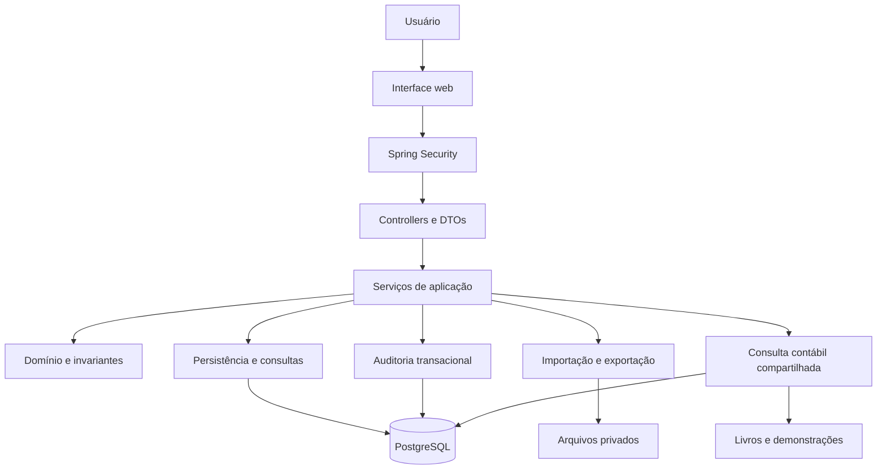
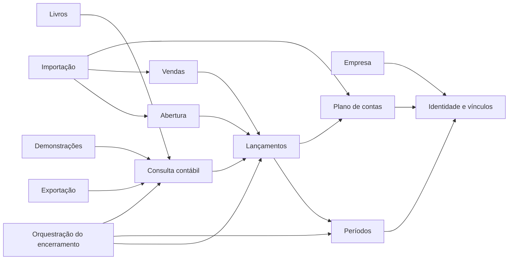
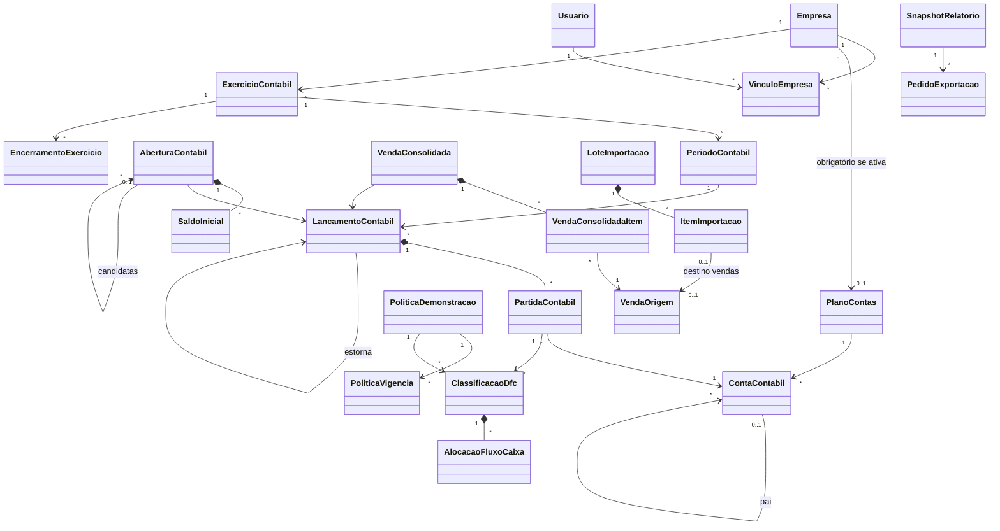
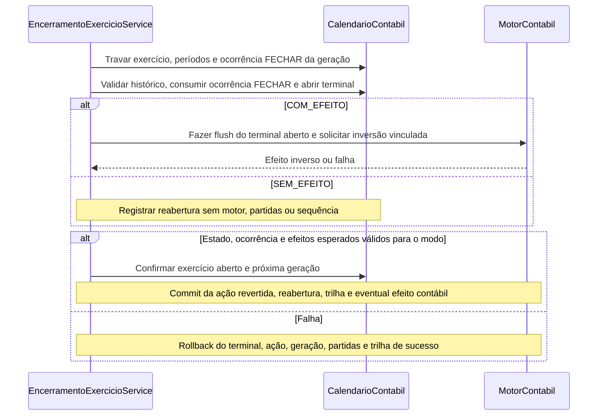
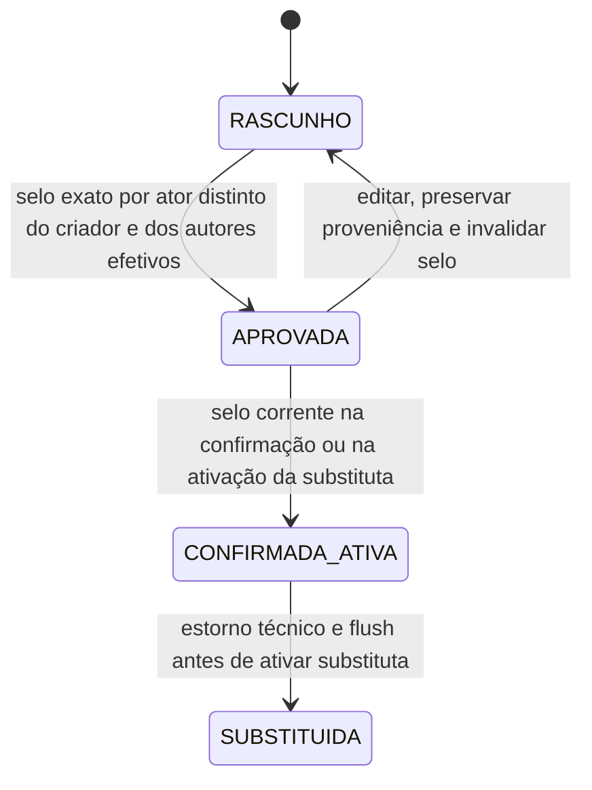
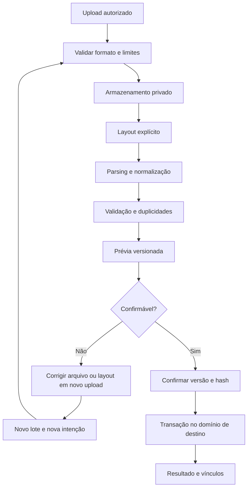
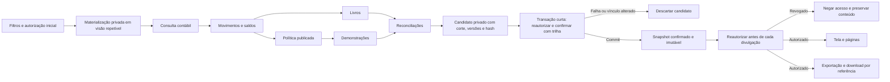

# Planejamento técnico do Sistema de Contabilidade — v1.5

**Referência técnica canônica da arquitetura v1.5.** A [visão funcional e roadmap](docs/PLANO_DESENVOLVIMENTO.md) acompanha esta versão. HEAD de referência `3c7d3981817583b11b10f643681f6cd0cf2f5c1f`. Blobs da v1.1 auditada: canônico `d1569424a5172c87d4289353f8008d019b84c16d`, complementar `b97b1c54c60b97ab9047cc0c66c83393d73fddd2`. A terceira auditoria reprovou a v1.2 (blobs 8a190a0f4d235999b184edabfdb18a11eb1e8aa4 e 64a0fa3845d5f5b3d026dd27a9d4862e491dee3f). A quarta auditoria reprovou a v1.3 (blobs `2b466ccd9dc7b4ea17f931fe0a58a0221b7a3079` e `190a2347642abfc4ede67fc9de348508d5f2f164`). V14-D01–D06 especificam o delta aprovado e V14-D07 é a conferência independente desta revisão. Os pareceres integrais da v1.1 e anteriores não estão disponíveis no repositório. Auditoria posterior e implementação exigem autorização própria. A quinta auditoria reprovou a v1.4 (blobs `f0e6b71b30b6f6ec3dd431f01ecd4f9afb3baa82` e `e2b60553fcc86f72be4836238aa37b4a8745ccc3`). V15-D01–D04 tratam os três resíduos conforme I.10, sujeitos a verificação e parecer.

# Índice da especificação

| Parte | Conteúdo | Situação nesta entrega |
|---|---|---|
| A | Diagnóstico real do repositório | Apresentado |
| B | Arquitetura, pacotes e dependências | Apresentado |
| C | Classes Java e relacionamentos | Catálogo e fichas por referência ao dicionário |
| D | Banco, integridade e migrações | Dicionário e protocolos propostos |
| E | Motor contábil e processos | Regras, concorrência e demonstrações |
| F | APIs e interface | Operações, DTOs e telas Angular |
| G | Segurança, testes e operação | Matriz de permissões, testes e critérios operacionais |
| H | Roadmap e backlog | Dependências e aceites |
| I | Riscos e decisões pendentes | Pendências e matrizes com 44 identificadores das cinco auditorias |

# Parte A — Diagnóstico do projeto existente

## A.1. Base examinada

O Planejador inspecionou:

- `AGENTS.md`, `.codex/config.toml` e `.codex/FLUXO-DA-EQUIPE.md`.
- Todo o código em `src/main/java`.
- Configurações em `src/main/resources`.
- Estrutura de `src/test/java`.
- `pom.xml`, `compose.yaml`, `Dockerfile`, `README.md` e `.gitignore`.
- Histórico e estado Git.
- Documento preexistente `docs/PLANO_DESENVOLVIMENTO.md`, considerado uma proposta anterior, sem presumir aprovação.

HEAD analisado:

```text
19ae7da4f90e9b55ce17b94e33c2d74b307bca6d
```

Estado Git informado pelo Planejador, preservado ao final:

```text
?? .codex/
?? AGENTS.md
?? docs/
```

O conteúdo de `.env` não foi lido.

## A.2. Estrutura implementada

```text
src/
├── main/
│   ├── java/org/example/
│   │   ├── Main.java
│   │   └── StatusController.java
│   └── resources/
│       └── application.properties
└── test/
    └── java/                  # sem testes encontrados
```

| Área | Evidência | Situação |
|---|---|---|
| Inicialização | `Main` com `@SpringBootApplication` | Implementada |
| Endpoint de status | `GET /api/status`, resposta textual | Implementado |
| Java/Spring | Java 21 e Spring Boot 3.5.7 | Configurados |
| Web/JPA/PostgreSQL | Dependências presentes | Fundação parcial |
| PostgreSQL Docker | `postgres:17-alpine`, volume nomeado e healthcheck | Configuração existente |
| Dockerfile | Build Maven e runtime Java 21 | Existente |
| Testes | Starter de testes, sem classes de teste | Ausentes |
| Domínio contábil | Nenhuma entidade, serviço ou repository encontrado | Precisa ser criado |
| Segurança | Sem autenticação/autorização implementadas | Precisa ser criada |
| Migrações | Nenhuma encontrada | Precisam ser planejadas |
| Frontend | Nenhum encontrado | Precisa ser criado |
| Pipeline | Nenhum arquivo versionado encontrado | Precisa ser definido |
| README | Apenas identificação do projeto | Documentação insuficiente |

O endpoint de status não comprova saúde do banco. A ausência de entidades no código também não comprova que o PostgreSQL esteja vazio: o esquema real não foi acessado.

O histórico contém `Initial commit` e duas mensagens `Forçando build no pipeline`. Isso não demonstra adoção de Conventional Commits nem comprova um pipeline operacional.

## A.3. Problemas e riscos imediatos

| Achado | Consequência | Tratamento proposto |
|---|---|---|
| `ddl-auto=update` | Inicialização pode modificar esquema existente | Diagnosticar banco antes de iniciar; adotar Flyway e posteriormente `validate` |
| Credenciais literais no Compose | Exposição de segredo em configuração | Externalização e avaliação de rotação em tarefa autorizada; valores omitidos |
| `show-sql=true` | Volume e exposição desnecessária em produção | Configuração por ambiente e logs sanitizados |
| Dockerfile ignora testes no empacotamento | Artefato pode ser produzido sem validação | Pipeline obrigatório antes da construção da imagem |
| Ausência de testes | Sem evidência de integridade ou regressão | Testes desde a fundação |
| Ausência de autorização | Recursos futuros ficariam expostos sem uma base segura | Identidade e isolamento antes dos módulos contábeis |
| Grafias históricas diferentes no Docker | Possibilidade de criar/apontar outro volume | Inventário por labels e montagens antes de normalizar |
| Plano anterior não rastreado | Risco de confundir proposta com implementação | Aprovação explícita por versão e tarefa |

A base é pequena. A evolução deve preservar `Main` e o escaneamento sob `org.example`, com refatoração limitada ao necessário.

## A.4. Dependências propostas

Todas dependem de aprovação e verificação de compatibilidade com Spring Boot 3.5.7.

| Finalidade | Proposta |
|---|---|
| Segurança | Spring Security |
| Validação | Spring Boot Validation |
| Migrações | Flyway e suporte PostgreSQL |
| Observabilidade | Actuator |
| XLSX | Apache POI |
| CSV | Apache Commons CSV |
| PDF | Apache PDFBox, sujeito à avaliação de layout |
| Contrato REST | Springdoc/OpenAPI compatível |
| Integração | Testcontainers PostgreSQL/JUnit |
| Segurança em testes | `spring-security-test` |
| Limites arquiteturais | ArchUnit |
| Frontend | Angular com TypeScript obrigatório. Versões a validar. |
| Testes de interface | Testing Library e Playwright |

A referência Netlify não retornou conteúdo utilizável na pesquisa. As telas desta proposta derivam dos seus requisitos; o inventário observado da referência permanece pendente.

# Parte B — Arquitetura e organização do código

## B.1. Recomendação

**Monólito modular, API REST, PostgreSQL compartilhado com isolamento por empresa e frontend na mesma origem.**

A recomendação considera:

- Necessidade de atomicidade entre lançamento, partidas, origem e auditoria.
- Pequeno estágio atual do projeto.
- Ausência de evidência que justifique distribuição.
- Facilidade de testar transações e manter regras consistentes.
- Possibilidade de evolução por módulos.

Microsserviços, event sourcing, mensageria e bancos separados por leitura não são propostos para a primeira versão.



## B.2. Responsabilidades

| Componente | Responsabilidade |
|---|---|
| Controller | Contrato HTTP, validação estrutural e chamada de caso de uso |
| Service de aplicação | Autorização, transação e coordenação do caso de uso |
| Entity | Estado persistente e invariantes locais |
| Value Object | Conceito imutável validado |
| Repository | Persistência e consultas do agregado |
| Consulta especializada | Projeções e agregações eficientes |
| DTO | Entrada/saída explícita da API |
| Mapper | Conversão estrutural de campos permitidos |
| Validator/política | Regra nomeada e reutilizável |
| Exportador | Transformação de resultado calculado em arquivo |

Controllers não somam partidas, escolhem contrapartidas ou acessam repositories diretamente.

Interfaces serão usadas em fronteiras úteis — parsers, armazenamento, exportadores e consultas — sem criar uma interface artificial para cada serviço.

## B.3. Estrutura proposta

```text
src/main/java/org/example/
├── Main.java
├── StatusController.java
├── empresa/
│   ├── api/
│   ├── aplicacao/
│   ├── dominio/
│   └── persistencia/
├── importacao/
│   ├── api/
│   ├── aplicacao/
│   ├── dominio/
│   └── persistencia/
├── identidade/
│   ├── api/
│   ├── aplicacao/
│   ├── dominio/
│   └── persistencia/
├── planocontas/
│   ├── api/
│   ├── aplicacao/
│   ├── dominio/
│   └── persistencia/
├── periodo/
│   ├── api/
│   ├── aplicacao/
│   ├── dominio/
│   └── persistencia/
├── encerramento/
│   ├── api/
│   ├── aplicacao/
│   ├── dominio/
│   └── persistencia/
├── lancamento/
│   ├── api/
│   ├── aplicacao/
│   ├── dominio/
│   └── persistencia/
├── abertura/
│   ├── api/
│   ├── aplicacao/
│   ├── dominio/
│   └── persistencia/
├── venda/
│   ├── api/
│   ├── aplicacao/
│   ├── dominio/
│   ├── infraestrutura/
│   └── persistencia/
├── consultacontabil/
│   ├── api/
│   ├── aplicacao/
│   ├── dominio/
│   ├── modelo/
│   └── persistencia/
├── livros/
│   ├── api/
│   ├── aplicacao/
│   └── modelo/
├── demonstracao/
│   ├── api/
│   ├── aplicacao/
│   ├── dominio/
│   ├── modelo/
│   └── persistencia/
├── exportacao/
│   ├── api/
│   ├── aplicacao/
│   ├── dominio/
│   ├── infraestrutura/
│   └── persistencia/
├── auditoria/
│   ├── api/
│   ├── aplicacao/
│   ├── dominio/
│   └── persistencia/
├── configuracao/
└── shared/
    ├── dominio/
    ├── seguranca/
    ├── api/
    ├── idempotencia/
    └── arquivo/
```

Cada módulo com operação REST separa os adaptadores HTTP em `web/` e os DTOs públicos em `api/dto/`, conforme C.3. `api/` expõe contratos públicos de colaboração e `modelo/` contém resultados calculados privados. `encerramento.aplicacao` é a orquestração de nível superior e usa portas públicas do motor, do calendário e da consulta. `shared` será restrito a conceitos realmente transversais. Regras de vendas, lançamentos e demonstrações permanecem nos módulos responsáveis.



Regras de dependência:

- Abertura e vendas contabilizam pelo motor.
- Demonstrações usam partidas contabilizadas.
- Exportadores recebem resultados calculados.
- Domínio não conhece HTTP ou configuração.
- Auditoria não chama serviços de domínio de volta.
- ArchUnit verificará ciclos e acessos proibidos.

# Parte C — Projeto principal das classes Java

## C.1. Regras comuns

Atributos compartilhados por entidades empresariais com autoria direta, onde mapeados em D.2:

```java
UUID id;
UUID empresaId;
Instant criadoEm;
UUID autorId;
```

Entidades editáveis com `versao` no dicionário têm versão otimista e atualização auditada. Componentes filhos herdam escopo e trilha do agregado quando o dicionário não tiver autoria própria.

- Datas contábeis: `LocalDate`.
- Auditoria: `Instant`.
- Dinheiro: `BigDecimal` encapsulado em objeto de valor.
- Empresa e autoria são determinadas pelo servidor.
- Consultas são realizadas por empresa e identificador.
- Entidades JPA não são serializadas diretamente.

## C.2. Catálogo persistente

Pacotes relativos a `org.example`. Toda classe persistente tem exatamente os atributos da tabela correspondente em D.2, com nomes camelCase. U → UUID, S → String salvo o enum declarado abaixo, N → long/Long, I → int/Integer, M → BigDecimal com `Dinheiro` para montantes positivos, D → LocalDate, T → Instant, B → boolean/Boolean, H → byte[] de 32 octetos copiado. O sufixo ? usa representação anulável e os primitivos aplicam-se apenas a campos obrigatórios. Não mapear colunas implícitas id/empresaId nas PKs explicitamente compostas. A projeção de atributos camelCase, incluindo PK e escopo, e as exceções tipadas abaixo são parte da ficha de cada entidade.

| Campo em D.2 | Tipo Java não textual ou contrato de estado |
|---|---|
| usuario_empresa_papel.papel | `identidade.dominio.Papel` ADMIN, OPERADOR, CONTADOR, APROVADOR, AUDITOR, LEITOR. `VinculoEmpresa.papeis` é Set de Papel. |
| administracao_global.capacidade | `CapacidadeGlobal` ADMINISTRAR_IDENTIDADES, CRIAR_EMPRESA. |
| conta_contabil/modelo_conta natureza, tipo, classe | `NaturezaConta` D/C, `TipoConta` ANALITICA/SINTETICA, `ClasseConta` ATIVO/PASSIVO/PATRIMONIO_LIQUIDO/RECEITA/DESPESA. Retificadora mantém classe e usa natureza oposta, com mapeamento validado. |
| exercicio_contabil.estado / periodo_contabil.estado | `EstadoExercicio` ABERTO/ENCERRADO; `EstadoPeriodo` ABERTO/FECHADO. |
| fechamento_periodo.acao/estado / encerramento_exercicio.estado | `AcaoPeriodo` FECHAR/REABRIR; `EstadoAcaoPeriodo` SOLICITADO/EXECUTADO; `EstadoEncerramento` PREPARADO/SUPERADO/EXECUTADO/REVERTIDO. |
| encerramento_exercicio.modo_efeito | `ModoEfeitoEncerramento` SEM_EFEITO/COM_EFEITO, derivado pelo motor. |
| lancamento_contabil.estado/tipo/origem_tipo | `EstadoLancamento` e `TipoLancamento` com os valores de D.2. `TipoOrigemLancamento` ABERTURA, REVERSAO_ABERTURA, VENDA, ESTORNO, ENCERRAMENTO, REVERSAO_ENCERRAMENTO, coerentes com o tipo. |
| partida_contabil/saldo_inicial.lado | `Lado` D/C. |
| abertura_contabil.estado / venda_consolidada.estado | `EstadoAbertura` RASCUNHO/APROVADA/CONFIRMADA_ATIVA/SUBSTITUIDA; `EstadoConsolidacao` RASCUNHO/APROVADA/CONFIRMADA. |
| regra_venda_conta.papel | `PapelContaVenda` CONTRAPARTIDA/RECEITA/DEDUCAO/TRIBUTO, parametrizado pela política homologada. |
| layout_importacao.destino/formato / lote_importacao.estado | `DestinoImportacao` CONTAS/VENDAS/ABERTURA e `FormatoImportacao` CSV/XLSX. `EstadoLote` RECEBIDO/VALIDANDO/VALIDADO/INVALIDO/CONFIRMADO/CANCELADO/EXPIRADO/ERRO. |
| politica_demonstracao/politica_vigencia.tipo / politica_demonstracao.estado | `TipoDemonstracao` BP/DRE/DFC; `EstadoPolitica` EM_EDICAO/PUBLICADA. |
| alocacao_fluxo_caixa.classe | `ClasseFluxoCaixa` OPERACIONAL/INVESTIMENTO/FINANCIAMENTO/INTERNA. |
| snapshot_relatorio.tipo / pedido_exportacao.formato/estado | `TipoRelatorio` DIARIO/RAZAO/BALANCETE/BP/DRE/DFC; `FormatoExportacao` PDF/XLSX; `EstadoExportacao` PENDENTE/PROCESSANDO/PRONTO/FALHA/EXPIRADO/CANCELADO. |

JSON persistido tem esquema proposital por coluna. Records imutáveis, com listas copiadas defensivamente, incluem versão de esquema na serialização. Ausência das estruturas abaixo na v1.2 significa contrato incompleto.

| Coluna J em D.2 | Record/estrutura Java e campos |
|---|---|
| regra_contabil_venda.mapeamento | `MapeamentoVenda(int schema, List<ComponenteVenda> componentes)`, com `ComponenteVenda(PapelContaVenda papel, Lado lado, String campoOrigem)`. Referências de conta estão em regra_venda_conta. |
| layout_importacao.configuracao | `ConfiguracaoLayout(int schema, String codificacao, String separador, String aba, String locale, List<String> formatosData, String separadorDecimal, String separadorMilhar, List<ColunaLayout> colunas)`, `ColunaLayout(String cabecalho, String destino, boolean obrigatoria)`. Layout é publicado por versão. A codificação e o separador de campos são exclusivos de CSV e a aba é exclusiva de XLSX. O separador de milhar pode ser ausente. |
| item_importacao.normalizado | `ItemNormalizado` sealed, esquema discriminado por destino. `ContaNormalizada(String codigo, String nome, String pai, NaturezaConta natureza, TipoConta tipo, ClasseConta classe, LocalDate inicio, LocalDate fim)`, `VendaNormalizada(String fonte, String identificador, LocalDate data, BigDecimal bruto)`, `SaldoNormalizado(String conta, Lado lado, BigDecimal valor)`. |
| lote_importacao.parametros_nova_abertura | `ParametrosNovaAbertura(UUID originalId, Motivo motivo)` reservado ao ramo NOVA, inativo até decisão. |
| snapshot_relatorio.parametros | `ParametrosEmissao(int schema, LocalDate inicio, LocalDate fim, UUID contaId, UUID politicaId, MetodoDfc metodo, OrdenacaoRelatorio ordem)`; campos inaplicáveis são anuláveis. MetodoDfc DIRETO/INDIRETO; OrdenacaoRelatorio DATA_NUMERO_ID/DATA_ID. |
| snapshot_relatorio.evidencia_politica | `EvidenciaPolitica(int schema, Instant corte, List<SegmentoPolitica> segmentos, List<ReferenciaClassificacao> classificacoes)`; `SegmentoPolitica(LocalDate inicio, LocalDate fim, UUID politicaId, int edicao)`, `ReferenciaClassificacao(UUID partidaId, UUID classificacaoId, long revisao)`. |
| snapshot_relatorio.resultado | `ResultadoEmissao(int schema, TipoRelatorio tipo, List<LinhaEmissao> linhas, TotaisEmissao totais)`. LinhaEmissao é união selada de LancamentoDiario, MovimentoConta, SaldoConta e LinhaDemonstrada; TotaisEmissao inclui débitos, créditos, resultado, caixa inicial/final conforme tipo e valores anuláveis quando inaplicáveis. |
| evento_auditoria.resumo e evento_administrativo.resumo | `ResumoAuditoria(int schema, String codigo, String motivoValidado, List<String> camposAlterados)`. No evento empresarial, usar extensões tipadas por ação para recuperação (ID do titular, estado, geração e tentativas), publicação de prévia (geração e identidade técnica minimizada) e abertura (origem, lote, solicitante, confirmador, executor correlacionado, revisão, digest, autores e selo anterior quando invalidado). Sem dados brutos e sem cabeçalhos/credenciais. |
| registro_idempotencia.resposta e registro_idempotencia_global.resposta | `RespostaIdempotente(int schema, int statusHttp, UUID recursoId, Long versao, ResultadoComando resultado)`. ResultadoComando é união fechada das views F.2 permitidas para comandos com chave, serializada com discriminador de operationId. Exclui binário, sessão, token e segredo. |

Value IDs entre agregados preservam escopo por FK composta em D.2. `SequenciaLancamento` usa `SequenciaId(UUID empresaId, UUID exercicioId)` como chave embutida. Converter enums para texto persistente e nunca por ordinal. Tipos monetários assinados não passam pelo construtor de montante positivo.

| Classe | Tabela e atributos | Métodos de domínio ou representação | Dependência de aplicação |
|---|---|---|---|
| `empresa.dominio.Empresa` | `empresa` | `ativar(), inativar()` | `EmpresaService` |
| `identidade.dominio.Usuario` | `usuario` | `estaAtivo(), alterarCredencial(String hash)` | `SessaoService` |
| `identidade.dominio.VinculoEmpresa` | `usuario_empresa` | `conceder(Set<Papel> papeis), revogar()` | `VinculoService` |
| `identidade.dominio.Papel` | `usuario_empresa_papel` | `Enum persistido como coleção de valores` | `VinculoService` |
| `identidade.dominio.PermissaoGlobal` | administracao_global | `conceder(UUID concedente, Instant quando), revogar(Instant quando)` | ProvisionamentoUsuarioService |
| `identidade.dominio.EstadoBootstrap` | bootstrap_identidade | `concluir(UUID primeiroAdmin, Instant quando)` | BootstrapIdentidadeService |
| `identidade.dominio.ConviteUsuario` | convite_usuario | `consumir(byte[] hash, Instant agora)` | ProvisionamentoUsuarioService |
| `identidade.dominio.EventoAdministrativo` | evento_administrativo | `resumoSeguro()` | ProvisionamentoUsuarioService |
| `planocontas.dominio.PlanoContas` | `plano_contas` | `renomear(String nome)` | `PlanoContasService` |
| `planocontas.dominio.ContaContabil` | `conta_contabil` | `recebePartida(LocalDate data), inativar(LocalDate dataEfetiva)` | `PlanoContasService` |
| `planocontas.dominio.ModeloPlano` | `modelo_plano` | `publicar(), instanciar(UUID empresaId)` | `PlanoContasService` |
| `planocontas.dominio.ModeloConta` | `modelo_conta` | `copiarPara(UUID planoId)` | `PlanoContasService` |
| `periodo.dominio.ExercicioContabil` | `exercicio_contabil` | `contem(LocalDate data), avancarGeracao()` | `CalendarioService` |
| `periodo.dominio.PeriodoContabil` | `periodo_contabil` | `exigirAberto(), fechar(), reabrir()` | `FechamentoPeriodoService` |
| `periodo.dominio.FechamentoPeriodo` | `fechamento_periodo` | `solicitar(UUID atorId), aprovar(UUID atorId)` | `FechamentoPeriodoService` |
| `encerramento.dominio.EncerramentoExercicio` | `encerramento_exercicio` | `executar(UUID aprovadorId, UUID ocorrenciaFechamentoId, UUID lancamentoId), reverter(UUID ocorrenciaReaberturaId, UUID estornoId)` (IDs de efeitos anuláveis somente conforme modo e estado de D.2) | `EncerramentoExercicioService` |
| `lancamento.dominio.SequenciaLancamento` | `sequencia_lancamento` | `proximo()` | `ContabilizacaoService` |
| `lancamento.dominio.LancamentoContabil` | `lancamento_contabil` | `editar(List<PartidaContabil> partidas), contabilizar(long numero, UUID ator, Instant instante), cancelar()` | `ContabilizacaoService` |
| `lancamento.dominio.PartidaContabil` | `partida_contabil` | `inverter()` | `LancamentoService` |
| `abertura.dominio.AberturaContabil` | `abertura_contabil` | `aprovar(UUID atorId, long revisaoConteudo, String digestSaldos), confirmar(UUID lancamentoId)` | `AberturaService` |
| `abertura.dominio.SaldoInicial` | `saldo_inicial` | `paraPartida(int ordem)` | `AberturaService` |
| `venda.dominio.RegraContabilVenda` | `regra_contabil_venda` | `aplicar(List<VendaOrigem> fontes)` | `VendaService` |
| `venda.dominio.RegraVendaConta` | `regra_venda_conta` | `resolverConta(String papel)` | `VendaService` |
| `venda.dominio.VendaOrigem` | `venda_origem` | `identidade()` | `VendaService` |
| `venda.dominio.VendaConsolidada` | `venda_consolidada` | `aprovar(UUID ator), confirmar(UUID lancamento)` | `VendaService` |
| `venda.dominio.VendaConsolidadaItem` | `venda_consolidada_item` | `consumir()` | `VendaService` |
| `importacao.dominio.LayoutImportacao` | `layout_importacao` | `publicar(), validarCabecalho(List<String> nomes)` | `ImportacaoService` |
| `importacao.dominio.LoteImportacao` | `lote_importacao` | `iniciarValidacao(), concluirValidacao(boolean valido), confirmar(), cancelar(), expirar()` | `ImportacaoService` |
| `importacao.dominio.ItemImportacao` | `item_importacao` | `validar(ValidadorItem validador)` | `ImportacaoService` |
| `importacao.dominio.ErroImportacao` | `erro_importacao` | `diagnosticoSeguro()` | `ImportacaoService` |
| `demonstracao.dominio.PoliticaDemonstracao` | `politica_demonstracao` | `publicar(), vigenteEm(LocalDate data)` | `DemonstracaoService` |
| `demonstracao.dominio.LinhaDemonstracao` | `linha_demonstracao` | `aplicarSinal(BigDecimal valor)` | `DemonstracaoService` |
| `demonstracao.dominio.MapeamentoConta` | `mapeamento_conta` | `associa(UUID contaId)` | `DemonstracaoService` |
| `demonstracao.dominio.PoliticaVigencia` | politica_vigencia | `contem(LocalDate data), encerrarAntes(LocalDate inicioDaSucessora)` | DemonstracaoService |
| `demonstracao.dominio.ClassificacaoDfc` | classificacao_dfc | `validarIntegralidade(BigDecimal valorPartida), substituirPor(long revisao)` | ClassificacaoDfcService |
| `demonstracao.dominio.AlocacaoFluxoCaixa` | alocacao_fluxo_caixa | `valor(), classe()` | ClassificacaoDfcService |
| `demonstracao.dominio.AjusteDfc` | `ajuste_dfc` | `valorComSinal()` | `DemonstracaoService` |
| `consultacontabil.dominio.SnapshotRelatorio` | `snapshot_relatorio` | `pagina(int indice, int tamanho), expiradoEm(Instant agora)` | `SnapshotService` |
| `exportacao.dominio.PedidoExportacao` | `pedido_exportacao` | `iniciar(), concluir(String chave), falhar(), cancelar(), expirar()` | `ExportacaoService` |
| `auditoria.dominio.EventoAuditoria` | `evento_auditoria` | `resumoSeguro()` | `AuditoriaService` |
| `shared.idempotencia.dominio.RegistroIdempotencia` | `registro_idempotencia` | `corresponde(byte[] hash), resultado()` | `IdempotenciaService` |
| `shared.idempotencia.dominio.RegistroIdempotenciaGlobal` | registro_idempotencia_global | `corresponde(byte[] hash), resultado()` | IdempotenciaService |

**Ownership JPA.** Repositório de raízes escreve seus componentes com FK no filho. `PartidaContabil` pertence ao lançamento, `SaldoInicial` à abertura, `ModeloConta` ao modelo, itens e erros ao lote, `VendaConsolidadaItem` à consolidação e `AlocacaoFluxoCaixa` à revisão. `VinculoEmpresa` é dono da coleção `Set<Papel>` com `@ElementCollection` e a PK de D.2. Sem cascata entre raízes; coleções próprias usam PERSIST apenas quando nascem com o pai. Sem orphanRemoval de componentes com histórico; exclusão de rascunhos ou temporários passa pelos protocolos E.6/G.1. `@Version` só nas raízes com coluna versao, e a aplicação incrementa a raiz após mudança de filho. FKs compostas entre agregados são garantidas no SQL; no lado Java guardar os UUIDs do escopo e evitar lazy proxy de outro módulo. `AberturaContabil` conserva criador, revisão de conteúdo, digest, autores efetivos e selo. H3 cruza a fronteira por IDs e contexto persistido E.7, sem referência JPA entre os agregados.

**Fronteiras Java.** As referências a outros agregados são UUIDs, inclusive quando a FK PostgreSQL é composta. Agregados próprios carregam as coleções sob demanda. `LancamentoContabil → PartidaContabil` e `AberturaContabil → SaldoInicial` admitem persistência dos novos filhos; remoção ocorre explicitamente no serviço em rascunho e a guarda persistida verifica ambas as pontas. Sem `CascadeType.REMOVE` entre agregados, plano para contas ou empresa para dados. Auditoria, contabilizados, origens confirmadas e políticas publicadas são preservados. As entidades editáveis usam `@Version`; serviços de mudança de filhos forçam incremento do pai. Repositories ficam em `<dominio>.persistencia`, com um repository por agregado manipulado e consultas por empresa/ID. O serviço controla operações em componentes sem repository próprio, como partidas e itens de importação. Projeções SQL compõem leitura sem carregar agregados de outros módulos.

**Valor e projeção.** `shared.dominio.Dinheiro(BigDecimal valor)` valida montante, fornece `somar(Dinheiro outro)` e `valor()`; totais e saldos assinados usam BigDecimal exato. `IntervaloDatas(LocalDate inicio, LocalDate fim)` expõe `contem(LocalDate)` e `sobrepoe(IntervaloDatas)`. `planocontas.dominio.CodigoConta(String valor)` preserva zeros; enums `NaturezaConta`, `TipoConta` e `ClasseConta` correspondem aos valores documentados. `lancamento.dominio.Lado`, `EstadoLancamento` e `TipoLancamento` espelham D.2. `ComposicaoLancamento(List<PartidaContabil>)` retorna `debitos()`, `creditos()` e `equilibrada()`. `shared.seguranca.Ator(UUID usuarioId, UUID sessaoId)` identifica o ator sem transportar permissão persistida em cache. Cada estado publicado de G.1 e E.4/E.6/E.7 corresponde a enum no domínio proprietário.

`consultacontabil.api.ExtratoPartida`, `MovimentoConta` e `SaldoConta` são records com chaves de conta/lançamento onde aplicável, data e valores computados. `LivroDiario`, `LivroRazao`, `BalanceteVerificacao`, `BalancoPatrimonial`, `DemonstracaoResultado` e `DemonstracaoFluxoCaixa` são resultados com filtro, linhas ordenadas e totais. O estorno é um lançamento ESTORNO vinculado ao original. `SnapshotRelatorio` guarda emissão específica, com projeções serializadas e sem se tornar razão auxiliar.

## C.3. Assinaturas, serviços e interfaces

A tabela de assinaturas ao final de C.3 enumera parâmetros e resultados por operationId. `Escopo(UUID empresaId, Ator ator)` contém a empresa da rota e o ator resolvido no servidor. Rotas globais de administração recebem `Ator`; sessão e escolha de identidade recebem `ContextoSessao(UUID sessaoId, Ator atorOpcional)`. `ControleMutacao(Long versaoEsperada, boolean somenteSeAusente, String idempotencyKey, UUID correlacaoId)` representa precondições já decodificadas, com valores anuláveis quando a operação não os exige. Adaptadores HTTP em `<dominio>.web` recebem os DTOs públicos imutáveis em `<dominio>.api.dto`, validam sintaxe e chamam a aplicação. Mappers por família compõem as views a partir de projeções. Validadores autoritativos usam o estado relido na transação. C.2 e D.2 definem nulabilidade e persistência de todos os atributos das entidades.

| Serviço, pacote | Responsabilidade, dependências e contratos |
|---|---|
| SessaoService, identidade | Identificar sessão, login/logout, invalidar sessão anterior. Usa provedor local ou adaptador externo conforme decisão, sem expor credenciais. |
| VinculoService e AutorizacaoEmpresa, identidade | Administrar vínculos; `exigir(Ator, UUID, Permissao)` consulta vínculo vivo e aplica G.2. |
| EmpresaService, empresa | Criar e listar empresas visíveis. Usa identidade para vínculo inicial atômico. |
| PlanoContasService, planocontas | Controlar hierarquia e vigência, importar contas, publicar/copiar modelo conforme política. Usa porta de consulta de movimentação. |
| CalendarioService e FechamentoPeriodoService, periodo | Gerir exercícios e períodos, fechar e reabrir. Usa autorização e repositórios de calendário. |
| EncerramentoExercicioService, caso de uso de orquestração | Prévia e execução anual. Usa API de calendário, motor e consulta, sem dependência reversa. |
| LancamentoService e ContabilizacaoService, lancamento | Editar rascunhos e gravar efeitos. Usa APIs de calendário, contas, autorização, auditoria e idempotência. |
| AberturaService, abertura | Valida posições iniciais, atualiza proveniência e selo de E.6, aplica a porta de preenchimento H3 e usa o motor para efetivar posição. |
| VendaService, venda | Materializar fontes idempotentes, aprovar consolidação, aplicar regra e publicar efeito pelo motor. |
| ImportacaoService, importacao | Coordena parser, armazenamento privado e portas dos destinos: ContaImportacaoService, VendaImportacaoService e AberturaService. `ValidadorItem.validar(ItemImportacao, LayoutImportacao)` retorna erros estruturados. Recuperação interna do lote por G.1/K, com resultado explícito e titular original imutável. |
| LivroService, livros; DemonstracaoService, demonstracao | Emitir resultados e validar políticas/DFC, via porta de leitura contábil e SnapshotService. |
| SnapshotService, consultacontabil | Criar emissão em leitura consistente, buscar página identificada e expirar resultado com política de retenção. |
| ExportacaoService, exportacao | Enfileirar, gerar, cancelar e baixar após autorização, via snapshot e armazenamento privado. Recuperação interna do pedido por G.1/K, com resultado explícito e titular original imutável. |
| AuditoriaService, auditoria; IdempotenciaService, shared.idempotencia | Append atômico, consulta autorizada, reserva/reuso de chave e resultado. |

Interfaces somam fronteiras que têm adaptadores: `ParserImportacao.ler(InputStream, LayoutImportacao)`, `ArmazenamentoPrivado.abrir(ChaveArquivo)`, `ArmazenamentoPrivado.gravar(InputStream, Limites)`, `RenderizadorRelatorio.renderizar(SnapshotRelatorio, OutputStream)` e `ConsultaContabil` abaixo. Parsers CSV/XLSX e renderizadores PDF/XLSX implementam contratos separados de regras de negócio. `LancamentoRepository.findByEmpresaIdAndId(UUID empresaId, UUID id)` e variantes de lock de E.3 não expõem consulta empresarial sem escopo. Projetar o mesmo padrão para os demais agregados de C.2.

~~~java
interface ConsultaContabil {
    Pagina<LancamentoDiario> consultarDiario(UUID empresaId, FiltroDiario filtro);
    List<MovimentoConta> agregarMovimentos(UUID empresaId, FiltroContabil filtro);
    List<SaldoConta> saldosEm(UUID empresaId, LocalDate data);
    boolean possuiMovimentacao(UUID empresaId, UUID contaId);
}
~~~

Dependências intra-Java são dirigidas: web → aplicação → domínio e portas; persistência implementa portas. `periodo` não importa `encerramento`. `planocontas` consulta movimentação por interface estreita implementada por adaptador de leitura, sem importar `lancamento`. ArchUnit verifica ciclos entre módulos, acesso web → repository, domínio → Spring MVC e acesso a persistência/entidades privadas de outro módulo. Testes de API e persistência descritos em G.4 conferem nomes e efeitos.

Portas proprietárias: `periodo.api.CalendarioContabil` declara `bloquearExercicio(Escopo, UUID, ModoCalendario)`, `bloquearPeriodos(Escopo, List<UUID>, ModoCalendario)`, `abrirTerminal(Escopo, UUID, UUID)` e `atualizarEstadoAnual(Escopo, UUID, EstadoExercicio, int)`. A aplicação de calendário delega as alterações tipadas da tabela de assinaturas aos métodos próprios `CalendarioRepository.alterarExercicioBloqueado(Escopo, UUID, LocalDate, LocalDate, long)` e `alterarPeriodoBloqueado(Escopo, UUID, LocalDate, LocalDate, long)`, que chamam os procedimentos de D.3. Outros módulos usam somente a API pública. `lancamento.api.MotorContabil` declara `confirmarOrigem(Escopo, OrigemContabilCmd)`, `EfeitoContabil reverterEncerramento(Escopo, ReversaoAnualCmd)` e `EfeitoContabil reverterAbertura(Escopo, ReversaoAberturaCmd)`; `ReversaoAnualCmd(UUID exercicioId, UUID periodoId, UUID acaoId, int geracao, UUID originalId, LocalDate data)` e `ReversaoAberturaCmd(UUID exercicioId, UUID periodoId, UUID originalAberturaId, UUID sucessoraId, UUID originalLancamentoId, LocalDate data)` recebem escopo empresarial da assinatura; `EfeitoContabil(UUID lancamentoId, TipoLancamento tipo, long versao)` é projeção do motor. Estas duas portas recebem referência tipada, verificam o vínculo persistido e só são acessíveis aos respectivos orquestradores Java. `consultacontabil.api.ConsultaContabil` retorna projeções. `planocontas.api.MovimentacaoContaPort` é implementada por adaptador SQL sob o próprio módulo, sem dependência de `lancamento`. `lancamento` não importa tipos de domínio de `encerramento` ou `abertura`; o FK SQL de ação não cria referência JPA nem dependência Java. Arquitetura testa em ArchUnit o DAG, incluindo consumidores autorizados para as portas técnicas.

### Assinaturas REST por operação

Resultados de criação e execução usam a mesma forma Java da view indicada em F.2. O controller monta status, headers, problemas e `Location`. Os DTOs de F.2 usam `UUID` para identificadores, `LocalDate` para datas, `Instant` para timestamps, `String` para valores decimais canônicos, `long` para versão e enum do proprietário para estados e classificações. Upload é `UploadInput` com stream fechado pelo adaptador, layout/edição e destino de abertura validado quando aplicável; `Binario` é resultado de streaming com metadados, não uma entidade.

| Serviço ou porta de aplicação | Assinatura Java |
|---|---|
| SessaoService | `SessaoView sessao(ContextoSessao contexto)` |
| SessaoService | `SessaoView entrar(ContextoSessao contexto, Credenciais entrada)` |
| ProvisionamentoUsuarioService | `void ativarConviteLocal(ContextoSessao contexto, AtivarConviteInput entrada)` |
| SessaoService | `void sair(ContextoSessao contexto)` |
| EmpresaService | `Pagina<EmpresaView> listarEmpresas(Ator ator, PaginaFiltro entrada)` |
| EmpresaService | `EmpresaView criarEmpresa(Ator ator, EmpresaInput entrada, ControleMutacao controle)` |
| ProvisionamentoUsuarioService | `Pagina<UsuarioAdministrativoView> buscarUsuarios(Ator ator, BuscaUsuarioFiltro entrada)` |
| VinculoService | `Pagina<UsuarioVinculavelView> buscarUsuariosVinculaveis(Escopo escopo, BuscaUsuarioFiltro entrada)` |
| ProvisionamentoUsuarioService | `UsuarioAdministrativoView provisionarUsuario(Ator ator, ProvisionarUsuarioInput entrada, ControleMutacao controle)` |
| ProvisionamentoUsuarioService | `UsuarioAdministrativoView alterarCapacidadeGlobal(Ator ator, UUID usuarioId, CapacidadeGlobal capacidade, CapacidadeGlobalInput entrada, ControleMutacao controle)` |
| VinculoService | `Pagina<VinculoView> listarVinculos(Escopo escopo, PaginaFiltro entrada)` |
| VinculoService | `VinculoView obterVinculo(Escopo escopo, UUID usuarioId)` |
| VinculoService | `VinculoView gravarVinculo(Escopo escopo, UUID usuarioId, VinculoInput entrada, ControleMutacao controle)` |
| VinculoService | `VinculoView revogarVinculo(Escopo escopo, UUID usuarioId, Motivo entrada, ControleMutacao controle)` |
| PlanoContasService | `Pagina<ContaView> listarContas(Escopo escopo, ContaFiltro entrada)` |
| PlanoContasService | `ContaView criarConta(Escopo escopo, ContaInput entrada, ControleMutacao controle)` |
| PlanoContasService | `ContaView atualizarConta(Escopo escopo, UUID id, ContaEdicaoInput entrada, ControleMutacao controle)` |
| CalendarioService | `Pagina<ExercicioView> listarExercicios(Escopo escopo, CalendarioFiltro entrada)` |
| CalendarioService | `ExercicioView criarExercicio(Escopo escopo, IntervaloInput entrada, ControleMutacao controle)` |
| CalendarioService | `PeriodoView criarPeriodo(Escopo escopo, UUID id, IntervaloInput entrada, ControleMutacao controle)` |
| CalendarioService | `ExercicioView alterarIntervaloExercicio(Escopo escopo, UUID exercicioId, AlterarIntervaloInput entrada, ControleMutacao controle)` |
| CalendarioService | `PeriodoView alterarIntervaloPeriodo(Escopo escopo, UUID periodoId, AlterarIntervaloInput entrada, ControleMutacao controle)` |
| FechamentoPeriodoService | `PeriodoView fecharPeriodo(Escopo escopo, UUID id, Motivo entrada, ControleMutacao controle)` |
| FechamentoPeriodoService | `DecisaoView solicitarReabertura(Escopo escopo, UUID id, Motivo entrada, ControleMutacao controle)` |
| FechamentoPeriodoService | `PeriodoView aprovarReabertura(Escopo escopo, UUID id, UUID acaoId, Motivo entrada, ControleMutacao controle)` |
| EncerramentoExercicioService | `EncerramentoView preverEncerramento(Escopo escopo, UUID id, PreviaEncerramentoInput entrada, ControleMutacao controle)` |
| EncerramentoExercicioService | `EncerramentoView encerrarExercicio(Escopo escopo, UUID id, UUID acaoId, EncerramentoInput entrada, ControleMutacao controle)` |
| EncerramentoExercicioService | `EncerramentoView reabrirExercicio(Escopo escopo, UUID id, UUID acaoId, Motivo entrada, ControleMutacao controle)` |
| LancamentoService | `Pagina<LancamentoView> listarLancamentos(Escopo escopo, DataFiltro entrada)` |
| LancamentoService | `LancamentoView obterLancamento(Escopo escopo, UUID id)` |
| LancamentoService | `LancamentoView criarRascunho(Escopo escopo, LancamentoInput entrada, ControleMutacao controle)` |
| LancamentoService | `LancamentoView editarRascunho(Escopo escopo, UUID id, LancamentoInput entrada, ControleMutacao controle)` |
| LancamentoService | `LancamentoView cancelarRascunho(Escopo escopo, UUID id, Motivo entrada, ControleMutacao controle)` |
| ContabilizacaoService | `LancamentoView contabilizar(Escopo escopo, UUID id, ControleMutacao controle)` |
| ContabilizacaoService | `LancamentoView estornar(Escopo escopo, UUID id, EstornoInput entrada, ControleMutacao controle)` |
| AberturaService | `Pagina<AberturaView> listarAberturas(Escopo escopo, DataFiltro entrada)` |
| AberturaService | `AberturaView criarAbertura(Escopo escopo, AberturaInput entrada, ControleMutacao controle)` |
| AberturaService | `AberturaView editarAbertura(Escopo escopo, UUID id, AberturaEdicaoInput entrada, ControleMutacao controle)` |
| AberturaService | `AberturaView aprovarAbertura(Escopo escopo, UUID id, AprovacaoAberturaInput entrada, ControleMutacao controle)` |
| AberturaService | `AberturaView confirmarAbertura(Escopo escopo, UUID id, ControleMutacao controle)` |
| AberturaService | `AberturaView substituirAbertura(Escopo escopo, UUID originalId, UUID substitutaId, SubstituirAberturaInput entrada, ControleMutacao controle)` |
| VendaService | `Pagina<VendaFonteView> listarVendas(Escopo escopo, DataFiltro entrada)` |
| VendaService | `Pagina<ConsolidacaoView> listarConsolidacoes(Escopo escopo, DataFiltro entrada)` |
| VendaService | `ConsolidacaoView criarConsolidacao(Escopo escopo, ConsolidacaoInput entrada, ControleMutacao controle)` |
| VendaService | `ConsolidacaoView aprovarConsolidacao(Escopo escopo, UUID id, Motivo entrada, ControleMutacao controle)` |
| VendaService | `ConsolidacaoView confirmarConsolidacao(Escopo escopo, UUID id, ControleMutacao controle)` |
| VendaService | `RegraVendaView publicarRegraVenda(Escopo escopo, RegraVendaInput entrada, ControleMutacao controle)` |
| ImportacaoService | `Pagina<LayoutResumoView> listarLayouts(Escopo escopo, SelecaoFiltro entrada)` |
| VendaService | `Pagina<RegraVendaView> listarRegras(Escopo escopo, SelecaoFiltro entrada)` |
| DemonstracaoService | `Pagina<PoliticaResumoView> listarPoliticas(Escopo escopo, SelecaoFiltro entrada)` |
| ImportacaoService | `Pagina<LoteView> listarLotes(Escopo escopo, PaginaFiltro entrada)` |
| ImportacaoService | `LoteView enviarLote(Escopo escopo, UploadInput entrada, ControleMutacao controle)` |
| ImportacaoService | `PreviaLoteView obterPrevia(Escopo escopo, UUID id, PaginaFiltro entrada)` |
| ImportacaoService | `LoteView confirmarLote(Escopo escopo, UUID id, ControleMutacao controle)` |
| ImportacaoService | `LoteView cancelarLote(Escopo escopo, UUID id, Motivo entrada, ControleMutacao controle)` |
| ImportacaoService | `LayoutView publicarLayout(Escopo escopo, LayoutInput entrada, ControleMutacao controle)` |
| LivroService | `SnapshotView emitirDiario(Escopo escopo, ConsultaInput entrada)` |
| LivroService | `SnapshotView emitirRazao(Escopo escopo, ConsultaInput entrada)` |
| LivroService | `SnapshotView emitirBalancete(Escopo escopo, ConsultaInput entrada)` |
| DemonstracaoService | `SnapshotView emitirBp(Escopo escopo, ConsultaInput entrada)` |
| DemonstracaoService | `SnapshotView emitirDre(Escopo escopo, ConsultaInput entrada)` |
| DemonstracaoService | `SnapshotView emitirDfc(Escopo escopo, ConsultaDfcInput entrada)` |
| DemonstracaoService | `PoliticaView rascunharPolitica(Escopo escopo, PoliticaInput entrada, ControleMutacao controle)` |
| DemonstracaoService | `PoliticaView publicarPolitica(Escopo escopo, UUID id, Motivo entrada, ControleMutacao controle)` |
| ClassificacaoDfcService | `AlocacaoView gravarAlocacao(Escopo escopo, UUID id, UUID partidaId, AlocacaoInput entrada, ControleMutacao controle)` |
| ClassificacaoDfcService | `ClassificacaoAtualView obterClassificacaoAtual(Escopo escopo, UUID id, UUID partidaId)` |
| ClassificacaoDfcService | `AlocacaoView obterAlocacaoAtual(Escopo escopo, UUID id, UUID partidaId)` |
| ClassificacaoDfcService | `Pagina<PendenciaDfcView> listarPendenciasDfc(Escopo escopo, PendenciaDfcFiltro entrada)` |
| SnapshotService | `SnapshotView obterSnapshot(Escopo escopo, UUID id, PaginaFiltro entrada)` |
| ExportacaoService | `Pagina<ExportacaoView> listarExportacoes(Escopo escopo, PaginaFiltro entrada)` |
| ExportacaoService | `ExportacaoView pedirExportacao(Escopo escopo, ExportacaoInput entrada, ControleMutacao controle)` |
| ExportacaoService | `ExportacaoView cancelarExportacao(Escopo escopo, UUID id, Motivo entrada, ControleMutacao controle)` |
| ExportacaoService | `Binario baixarExportacao(Escopo escopo, UUID id)` |
| AuditoriaService | `Pagina<EventoView> listarAuditoria(Escopo escopo, DataFiltro entrada)` |
| EmpresaService | `EmpresaView editarEmpresa(Escopo escopo, EmpresaInput entrada, ControleMutacao controle)` |
| PlanoContasService | `Pagina<ModeloView> listarModelos(Escopo escopo, PaginaFiltro entrada)` |
| PlanoContasService | `PlanoView aplicarModelo(Escopo escopo, UUID id, ControleMutacao controle)` |
| PlanoContasService | `Binario exportarPlano(Escopo escopo, ExportarPlanoFiltro entrada)` |
| PlanoContasService | `ContaView inativarConta(Escopo escopo, UUID id, InativarContaInput entrada, ControleMutacao controle)` |

## C.4. Relacionamentos principais



A exigência mínima de duas partidas aplica-se ao lançamento contabilizado; rascunhos podem estar incompletos.

# Parte D — Modelo PostgreSQL

## D.1. Convenções propostas

| Informação | Tipo |
|---|---|
| Identificador | `uuid` |
| Valor contábil | `numeric(19,2)` |
| Taxa/intermediário aprovado | `numeric(19,8)` |
| Data contábil | `date` |
| Auditoria | `timestamptz` |
| Versão otimista | `bigint` |
| Estado | `varchar` com restrição |
| Layout/dados normalizados | `jsonb`, validado |
| Hash | SHA-256 |

Tabelas empresariais terão `empresa_id NOT NULL` e:

```text
UNIQUE (empresa_id, id)
```

Referências empresariais usarão FKs compostas:

```text
(empresa_id, conta_id)
    → conta_contabil(empresa_id, id)

(empresa_id, lancamento_id)
    → lancamento_contabil(empresa_id, id)
```

Isso impede, no banco, uma partida da empresa A de apontar para uma conta da empresa B.

## D.2. Dicionário PostgreSQL

Legenda: `U` uuid, `S` text, `N` bigint, `I` integer, `M` numeric(19,2), `D` date, `T` timestamptz, `J` jsonb, `B` boolean, `H` bytea SHA-256 de 32 octetos. Campos são NOT NULL salvo `?`. Tabelas com escopo empresarial levam `empresa_id U` FK para empresa e `id U` PK, com UNIQUE(empresa_id,id), salvo chave explícita. Nas FKs empresariais abaixo, o prefixo empresa_id é implícito. Tabelas globais têm id U PK. Estados têm CHECK no conjunto indicado no fluxo correspondente. Escritas mutáveis usam `versao N DEFAULT 0`, não negativa onde indicada, e expõem a versão na API. Usar Restrict para FKs, salvo dependentes sem valor histórico expressamente removidos pelo serviço. Índices das FKs incluem empresa, salvo equivalente já coberto por PK/UNIQUE/índice de consulta.

| Tabela | Colunas de negócio | Restrições, FKs e índices |
|---|---|---|
| empresa | razao_social S, documento_fiscal S, ativo B, criado_em T, versao N | UNIQUE(documento_fiscal normalizado). Inativação lógica. |
| usuario | identificador S, nome S, credencial_hash S?, ativo B, provedor S?, sujeito_externo S?, criado_em T, versao N | UNIQUE(identificador normalizado). Identidade externa usa UNIQUE(provedor,sujeito_externo) quando presente e exige ambos ou nenhum. Hash presente apenas para identidade local. |
| usuario_empresa | usuario_id U, ativo B, versao N, concedido_por U, concedido_em T | FKs usuario e concedente. UNIQUE(empresa_id,usuario_id). Índice (usuario_id,ativo). |
| usuario_empresa_papel | vinculo_id U, papel S | PK(empresa_id,vinculo_id,papel). FK usuario_empresa. CHECK papéis de G.2. |
| administracao_global (global) | usuario_id U, capacidade S, ativa B, concedido_por U?, atualizado_em T, versao N | FK usuário e concedente. UNIQUE(usuario_id,capacidade). CHECK ADMINISTRAR_IDENTIDADES/CRIAR_EMPRESA. Alterar somente sob lock singleton; concessão inicial registrada no bootstrap. |
| bootstrap_identidade (global) | concluido_em T?, primeiro_admin U?, versao N | ID fixo reservado, criado na cadeia limpa. CHECK de presença conjunta de instante e administrador. Única atualização de inicialização; FK usuário. |
| convite_usuario (global) | usuario_id U, token_hash H, expira_em T, consumido_em T?, criado_em T | FK usuário, UNIQUE(token_hash). Consumo atômico antes de ativar. |
| evento_administrativo (global) | ator_id U?, alvo_id U, acao S, ocorrido_em T, resumo J | FKs ator quando presente e usuário alvo. Append-only. Índice (alvo_id,ocorrido_em). |
| registro_idempotencia_global (global) | ator_id U, operacao S, chave S, hash H, estado S, status_http I?, resposta J?, criado_em T, expira_em T | FK usuário. UNIQUE(ator_id,operacao,chave). E.3 usa marcador explícito de escopo global no hash. Índice expira_em; CHECK e guarda diferida iguais ao registro empresarial. |
| plano_contas | nome S, versao N | UNIQUE(empresa_id). |
| conta_contabil | plano_id U, pai_id U?, codigo S, nome S, natureza S, tipo S, classe S, inicio D, fim D?, versao N | FK plano e pai composto com plano_id. UNIQUE(empresa_id,plano_id,codigo) e chave para pai. CHECK natureza D/C, tipo SINTETICA/ANALITICA, pai diferente de si e fim ≥ início. Índice (empresa_id,plano_id,pai_id). Serviço verifica ciclo e vigência sob lock. |
| modelo_plano (global) | nome S, edicao I, publicado B | UNIQUE(nome,edicao). Publicado imutável. |
| modelo_conta (global) | modelo_id U, pai_id U?, codigo S, nome S, natureza S, tipo S, classe S | UNIQUE(modelo_id,codigo), FK pai do mesmo modelo. Mesmos checks hierárquicos do plano. |
| exercicio_contabil | inicio D, fim D, estado S, geracao I, versao N | CHECK fim ≥ início, geração ≥ 1. Exclusão por intervalo aplicada pelo procedimento D.3. |
| periodo_contabil | exercicio_id U, inicio D, fim D, estado S, fechamento_atual_id U?, versao N | Chave referenciável (empresa_id,exercicio_id,id). CHECK ABERTO/FECHADO e fim ≥ início. FK exercício e procedimento de exclusão e inclusão conforme D.3. FK empresarial (empresa_id,id,fechamento_atual_id) para (empresa_id,periodo_id,id) de fechamento_periodo. ABERTO veda referência; FECHADO exige ocorrência FECHAR efetivada no mesmo período. |
| fechamento_periodo | periodo_id U, acao S, fechamento_origem_id U?, solicitante_id U, aprovador_id U?, motivo S, criado_em T, executado_em T?, estado S, versao N | FK período e usuários. Ação FECHAR/REABRIR. FK empresarial autorreferente (empresa_id,periodo_id,fechamento_origem_id) para chave única (empresa_id,periodo_id,id). FECHAR veda origem e REABRIR exige FECHAR efetivado como origem; guarda D.3 confere a ocorrência atual. Índice (empresa_id,periodo_id,criado_em). Aprovação de reabertura por outro ator. |
| encerramento_exercicio | exercicio_id U, geracao I, revisao I, periodo_terminal_id U, data_efeito D, conta_resultado_id U?, snapshot_hash H, versao_calculo I, modo_efeito S, estado S, autor_id U, aprovador_id U?, criado_em T, executado_em T?, ocorrencia_fechamento_id U?, ocorrencia_reabertura_id U?, lancamento_id U?, estorno_id U?, motivo_reabertura S?, reaberto_por U?, reaberto_em T?, versao N | FKs compostas para exercício, período terminal, conta, ocorrências do terminal e lançamentos do exercício. UNIQUE(empresa_id,exercicio_id,geracao,revisao) e UNIQUE(empresa_id,exercicio_id,id); índices únicos parciais por empresa/exercício/geração para PREPARADO e, separadamente, para EXECUTADO ou REVERTIDO. CHECK: PREPARADO/SUPERADO sem efeitos, ocorrências nem aprovação; EXECUTADO exige aprovador distinto, data e ocorrência FECHAR e veda estorno e ocorrência de reabertura; REVERTIDO conserva esses dados e exige ocorrência de reabertura, motivo, ator e data. Em COM_EFEITO, EXECUTADO/REVERTIDO exigem lançamento e só REVERTIDO exige estorno. Em SEM_EFEITO ambos são nulos em todos os estados. IDs de efeitos únicos por empresa. Conta de resultado anulável, com guarda de cálculo que exige conta elegível quando houver líquido a transferir ao PL. Rotina controlada deriva modo e digest e guarda diferida valida vínculos, ocorrência e estados finais em D.3/E.4. |
| sequencia_lancamento | exercicio_id U, ultimo N | PK(empresa_id,exercicio_id). FK exercício. CHECK ultimo ≥ 0. |
| lancamento_contabil | exercicio_id U, periodo_id U, numero N?, data D, historico S, estado S, tipo S, origem_tipo S?, origem_id U?, acao_anual_id U?, estorna_id U?, corrige_id U?, autor_id U, criado_em T, contabilizado_por U?, contabilizado_em T?, versao N | FK composta de calendário, autor, contabilizador e vínculos internos. UNIQUE(empresa_id,exercicio_id,numero), UNIQUE(empresa_id,estorna_id), UNIQUE(empresa_id,origem_tipo,origem_id) com origem presente. CHECK origem em par, número positivo, estado RASCUNHO/CONTABILIZADO/CANCELADO e tipos MANUAL/ABERTURA/VENDA/ESTORNO/ENCERRAMENTO/REVERSAO_ENCERRAMENTO/REVERSAO_ABERTURA. UNIQUE(empresa_id,exercicio_id,id) referenciável. FK (empresa_id,exercicio_id,acao_anual_id) para ação; UNIQUE(empresa_id,acao_anual_id,tipo) quando presente. CHECK ação anual presente se e somente se tipo anual, e original obrigatório nas reversões. Outros comandos não podem gravar tipos reservados. Índice (empresa_id,data,numero,id) parcial contabilizado. |
| partida_contabil | lancamento_id U, conta_id U, ordem I, lado S, valor M, complemento S? | FKs lançamento e conta. UNIQUE(empresa_id,lancamento_id,ordem). CHECK ordem > 0, lado D/C, valor > 0. Índice (empresa_id,conta_id,lancamento_id). |
| abertura_contabil | exercicio_id U, periodo_id U, data_corte D, estado S, autor_id U, aprovador_id U?, revisao_conteudo N, digest_saldos H, autores_efetivos J, selo_aprovacao J?, lancamento_id U?, lote_id U?, original_id U?, substituta_id U?, estorno_id U?, versao N | FKs calendário, usuários, lançamento/lote e ambas posições no mesmo exercício. UNIQUE(empresa_id,exercicio_id,id) para FKs da cadeia. UNIQUE parcial (empresa_id,exercicio_id) WHERE estado = CONFIRMADA_ATIVA. UNIQUE dos efeitos (empresa_id,lancamento_id) e (empresa_id,estorno_id); até uma substituta efetivada por original por UNIQUE(empresa_id,original_id) WHERE lancamento_id IS NOT NULL. CHECK estados RASCUNHO/APROVADA/CONFIRMADA_ATIVA/SUBSTITUIDA; SUBSTITUIDA exige substituta e estorno. Criador imutável; CHECK revisão positiva, digest SHA-256 e forma de JSONB conforme E.6. RASCUNHO sem aprovador e selo; estados aprovados e efetivados com selo e aprovador. Guardas persistidas de escrita verificam igualdade entre selo e conteúdo, IDs humanos, a segregação e incremento da versão do agregado quando filhos mudam. Validação diferida confirma vínculos recíprocos e tipo dos efeitos. |
| saldo_inicial | abertura_id U, conta_id U, lado S, valor M | FKs abertura e conta. UNIQUE(empresa_id,abertura_id,conta_id). CHECK D/C, valor > 0. |
| regra_contabil_venda | codigo S, edicao I, inicio D, fim D?, mapeamento J, publicada B, versao N | UNIQUE(empresa_id,codigo,edicao). Referências operacionais de conta em `regra_venda_conta`, validadas antes de publicar. |
| regra_venda_conta | regra_id U, papel S, conta_id U | FKs regra e conta. UNIQUE(empresa_id,regra_id,papel). |
| venda_origem | fonte S, identificador S, revisao I, data D, bruto M, hash H, item_id U? | FK composta (empresa_id,item_id) para item_importacao quando presente e vinculado a lote de vendas. UNIQUE(empresa_id,item_id) preserva no máximo uma origem por item e permite múltiplas origens sem item. UNIQUE(empresa_id,fonte,identificador,revisao). CHECK bruto > 0 e revisão positiva. Índice (empresa_id,data,id). |
| venda_consolidada | regra_id U, data D, estado S, autor_id U, aprovador_id U?, lancamento_id U?, versao N | FKs regra, usuários, lançamento. UNIQUE(empresa_id,lancamento_id). Índice (empresa_id,data,id). |
| venda_consolidada_item | consolidacao_id U, fonte_id U, consumida B | FKs consolidação e origem. UNIQUE(empresa_id,consolidacao_id,fonte_id) e UNIQUE parcial(empresa_id,fonte_id) WHERE consumida. Fonte consumida permanece vinculada após estorno. |
| layout_importacao | destino S, formato S, edicao I, configuracao J, publicado B | UNIQUE(empresa_id,destino,formato,edicao), UNIQUE(empresa_id,id,destino,edicao). CHECK destino CONTAS/VENDAS/ABERTURA e formato CSV/XLSX. O JSONB versionado contém schema, codificacao, separador, aba, locale, formatosData, separadorDecimal, separadorMilhar e colunas (cabecalho, destino, obrigatoria), conforme C.2. Validar campos por formato antes de publicar. Congelar a configuração publicada, referenciada pelo lote para prévia e retomada com as mesmas regras. |
| lote_importacao | layout_id U, layout_edicao I, destino S, autor_id U, hash H, chave_arquivo S?, bytes N, estado S, criado_em T, expira_em T, versao N, worker_id S?, lease_token U?, lease_ate T?, tentativas I, disponivel_em T, lease_geracao N, exercicio_destino_id U?, periodo_destino_id U?, data_corte D?, tipo_destino_abertura S?, destino_abertura_id U?, versao_abertura_esperada N?, parametros_nova_abertura J?, abertura_id U? | FK de layout por empresa, destino e edição, e FK de usuário. Para ABERTURA, FKs compostas de calendário e de abertura resolvida; EXISTENTE exige abertura_id igual ao alvo e versão esperada; NOVA fica desabilitado até decisão, com UUID estável e abertura_id nulo até criar. Campos de intenção congelados após upload. Índices únicos parciais: CONTAS/VENDAS por empresa/layout/hash; ABERTURA por empresa/layout/edição/hash/destino_abertura_id/data_corte. CHECK distingue campos exigidos/vedados por destino e posse toda presente ou ausente, tentativas/geração não negativas. Guarda de origem de venda, armazenamento opaco e índices por empresa/estado, expiração, fila e lease preservados. |
| item_importacao | lote_id U, linha I, normalizado J?, hash H | FK lote. UNIQUE(empresa_id,lote_id,linha). Payload por destino validado, limpável conforme retenção. Linha, hash e chave do lote preservados enquanto houver fonte referenciando. |
| erro_importacao | item_id U, campo S, codigo S | FK item. UNIQUE(empresa_id,item_id,campo,codigo). Sem conteúdo bruto. |
| politica_demonstracao | tipo S, edicao I, inicio D, fim D?, estado S, versao N | UNIQUE(empresa_id,tipo,edicao) e UNIQUE(empresa_id,id,tipo). CHECK EM_EDICAO/PUBLICADA. Uma política publicada vigente por tipo/data, sem sobreposição no mesmo tipo. Publicar torna regras e versão imutáveis. A sucessão futura usa `politica_vigencia`, com escrita serializada na raiz empresarial. |
| linha_demonstracao | politica_id U, pai_id U?, codigo S, rotulo S, ordem I, sinal I | FK política e pai da mesma política. UNIQUE(empresa_id,politica_id,codigo). CHECK sinal −1/1, ordem positiva. |
| mapeamento_conta | linha_id U, conta_id U | FKs linha e conta. UNIQUE(empresa_id,linha_id,conta_id). Regra de classificação sem dupla inclusão em folhas da política. |
| politica_vigencia | politica_id U, tipo S, inicio D, fim D? | FK (empresa_id,politica_id,tipo) para UNIQUE(empresa_id,id,tipo) da política; escrever sob raiz exclusiva da empresa e validar ausência de sobreposição por tipo. Permitir apenas término futuro de faixa vigente por publicação da sucessora; preservar a faixa efetivamente usada na emissão. |
| classificacao_dfc | partida_id U, politica_id U, revisao N, vigente B, motivo S, autor_id U, criado_em T | FKs empresariais partida e política, FK autor, revisão positiva. UNIQUE(empresa_id,politica_id,partida_id,revisao), UNIQUE parcial (empresa_id,politica_id,partida_id) WHERE vigente. Conteúdo imutável. Desativação da anterior e ativação da nova no mesmo commit; guarda de integralidade sobre alocações. |
| alocacao_fluxo_caixa | classificacao_id U, ordem I, classe S, valor M, motivo S, par_interno_id U? | FK revisão. UNIQUE(empresa_id,classificacao_id,ordem). CHECK ordem positiva, valor > 0 e classe OPERACIONAL/INVESTIMENTO/FINANCIAMENTO/INTERNA. CHECK par_interno_id presente somente para INTERNA e obrigatório nesse caso. Imutável após efetivação da revisão. |
| ajuste_dfc (somente T23) | politica_id U, competencia D, referencia S, revisao N, origem S, valor M, motivo S, autor_id U | FKs política DFC e autor. UNIQUE(empresa_id,politica_id,competencia,referencia,revisao). Revisões imutáveis com origem, competência e seleção congeladas na emissão indireta. CHECK valor <> 0. Administração e elegibilidade condicionadas a T23 homologado. |
| snapshot_relatorio | tipo S, parametros J, evidencia_politica J?, versao_conteudo I, capturado_em T, reter_ate T, hash H, resultado J, criado_em T, expira_em T | Resultado imutável, hash cobre versão, parâmetros, corte, evidências e conteúdo. capturado_em marca a visão de cálculo, criado_em registra a confirmação. Índices (empresa_id,tipo,criado_em) e expira_em. Metadados incluem corte, segmentos, IDs e revisões aplicáveis; retenção do conteúdo independente da expiração de navegação e dos artefatos. A autorização vigente governa toda divulgação. |
| pedido_exportacao | snapshot_id U, autor_id U, formato S, estado S, chave_arquivo S?, hash H?, bytes N?, geracao_publicada N?, criado_em T, expira_em T, versao N, worker_id S?, lease_token U?, lease_ate T?, tentativas I, disponivel_em T, lease_geracao N | FKs snapshot e autor. CHECK PDF/XLSX. PRONTO exige referência privada, hash, tamanho e geração confirmada. Somente PRONTO é baixável. Índices (empresa_id,autor_id,criado_em) e (estado,expira_em). CHECK posse toda presente ou ausente, tentativas/geração não negativas. Índice (estado,disponivel_em,id) para fila e (estado,lease_ate) para retomada. |
| evento_auditoria | ator_id U?, acao S, alvo_tipo S, alvo_id U?, correlacao U, ocorrido_em T, resumo J | FK usuário quando presente. Append-only. Índices (empresa_id,ocorrido_em,id), (empresa_id,alvo_tipo,alvo_id). |
| registro_idempotencia | ator_id U, operacao S, chave S, hash H, estado S, status_http I?, resposta J?, criado_em T, expira_em T | FK usuário. UNIQUE(empresa_id,ator_id,operacao,chave). Índice expira_em. CHECK de RESERVADO sem resposta/status e CONCLUIDO com ambos; guarda diferida de commit de E.3 vale também para o registro global. SHA-256 da identidade completa versionada de E.3; sem segredos, header bruto ou arquivo bruto. |

Datas de auditoria em UTC; data contábil segue calendário da empresa. Histórico, vínculos e origem persistem conforme política aprovada. Cópias, itens temporários e artefatos seguem G.1. `numeric(19,2)` pode coagir escala, por isso validar antes do cast parametrizado na escrita e impedir SQL arbitrário pelo papel da aplicação.

~~~mermaid
erDiagram
    EMPRESA ||--o{ USUARIO_EMPRESA : vincula
    USUARIO ||--o{ USUARIO_EMPRESA : participa
    EMPRESA ||--o| PLANO_CONTAS : possui
    PLANO_CONTAS ||--o{ CONTA_CONTABIL : contem
    EXERCICIO_CONTABIL ||--o{ PERIODO_CONTABIL : divide
    EXERCICIO_CONTABIL ||--o{ ENCERRAMENTO_EXERCICIO : registra
    PERIODO_CONTABIL ||--o{ FECHAMENTO_PERIODO : controla
    PERIODO_CONTABIL ||--o{ LANCAMENTO_CONTABIL : recebe
    LANCAMENTO_CONTABIL ||--o{ PARTIDA_CONTABIL : contem
    CONTA_CONTABIL ||--o{ PARTIDA_CONTABIL : referencia
    ABERTURA_CONTABIL ||--o{ SALDO_INICIAL : contem
    LOTE_IMPORTACAO ||--o{ ITEM_IMPORTACAO : contem
    ITEM_IMPORTACAO ||--o{ ERRO_IMPORTACAO : diagnostica
    ITEM_IMPORTACAO o|--o| VENDA_ORIGEM : normaliza
    VENDA_ORIGEM ||--o{ VENDA_CONSOLIDADA_ITEM : vincula
    VENDA_CONSOLIDADA ||--o{ VENDA_CONSOLIDADA_ITEM : agrega
    PARTIDA_CONTABIL ||--o{ CLASSIFICACAO_DFC : classifica
    POLITICA_DEMONSTRACAO ||--o{ CLASSIFICACAO_DFC : rege
    CLASSIFICACAO_DFC ||--o{ ALOCACAO_FLUXO_CAIXA : contem
    SNAPSHOT_RELATORIO ||--o{ PEDIDO_EXPORTACAO : origina
~~~

O diagrama mostra as relações centrais. A lista acima especifica as chaves de todas as tabelas.

## D.3. Proteções da escrituração e calendário

Empresa, exercício, período e data são protegidos com FKs compostas e procedimentos de escrita do calendário. O mecanismo escolhido é `FOR UPDATE` na linha de `empresa` antes de criar ou alterar limites de exercício/período. A raiz existe antes do primeiro exercício, serializa conjuntos vazios e dispensa extensão. Expor comandos restritos, com proprietário sem login, nomes/esquema qualificados e validações internas, e revogar EXECUTE do papel público. Fechamento/reabertura só alteram estado por procedimento próprio, sem modificar limites. Escrita direta dessas operações fica revogada no papel de execução. Reconsultar intervalos em READ COMMITTED após a espera e validar `daterange(inicio,fim,'[]')`: exercícios sem sobreposição na empresa, períodos sem sobreposição no exercício e contidos nele. Em alteração, os procedimentos `alterar_intervalo_exercicio` e `alterar_intervalo_periodo` recebem empresa, alvo, início, fim e versão. O serviço autoriza `GERIR_CALENDARIO` sob a raiz empresarial exclusiva e vínculo ativo. O procedimento relê alvo escopado e versão, bloqueia exercício e períodos pertinentes na ordem E.3, exige estados abertos de F.2 e verifica filhos e fatos existentes. Rejeita encurtamento que exclua período filho ou data contabilizada. Incrementa a versão. Motivo, correlação, auditoria e resposta idempotente são registrados na mesma transação de aplicação. O papel de execução não altera limites diretamente. A contabilização compartilha a mesma raiz e valida data dentro do período após os locks. Exercícios e períodos adjacentes são válidos quando não compartilham um dia.

Triggers de guarda examinam OLD e NEW em INSERT/UPDATE/DELETE das partidas, incluindo reatribuição de pai. Travam os lançamentos envolvidos e rejeitam qualquer mutação que envolva contabilizado. Cabeçalho contabilizado rejeita UPDATE e DELETE. INSERT de cabeçalho inicia em RASCUNHO. Na transição para CONTABILIZADO, trigger exige período elegível, conta vigente analítica, número, autor e data válidos. Para ENCERRAMENTO e REVERSAO_ENCERRAMENTO, somente a rotina técnica validada pode aplicar a exceção de conta histórica conforme E.4 após homologação; conferir conta, período e vínculo da ação com o efeito, e inversão exata para a reversão. Os demais tipos não usam a exceção. Constraint triggers diferidos na transição e nas mutações relevantes verificam pelo menos duas partidas e somas exatas de débito e crédito no commit. Rascunho pode estar incompleto. A aplicação aplica as mesmas invariantes antes da transição. Privilégios da aplicação excluem DDL, TRUNCATE, desabilitar triggers, replicação e escrita fora dos contratos. A manutenção privilegiada tem aprovação própria e revalidação. [Constraints PostgreSQL 17](https://www.postgresql.org/docs/17/ddl-constraints.html) · [CREATE TRIGGER](https://www.postgresql.org/docs/17/sql-createtrigger.html)

## D.4. Histórico, exclusão e saldos

- `ON DELETE RESTRICT` em referências contábeis.
- Escrita de `saldo_inicial` somente no protocolo F/H3 com abertura X, empresa e conta compatíveis, unicidade de conta, estado editável e `@Version` do pai atualizado. Conferir autoria, digest e forma/coerência do selo pelas guardas de D.2/E.6. Identidades históricas permanecem rastreáveis após revogação.
- Empresa, conta movimentada e lançamento contabilizado não serão removidos fisicamente.
- Políticas publicadas serão imutáveis.
- Retenção será definida com contador e responsável por privacidade.
- Arquivos temporários poderão expirar sem apagar a evidência necessária.

**Fonte de verdade dos saldos: partidas contabilizadas.**

Inicialmente, saldos serão calculados por agregação SQL. Materialização diária/mensal será considerada somente após medição, com reconstrução e reconciliação verificáveis.

## D.5. Flyway e banco existente

Cada passo abaixo produz evidência própria. Operações reais dependem de autorização específica e destino comprovado.

1. Inventário somente leitura dos projetos históricos `AccountabillitySystem` e `accountabilitySystem`, incluindo labels, serviço, rede e nomes efetivos.
2. Identificação inequívoca dos IDs de container/volume, montagens, banco e ambiente. Os projetos podem apontar para volumes distintos.
3. Backup aprovado, com manifesto, checksum, acesso restrito e proteção de credenciais.
4. Restauração em ambiente e volume isolados, com verificação de integridade e tempo medido.
5. Inspeção de catálogo, constraints, colunas, extensões e contagens na cópia. Registrar divergências sem divulgar dados reais.
6. Definir baseline explícito somente quando o esquema existente verificado corresponde à versão inicial pretendida. Desabilitar baseline automático.
7. Preparar migrações versionadas para cadeia limpa e transição da cópia, com plano de recuperação.
8. Comparar os esquemas resultantes, inclusive índices, constraints, permissões e extensões. Aplicação usa papel sem DDL. Flyway usa papel separado.
9. Reconciliar contagens, chaves, somas D/C e saldos por empresa, exercício e conta. Divergência interrompe o avanço.
10. Testar `ddl-auto=validate` na cadeia limpa e na cópia evoluída. Promover somente com evidências de compatibilidade, recuperação e autorização de mudança.

A auditoria documental não provou o estado do banco ou dos volumes. [Baseline Flyway](https://documentation.red-gate.com/flyway/reference/commands/baseline) · [Nomes de projeto Compose](https://docs.docker.com/compose/how-tos/project-name/)

# Parte E — Motor contábil e processos

## E.1. Invariantes

1. Pelo menos duas partidas em cada lançamento contabilizado.
2. Total exato de débitos igual ao total exato de créditos.
3. Cada partida possui um lado e valor positivo.
4. Empresa única entre lançamento, contas, período e origem.
5. Conta analítica, vigente e permitida na data.
6. Data pertencente a período aberto.
7. Contabilizado não pode ser editado ou excluído.
8. Estorno preserva original e autoria.
9. Confirmação repetida não gera efeito adicional.
10. Livros oficiais usam somente contabilizados.
11. Original e estorno entram conforme suas respectivas datas.
12. Todas as origens usam o mesmo motor.
13. Fechamento concorrente não permite contabilização indevida.
14. Seleção de empresa na interface não concede autorização.

## E.2. Múltiplas partidas e valores

Exemplo válido:

```text
D Clientes       900,00
D Caixa          100,00
C Receita      1.000,00
```

Será um lançamento com três partidas.

Política inicial proposta:

- BRL e duas casas contábeis.
- Construção de `BigDecimal` por string.
- Casas excedentes na entrada rejeitadas.
- Nenhuma tolerância para desequilíbrio.
- Para valor de partida aplicar `setScale(2, UNNECESSARY)` após validar sintaxe e até duas casas na entrada, inclusive zeros excedentes, com máximo de `99999999999999999.99`. Construir sem notação científica. `1,005` em locale decimal português e `1.005` no contrato canônico são rejeitados. Valores zero e negativos são válidos em projeções assinadas ou ajustes autorizados, nunca como montante de partida.
- Efetuar rateio em centavos inteiros, por proporção exata e maiores restos, com desempate por identificador ordenado. Converter centavos intermediários e resíduos para `BigInteger`, com conversão exata e sem `long`. R$ 1,00 em três pesos iguais resulta em `0.34`, `0.33`, `0.33`. Para outros cálculos intermediários, política versionada declara precisão, estágio e modo. Não publicar regra sem essa declaração. XLSX exporta decimais na forma canônica em células de texto para preservar toda a precisão; importação monetária usa a representação textual definida no layout e valida round-trip.
- Negativos não entram como partidas; o lado representa o movimento.
- Saldos contrários à natureza permanecem visíveis.

Fórmula canônica:

```text
saldoAssinado = débitos − créditos

saldoFinal =
    saldoAnterior + débitosDoPeríodo − créditosDoPeríodo
```

## E.3. Contabilização e concorrência

Uma transação de aplicação em READ COMMITTED revalida estados após espera. A ordem canônica, os recursos e modos por escritor são os de G.6. A contabilização usa a raiz compartilhada; alterações de limites, vigência de conta e de política usam raiz exclusiva. Identificar o conjunto de locks antes de mutar e reiniciar se o conjunto mudar após releitura. Numeração em tabela transacional, sem sequência externa irreversível.

Confirmar exige versão esperada, autorização, período aberto, conta analítica vigente, data no intervalo, identidade de origem e D=C. A edição de partida incrementa a versão do agregado. Origens incluem ações anuais e posições de abertura, por tipo e ID antes dos lançamentos. Jobs não retêm lock da fila enquanto buscam empresa ou vínculo. Aquisição, renovação e publicação adquirem empresa/vínculo antes de travar e revalidar o job. Somente a varredura técnica de esgotamento e a limpeza de candidato usam job isolado, sem adquirir raiz posteriormente. Registrar transição, número, evento de autoria e resultado idempotente juntos. Rejeição ou falha antes de commit não grava efeitos. Timeout de lock proposto de 2 s, ajustável após carga. Retry até duas vezes com atraso limitado para SQLSTATE 40001/40P01, nova transação e mesma chave. Lock timeout devolve conflito temporário com instrução de releitura. Falha de rede após commit pode ser consultada pela repetição idempotente.

~~~mermaid
sequenceDiagram
    participant P as Contabilização
    participant B as Banco
    participant F as Fechamento
    P->>B: Lock calendário e releitura ABERTO
    F->>B: Espera os mesmos locks
    P->>B: Valida partidas e origem, grava e confirma
    B-->>F: Libera lock
    F->>B: Relê estado, registra fechamento e confirma
~~~

~~~mermaid
sequenceDiagram
    participant F as Fechamento
    participant B as Banco
    participant P as Contabilização
    F->>B: Lock calendário e grava FECHADO
    P->>B: Espera os mesmos locks
    F->>B: Confirma
    B-->>P: Libera lock
    P->>B: Relê FECHADO e aborta sem efeitos
~~~

A reserva HTTP entra na transação do efeito, antes dos locks do negócio. Inserir RESERVADO mediante INSERT com ON CONFLICT DO NOTHING. Quem perde a disputa relê em nova instrução sob READ COMMITTED e reautoriza o alvo antes de distinguir replay de conflito. Se a reserva concorrente reverter ou o registro for removido pela retenção, repetir a aquisição dentro do limite operacional. O titular grava CONCLUIDO e resposta na mesma transação do efeito. CHECK exige resposta/status apenas no estado concluído; guarda diferida relê a linha ao fim para impedir commit da reserva órfã, inclusive no registro global. Falha reverte a reserva e o efeito. Para upload, calcular previamente o hash do conteúdo validado em quarentena, incluir revisão do layout no descritor e descartar temporário órfão pelo protocolo de G.1. Enfileirar significa confirmar a criação do job, sem aguardar sua execução. IdempotenciaService expõe `ReservaOuReplay reservar(IdentidadeComando identidade)` e `void concluir(ReservaIdempotente reserva, RespostaIdempotente resposta)` para uso na transação do comando. A reserva HTTP usa UNIQUE por empresa, ator, operationId e chave. Operações administrativas globais usam `registro_idempotencia_global` por ator, operationId e chave, com marcador de escopo global. O descritor canônico versionado inclui esses valores, método, template da rota com todos os IDs canônicos, query com efeito funcional, corpo normalizado e precondições como If-Match e If-None-Match. Representar ausência separadamente de vazio, normalizar datas, UUIDs e decimais conforme DTOs, preservar ordem significativa. Registrar SHA-256 e resposta segura na transação do efeito. Antes de replay, reautorizar ação e alvo. Mesmo descritor concluído devolve o resultado registrado mesmo se o estado avançou. A escrita DFC aplica as regras específicas de replay e precondições em F.2. Descritor divergente sob mesma chave retorna 409 sem tocar o segundo alvo, inclusive para dois comandos de corpo vazio. Reservas concorrentes aguardam a primeira transação ou prosseguem se ela reverter. Unicidade da origem de negócio independe do TTL HTTP.

## E.4. Estorno, fechamento e encerramento anual

- Estorno integral cria lançamento de lados invertidos, com motivo, autor, referência ao original e data válida em período aberto. O original permanece imutável. Um estorno direto por original. `ContabilizacaoService.estornar` reautoriza e lê o tipo sob lock. A API genérica rejeita `ENCERRAMENTO`, `REVERSAO_ENCERRAMENTO`, `ABERTURA` e `REVERSAO_ABERTURA` com `409 ESTORNO_TECNICO_RESTRITO`, sem efeitos. Reversões técnicas usam comandos internos exclusivos do fluxo anual e de E.6. Retificação comum usa novo lançamento vinculado à cadeia.
- Fechamento do período muda ABERTO para FECHADO sob os locks de E.3. Reabertura registra como origem a ocorrência FECHAR efetivada visível sob lock, exige motivo e aprovação de outro ator. Ao aprovar, comparar a ocorrência do pedido à ocorrência atual, retornar 409 se estiver obsoleta e limpar a referência atual ao abrir. Uma nova ação FECHAR atribui nova ocorrência. O fluxo anual também registra/consome ocorrência no terminal, sem expor esse caminho à ação mensal. Reabertura de período de exercício encerrado depende da reabertura anual.
- Encerramento anual tem prévia por versão dos dados, estados PREPARADO → EXECUTADO → REVERTIDO ou PREPARADO → SUPERADO e identidade única por exercício/geração/revisão, com uma revisão corrente e uma execução efetivada por geração. A prévia não altera o razão. Uma nova revisão torna SUPERADO o PREPARADO anterior e faz flush dessa transição antes de inserir a nova revisão. A prévia recebe data e conta de resultado opcional em PreviaEncerramentoInput. O serviço resolve o terminal pelo calendário, apura o vetor de saldos, valida a regra homologada e persiste terminal, data e conta na revisão imutável. A conta é obrigatória somente se houver líquido a transferir ao PL; se informada no caso de líquido zero, validar que é uma conta de PL elegível da empresa e preservar o parâmetro sem movimentá-la. A ausência é explícita no digest. Se houver líquido a transferir sem conta, rejeitar a prévia com 422, sem gravar a revisão. EncerramentoView expõe os três parâmetros após recarga autorizada. O digest versionado inclui saldos por conta ordenados por ID, estados/versões do calendário, geração, revisão e os três parâmetros. A execução recebe ID, ETag e digest e recalcula com os parâmetros persistidos, sem aceitar substituição no comando de aprovação. Sob os locks, recalcula o digest e rejeita revisão obsoleta com 409 sem consumir a geração. Após reabertura, a nova geração começa com nova prévia. Exclusividade no exercício e períodos, revalidação da prévia, apuração, eventual lançamento técnico e ocorrência FECHAR são atômicos. Apurar saldo por conta de resultado elegível, com `BigDecimal`, ordenar por ID e tomar o vetor de saldos diferentes de zero. Vetor vazio determina SEM_EFEITO; vetor não vazio determina COM_EFEITO, ainda que o resultado líquido seja zero. Persistir modo e versão do cálculo com a revisão e incluí-los no digest. Na execução, recalcular ambos sob os mesmos locks. Em COM_EFEITO, zerar cada conta elegível com saldo residual; usar a conta de PL somente se houver resultado líquido a transferir. Em SEM_EFEITO, persistir aprovação, data e ocorrência FECHAR e fechar terminal/exercício sem criar cabeçalho, partidas fictícias ou consumir sequência. A ausência de efeito exigível aborta a operação. Nenhuma transferência fictícia altera DRE ou PL. Exigir períodos anteriores fechados e período terminal aberto para a execução, fechando-o na mesma transação. Na reabertura anual de um encerramento EXECUTADO, exigir ator aprovador distinto do iniciador do encerramento, motivo, versão esperada e chave idempotente. Na mesma transação e sob os locks exclusivos do exercício e dos períodos na ordem de E.3, revalidar exercício encerrado e período terminal fechado, reabrir apenas o período terminal e registrar a transição antes de chamar o motor. `EncerramentoExercicioService.reabrirExercicio` exige `REVERTER_ENCERRAMENTO` e, em COM_EFEITO, invoca a porta interna do motor com `ReversaoAnualCmd` contendo exercício, período terminal, ação, geração, original e data e o Escopo da empresa. O motor valida a associação e grava `REVERSAO_ENCERRAMENTO` no terminal reaberto, sem exceção à regra de período aberto. Em SEM_EFEITO, consumir a mesma ocorrência FECHAR sem invocar o motor ou consumir sequência. Em ambos os modos, registrar a ocorrência de reabertura, marcar encerramento REVERTIDO e exercício ABERTO e avançar a geração na mesma confirmação. Se qualquer passo falhar, o terminal permanece fechado e o exercício, a geração, os lançamentos e a trilha permanecem como antes. Proposta a homologar com contador: apurar saldo residual por conta histórica ainda vinculada à empresa e permitir uso de conta inativa exclusivamente no zeramento interno desse saldo ou na inversão espelho exata do original. Validar a conta de destino no PL quando exigida ou informada. Executar e inverter na data homologada do terminal do mesmo exercício. Proposta conservadora a homologar: sob raiz empresarial exclusiva, bloquear reabertura com 409 se qualquer exercício que comece após o fim do exercício alvo tiver abertura CONFIRMADA_ATIVA ou lançamento CONTABILIZADO, inclusive transporte materializado em lançamento. Derivar dependência das linhas persistidas. Abertura, importação e escrituração compartilham a raiz, de modo que a checagem observa efeitos anteriores ao lock. A regra pode bloquear exercício posterior independente, até haver tratamento autorizado e rastreável. Sem homologação, bloquear esses fluxos. A operação e seus documentos permanecem rastreáveis. Identidade única por ação/tipo e por original evita duplicidade com chave nova. A repetição idêntica reautorizada recupera o resultado. Guarda diferida valida empresa/exercício/ação, ocorrências e vínculos técnicos conforme modo, estado final REVERTIDO, terminal aberto e geração avançada no commit da reversão. Na execução anual, valida ação EXECUTADO, exercício encerrado e terminal fechado.
- DRE exclui tanto o movimento técnico de zeramento quanto o seu estorno direto, identificado pelo vínculo ao lançamento técnico. BP apresenta resultado corrente até a transferência e usa a transferência uma vez após contabilizada. Fixture com lucro de R$ 800 identifica o mesmo lucro na DRE antes e depois e o efeito único de R$ 800 no PL. Repetir a execução preserva número de lançamentos e saldos. Homologar contas de resultado e efeitos temporais antes da implementação.

Fluxo anual e invariantes de rollback:



## E.5. Plano de contas

**Edição estrutural.** Nome é editável antes e depois da primeira escrituração, com ETag. Relatório confirmado preserva o rótulo materializado; consulta nova pode usar o nome atual. Código, natureza, classe, tipo e conta-pai podem mudar apenas antes do primeiro fato contabilizado da conta ou de descendente afetado pela alteração. Após movimentação, preservar sua posição histórica e usar nova conta e transição contábil autorizada quando necessário. Início de vigência é fixo após criação. Fim pertence à inativação; elegibilidade é derivada de vigência, tipo, hierarquia e demais guardas. `ContaEdicaoInput` não aceita datas, estado ou elegibilidade.

A edição estrutural usa empresa X, vínculo S e conta, pais e descendentes afetados X em ordem de ID. Sob lock, reler ETag, hierarquia e inexistência de fatos contabilizados, inclusive se o efeito foi estornado. Validar unicidade, tipo e ancestralidade; efetuar refresh antes de alterar ou fazer flush. O escritor controlado e o papel de runtime em D.3 impedem DML estrutural alternativo. Contabilização usa empresa S e relê as contas; se confirmar primeiro, uma edição incompatível é rejeitada. Se a edição confirmar primeiro, a escrituração usa a estrutura relida. Inativação não exclui fatos da vigência histórica.

- Hierarquia por referência explícita. `criarEmpresa` cria a empresa e vínculo administrador, prepara um único plano vazio e ativa a empresa na mesma transação. Um cadastro ainda em preparação admite zero ou um plano; empresa ativa exige exatamente um, com validação diferida na ativação e bloqueio de remoção fora do fluxo permitido. `UNIQUE(empresa_id)` limita a no máximo um. Inativar uma conta registra o fim inclusivo da vigência anterior à data efetiva, preserva o histórico e rejeita se houver dependente ativo ou fato posterior incompatível. Estado na data consultada é derivado da vigência. Exportar recebe raiz opcional/data de referência, preserva ancestralidade e permite refazer a solicitação com recorte menor após 422.
- Código textual, sem inferir classificação pelo primeiro dígito.
- Sintéticas agregam; analíticas recebem movimentos.
- Sem ciclos.
- Modelo padrão copiado de versão publicada.
- Conta movimentada não muda livremente de natureza, tipo ou posição histórica.
- Inativação preserva consulta dos movimentos anteriores.
- Contas retificadoras terão classificação explícita.
- BP/DRE usarão mapeamentos versionados.
- DFC exigirá identificação de caixa/equivalentes e semântica dos movimentos.

## E.6. Abertura

1. Definir data de corte.
2. Digitar/importar saldos por conta analítica.
3. Validar contas e equilíbrio.
4. Conferir compatibilidade com movimentos existentes.
5. Aprovar.
6. Gerar lançamento pelo motor.
7. Vincular saldos e origem.

Estados RASCUNHO → APROVADA → CONFIRMADA_ATIVA → SUBSTITUIDA. Aprovação, edição direta e H3 seguem as regras de proveniência e selo abaixo. Confirmação comum aceita somente posição sem original vinculado e com selo corrente. `AberturaService.substituirAbertura(escopo, originalId, substitutaId, entrada, controle)` exige `SUBSTITUIR_ABERTURA`, motivo, executor distinto do aprovador, chave e versões de ambas as posições. Sob E.3, bloqueia as posições em ordem de ID, exige selo corrente da candidata, valida mesma empresa/exercício/chave da posição, corte e os dois pares período/data abertos. Cada data deve pertencer ao período indicado, e o período da sucessora deve corresponder ao seu rascunho. Proposta a homologar: inversão e sucessora têm a mesma data efetiva para não criar posição intermediária por corte. Sem homologação do corte após movimentações posteriores, bloquear a substituição. A porta interna `reverterAbertura` recebe Escopo e ReversaoAberturaCmd com período da inversão e grava `REVERSAO_ABERTURA` vinculada ao original, sem mutá-lo. O serviço registra a inversão, muda a original para SUBSTITUIDA e faz flush JPA explícito da desativação antes de contabilizar e ativar a substituta. Para cada lançamento, gravar filhos enquanto o cabeçalho ainda é editável. Efeitos, versões, trilha e resultado idempotente confirmam juntos. Falha reverte tudo. A mesma intenção reautorizada retorna o resultado e outra substituta concorrente perde por estado/versão. Sem período elegível, rejeitar sem efeitos e usar reabertura autorizada quando cabível.

**Criador e autores efetivos.** `autor_id` identifica o criador original imutável. `AberturaService` apura no servidor o conjunto acumulado de autores humanos da cadeia de rascunho: criador quando produz saldos, atores das edições materiais e responsáveis humanos da importação H3 conforme E.7. Comparar saldos normalizados por conta, lado e valor. Inclusão, alteração e exclusão são materiais; edição superficial e reenvio idêntico não acrescentam autor nem eliminam autoria anterior. A trilha distingue saldos mantidos, incluídos, alterados e removidos e identifica a origem da mudança. Sobrescrita e exclusão preservam os autores acumulados. A candidata à substituição usa o mesmo protocolo e herda a proveniência de dados copiados de outra posição quando houver. IDs e referências permanecem na trilha autorizada e não se delega a escrita de autoria ao cliente.

**Revisão e digest.** Guardar `revisao_conteudo`, `digest_saldos`, `autores_efetivos` (array JSONB sem duplicatas de UUIDs humanos válidos em ordem canônica) e `selo_aprovacao` (JSONB com revisão, digest e autores aprovados). Usar SHA-256 sobre UTF-8 de uma estrutura versionada e inequívoca: array JSON compacto sem espaços com marcador `abertura-saldos-v1`, UUIDs canônicos minúsculos de empresa, abertura, exercício e período, data de corte ISO e array de saldos ordenado pelo UUID textual da conta. Cada saldo é `[contaId,lado,valor]`, com lado enumerado e valor como string decimal de duas casas e ponto, normalizado pelas regras monetárias, sem arredondamento implícito. A revisão de conteúdo começa em 1 e só avança se mudar o conteúdo selado, inclusive a lista de saldos ou o corte/calendário. `@Version` do agregado controla concorrência e avança também na mudança de filho; seus incrementos de estado não alteram a revisão de conteúdo.

**Submissão e selo.** Na transição RASCUNHO → APROVADA, `AberturaService.aprovarAbertura` relê estado, autorização APROVAR, versão, revisão, digest e autores sob F. `AberturaContabil.aprovar` exige equilíbrio, revisão/digest submetidos correspondentes ao conteúdo recalculado e aprovador diferente do criador e de todos os autores efetivos. Gravar selo, aprovador e trilha atomicamente. Divergência de versão, revisão ou digest retorna 409 e falta de segregação retorna 403. Editar APROVADA exige autorização, versão e motivo; retorna a RASCUNHO e limpa selo e aprovador em conjunto, com o selo anterior preservado na trilha. A confirmação e a substituição conferem revisão, digest recalculado e autores do selo contra o conteúdo corrente antes dos efeitos. A substituição preserva as guardas de função e de período acima. Com F/H3, se a aprovação vencer, a edição/H3 obsoleta perde pelo controle de versão/estado; se a edição vencer, a aprovação antiga perde. Falha reverte saldos, autoria, revisão, digest, selo, estado, lote e trilha em conjunto.

Não será criada contrapartida automática para esconder diferença.

Implantação no meio do exercício, conta transitória e tratamento de resultados precisam de decisão contábil. Correção posterior segue o procedimento atômico acima. Corte inicial, estorno e substituta exigem homologação contábil.

Substituição documentada sob locks da raiz, calendário e posições:



## E.7. Vendas e importação

**Intenção ABERTURA.** O upload autorizado calcula hash dos bytes, valida o layout publicado pela edição e congela exercício, período, corte e destino. EXISTENTE só aceita rascunho da empresa, com versão esperada e calendário/corte correspondentes. NOVA é ramo previsto, desabilitado e rejeitado sem lote até decisão de produto; quando habilitado, exige UUID estável e parâmetros mínimos e não converte UUID já ocupado em atualização. O descritor HTTP inclui todos esses dados. A unicidade de ABERTURA distingue destinos e cortes; coincidência da identidade com contexto/versão divergentes gera 409, enquanto repetir a intenção recupera o lote após autorização. CONTAS e VENDAS mantêm sua unicidade anterior. O cliente que mudar destino ou corte precisa enviar nova intenção.

A prévia devolve o contexto congelado. A confirmação aceita somente a versão do lote, sem dados de destino substitutos. Sob H3, reler autorização, versão e estado do rascunho, layout/edição, corte, período, exercício e hash. Destino alterado ou versão obsoleta recebe 409 sem efeito. `ImportacaoService.confirmarLote` envia à porta interna de `AberturaService` o contexto persistido da empresa, lote, origem, alvo, versão esperada, hash e atores. Identificar o solicitante pelo `lote_importacao.autor_id`, o confirmador pela identidade humana autenticada e o executor técnico, quando houver, pela identidade correlacionada à geração produtora da prévia. Se o lote alterar saldos materialmente, solicitante e confirmador integram o conjunto acumulado. Executor técnico consta da trilha e permanece separado da autoria humana. Se o lote não alterar saldos, registrar a confirmação e preservar proveniência e revisão. H3 só opera em rascunho existente: NOVA permanece desabilitado. O lote nunca aprova nem contabiliza. Lote, alvo, vínculo, estado, saldos, revisão, digest, autores, selo e trilha confirmam juntos ou revertem no mesmo rollback, inclusive após flush.

Venda consolidada agregará fontes da mesma empresa. Não representa consolidação societária.

- Regra contábil publicada e versionada.
- Memória de cálculo.
- Distinção entre competência, recebível e recebimento.
- Referência externa para deduplicação.
- Aprovação antes da contabilização.
- Fontes vinculadas ao lançamento.
- Tributos não serão inferidos sem política aprovada.



Proposta inicial:

- CSV e XLSX.
- Sem macros, fórmulas executadas ou links externos.
- Limites preliminares: 10 MiB, 20 mil linhas e 50 colunas.
- Limites adicionais para descompactação e quantidade de células.
- Datas e separadores ambíguos rejeitados.
- Upload fora de transação longa.
- Prévia sem escrituração.
- Confirmação integral do lote limitado.
- Importar vendas cria fontes. Consolidação posterior, em RASCUNHO → APROVADA → CONFIRMADA, usa versão de regra e fontes retidas, trava a origem, aplica unicidade de consumo e contabiliza pelo motor. Retificação usa estorno e uma revisão explícita da origem autorizada. Importar contas altera apenas o plano pelo serviço de contas, sem materializar VendaOrigem.
- Arquivos e erros exigem autorização empresarial.

## E.8. Livros e demonstrações

| Relatório | Regra central |
|---|---|
| Diário | Lançamentos completos, ordenação estável e totais do filtro inteiro |
| Razão | Saldo anterior + movimentos = saldo final |
| Balancete | Sem dupla contagem de sintéticas; igualdade global |
| BP | Ativo = Passivo + PL; resultado corrente sem duplicação |
| DRE | Competência e tratamento explícito dos lançamentos técnicos de encerramento |
| DFC direta | Movimentos efetivos de caixa classificados por atividade |
| DFC indireta | Resultado ajustado por itens sem caixa, capital de giro e demais efeitos |

**DFC direta.** Classificar cada movimento de caixa pelo efeito, com alocação integral por partida de caixa. Transferência interna tem ambos os lados em caixa/equivalentes, categoria INTERNA e efeito consolidado zero. Operações sem caixa não entram nos fluxos e recebem divulgação conforme política. Quando composto, a soma das alocações deve equivaler ao valor da partida e as classes devem ser compatíveis com a atividade e a política publicada. Divergências bloqueiam a emissão publicável, incluindo partida de R$ 600 com R$ 500 alocados. A abertura migrada integra o saldo inicial. Aporte no período integra financiamento.

**Políticas e revisões DFC.** Publicar `PoliticaDemonstracao` torna suas regras imutáveis. A seleção usa a data contábil e somente politica_vigencia publicada, em segmentos sem sobreposição. Datas da política em edição são uma proposta. Publicação adquire raiz exclusiva; classificação adquire raiz compartilhada e relê partida, revisão e vigência após os locks. Usar REPEATABLE READ para congelar a emissão, segmentando o corte quando a política mudar. Uma sucessão encerra prospectivamente a faixa de seleção anterior sem modificar seu conteúdo nem a versão referenciada em emissões anteriores. `ClassificacaoDfcService` registra revisões imutáveis por partida contabilizada e versão publicada aplicável. Sob lock da partida e revisão vigente, valida integralidade, classe, sinal, motivo e autoria. O primeiro registro usa precondição `If-None-Match: *`; reclassificar usa `If-Match` com ETag forte do GET no URI editável de alocações (F.2) e capacidade distinta. Desativar a revisão corrente e efetuar flush antes de ativar a seguinte. A emissão persiste segmentos de vigência, referências das revisões usadas, corte e resultado. `422 CLASSIFICACAO_DFC_PENDENTE` oferece consulta paginada de lacunas e impede snapshot parcial. A emissão anterior fica reproduzível pelo conteúdo retido, enquanto nova emissão usa as revisões vigentes. Para cada lançamento e par interno, exigir exatamente duas parcelas opostas, em contas de caixa distintas, no mesmo segmento, com o mesmo valor e par_interno_id. As outras parcelas integram fluxos externos nas classes atribuídas. A revisão por partida pode deixar o par temporariamente pendente; a emissão valida o par completo na visão congelada e retorna 422 se faltar contraparte ou conciliação. Proposta contábil: abertura migrada, sua inversão e sucessoras não compõem atividades da DFC; efeitos anteriores ao início integram o saldo inicial e os efeitos dentro do corte compõem ajuste de posição inicial destacado, conciliando caixa inicial mais ajuste mais fluxos com saldo final do razão. Sem homologação, bloquear emissão afetada. Retenção da prova contábil é separada do TTL de navegação e artefatos, com prazos a homologar.

**DFC indireta.** Depende de escopo e homologação de balanços comparativos, resultado, ajustes suportados sem caixa, capital de giro, itens não operacionais e conciliação do caixa com o método direto. Publicação condicionada à cobertura dessas classificações. [CPC 03 (R2)](https://www.cpc.org.br/CPC/Documentos-emitidos/Pronunciamentos/Pronunciamento?Id=34).

**Emissão e paginação.** A emissão segue as fases de E.8/G.6. O Diário pagina cabeçalhos ordenados por data, número e ID e inclui todas as partidas dos cabeçalhos selecionados, mesmo com filtro por conta. Razão pagina movimentos da conta e explica o saldo anterior. PDF/XLSX e páginas leem o mesmo resultado imutável. Expirar um artefato admite regenerar o mesmo snapshot ainda retido e autorizado. Encerrar a retenção da emissão impede recuperar esse ID. Nenhuma consulta paralela reexecuta a emissão sob o mesmo snapshotId.
**Autorização e versão da emissão.** Na solicitação, validar empresa e permissão LER e identificar o vínculo. Em transação de leitura REPEATABLE READ, autorizar com a visão corrente, registrar identidade/versão do vínculo que fundamentou o acesso e materializar, privadamente e dentro dos limites homologáveis, parâmetros, marca temporal da visão, corte, referências de políticas/revisões, linhas e totais. Calcular hash do conteúdo canônico versionado sobre esses dados. Nenhum lock empresarial de autorização é mantido durante o cálculo. Os metadados e o conteúdo integral permitem reproduzir e verificar o resultado identificado, sem refazer a consulta em dados posteriores.

Após a materialização, em nova transação curta READ COMMITTED, obter empresa S e vínculo S, reautorizar e comparar identidade/versão de acesso observadas. Se revogado, ausente ou modificado, descartar o candidato sem persistir. Se válido, persistir snapshot imutável e trilha juntos. Commit confirma/publica o snapshot para leitores autorizados. Falha anterior ao commit descarta o candidato, sem snapshot acessível. Alteração posterior da origem não modifica o conteúdo já capturado. Limites de memória, tamanho e tempo aguardam aprovação operacional; exceder o limite rejeita com 422 SNAPSHOT_LIMITE_EXCEDIDO sem confirmação.

Antes da primeira resposta, de cada consulta posterior, da criação de exportação, da publicação do arquivo e do início de download, reautorizar o acesso no seu ponto de divulgação. A autorização breve usa escopo, empresa e vínculo atuais segundo G.2. Se revogado entre commit e resposta, negar a entrega e preservar o snapshot imutável sob retenção. Revogação após o início de resposta ou transmissão vale para novas divulgações; não prolongar lock por toda a transferência. Empresa divergente não recupera o recurso. Esta regra separa a consistência do conteúdo da autorização do acesso.




## E.9. Matrizes de estados e efeitos

Cada linha é uma transação autorizada. O código na coluna bloqueio remete a G.6, que define releitura, concorrência, flush, commit, timeout e rollback para a operação. Transições ausentes são proibidas, inclusive por PATCH genérico, repositório de outro módulo, limpeza de job ou SQL do papel de execução. Disputa e falha preservam o estado de origem e os efeitos confirmados anteriormente. Replay reautorizado retorna o resultado confirmado e não repete o efeito. Leituras autorizadas não alteram estado. Em ClassificacaoDfc, VIGENTE/SUPERADA correspondem ao booleano vigente.

### LancamentoContabil

| Origem | Operação | Destino | Autorização | Precondição | Bloqueio G.6 | Efeito persistido | Aceite |
|---|---|---|---|---|---|---|---|
| ∅/RASCUNHO | criar/editar | RASCUNHO | EDITAR_LANCAMENTO | versão na edição, empresa/calendário válidos | B | cabeçalho/partidas editáveis e trilha | PG-equil |
| RASCUNHO | contabilizar | CONTABILIZADO | CONTABILIZAR | ETag, período aberto, contas elegíveis e D=C | B | número, autor, efeito e trilha | PG-corrida / PG-imut |
| RASCUNHO | cancelarRascunho | CANCELADO | EDITAR_LANCAMENTO | If-Match, motivo, autorização e chave idempotente | B | Estado terminal, incremento da versão, trilha e resultado no mesmo commit; falha restaura RASCUNHO | CT-cancelarRascunho |
| CONTABILIZADO | estorno comum/técnico | CONTABILIZADO (original) | ESTORNAR ou workflow técnico autorizado | tipo elegível, original sem inversão e data/período válidos | E/F | novo lançamento contabilizado, vínculo único e trilha | PG-estorno-tecnico / PG-substituir |

### PeriodoContabil

| Origem | Operação | Destino | Autorização | Precondição | Bloqueio G.6 | Efeito persistido | Aceite |
|---|---|---|---|---|---|---|---|
| ∅/ABERTO | criar/alterar limites | ABERTO | GERIR_CALENDARIO | versão para alteração, intervalos sem sobreposição | A | intervalo e trilha | PG-cal-intervalo |
| ABERTO | fechar | FECHADO | FECHAR ou aprovação anual | versão, ocorrência nova, exercício aberto e guardas do fluxo | C/D | ocorrência FECHAR atual e trilha | PG-corrida |
| FECHADO | solicitar reabertura | FECHADO | FECHAR | versão do período e ocorrência corrente | C | pedido ligado à ocorrência | PG-reabertura-obsoleta |
| FECHADO | aprovar reabertura | ABERTO | APROVAR ou REVERTER_ENCERRAMENTO no terminal | ETag da ação, ocorrência atual, segundo ator e fluxo elegível | C/E | consumo da ocorrência e trilha | PG-reabertura-obsoleta / PG-anual |

### ExercicioContabil

| Origem | Operação | Destino | Autorização | Precondição | Bloqueio G.6 | Efeito persistido | Aceite |
|---|---|---|---|---|---|---|---|
| ∅/ABERTO | criar/alterar limites | ABERTO | GERIR_CALENDARIO | versão na alteração, limites compatíveis com filhos/fatos | A | intervalo, geração inicial na criação e trilha | PG-cal-alteracao |
| ABERTO | encerrar | ENCERRADO | APROVAR | prévia corrente e terminal aberto, anteriores fechados | D | efeito técnico quando exigido, ocorrência FECHAR e fechamento do terminal na mesma transação | PG-anual |
| ENCERRADO | reabrir | ABERTO | REVERTER_ENCERRAMENTO | revisão executada, ator distinto e dependências posteriores tratadas | E | reversão, terminal aberto e geração avançada uma vez | PG-anual |

### EncerramentoExercicio

| Origem | Operação | Destino | Autorização | Precondição | Bloqueio G.6 | Efeito persistido | Aceite |
|---|---|---|---|---|---|---|---|
| ∅ | prever | PREPARADO | FECHAR | exercício/terminal abertos, revisão sob lock | D | digest e versão, sem efeito contábil | PG-anual |
| PREPARADO | renovar prévia | SUPERADO + novo PREPARADO | FECHAR | mesma geração e exercício aberto | D | revisão anterior preservada e flush antes da nova | PG-anual |
| PREPARADO | executar | EXECUTADO | APROVAR | ETag, hash recalculado e ator distinto | D | ocorrência e calendário fechado; lançamento apenas em COM_EFEITO | PG-anual / PG-anual-sem-efeito |
| EXECUTADO | reverter | REVERTIDO | REVERTER_ENCERRAMENTO | ETag, dependências e terminal da mesma geração | E | ocorrência consumida, terminal aberto e geração avançada; estorno apenas em COM_EFEITO | PG-anual / PG-anual-sem-efeito |

### AberturaContabil

| Origem | Operação | Destino | Autorização | Precondição | Bloqueio G.6 | Efeito persistido | Aceite |
|---|---|---|---|---|---|---|---|
| ∅/RASCUNHO | criar/editar ou preencher por lote | RASCUNHO | EDITAR_LANCAMENTO ou IMPORTAR na confirmação de lote | versão na edição, destino ABERTURA existente congelado e NOVA desabilitado | F/H3 | rascunho, revisão, digest e autores, sem efeito contábil | PG-abertura / PG-alvo-abertura / PG-abertura-autoria |
| RASCUNHO | aprovar | APROVADA | APROVAR | versão do agregado, revisão, digest, equilíbrio e ator distinto do criador e de todos os autores efetivos | F | selo, aprovador e trilha | PG-abertura-autoria |
| APROVADA | editar | RASCUNHO | EDITAR_LANCAMENTO | versão e motivo | F | limpar aprovador e selo, manter proveniência e auditar invalidação | PG-substituir |
| APROVADA | confirmar primeira | CONFIRMADA_ATIVA | CONTABILIZAR | sem original_id, versão, selo corrente e período aberto, sem outra ativa | F | lançamento e vínculo de origem | PG-abertura |
| CONFIRMADA_ATIVA + APROVADA | substituir | SUBSTITUIDA + CONFIRMADA_ATIVA | SUBSTITUIR_ABERTURA | duas versões, selo corrente da candidata, períodos/datas elegíveis e executor distinto do aprovador | F | estorno, cadeia, flush da desativação antes da ativação | PG-substituir |

### PoliticaDemonstracao

| Origem | Operação | Destino | Autorização | Precondição | Bloqueio G.6 | Efeito persistido | Aceite |
|---|---|---|---|---|---|---|---|
| ∅ | rascunhar | EM_EDICAO | CONFIGURAR | tipo, linhas e contas elegíveis | G | proposta de vigência e regras | UN-bpdre |
| EM_EDICAO | publicar | PUBLICADA | CONFIGURAR | versão, regras completas e faixa válida | G | regras congeladas e vigência canônica | PG-dfc-revisao |
| PUBLICADA | publicar sucessora | PUBLICADA + nova PUBLICADA | CONFIGURAR | sucessora em edição; só encurtar faixa prospectivamente | G | vigências sem sobreposição e evidência anterior preservada | PG-dfc-revisao |

### ClassificacaoDfc

| Origem | Operação | Destino | Autorização | Precondição | Bloqueio G.6 | Efeito persistido | Aceite |
|---|---|---|---|---|---|---|---|
| ∅ | classificar | VIGENTE | CLASSIFICAR_DFC | `If-None-Match: *` no alvo de alocações, política aplicável, partida contabilizada | G | revisão 1 e alocações integrais | PG-dfc-revisao |
| VIGENTE | reclassificar | SUPERADA + nova VIGENTE | RECLASSIFICAR_DFC | `If-Match` com ETag forte do mesmo alvo, motivo e mesma política aplicável | G | flush da desativação, nova revisão e trilha | PG-dfc-revisao |

### LoteImportacao

| Origem | Operação | Destino | Autorização | Precondição | Bloqueio G.6 | Efeito persistido | Aceite |
|---|---|---|---|---|---|---|---|
| ∅ | enviar | RECEBIDO | IMPORTAR | layout publicado, arquivo elegível, chave e hash | H | referência privada e origem do lote | IM-arquivo |
| RECEBIDO/VALIDANDO vencido | adquirir | VALIDANDO | worker interno, ator reautorizado na aquisição | disponibilidade, lease livre/vencido e limite | K | token/prazo, nova geração e tentativa | PG-lease |
| VALIDANDO | renovar | VALIDANDO | worker com posse e autor reautorizado | token/geração e prazo corrente | K | prazo renovado | PG-lease |
| VALIDANDO | publicar prévia ou finalizar falha | VALIDADO/INVALIDO/ERRO | worker com posse, autor reautorizado para publicar | prazo após lock, geração, diagnóstico; ERRO em falha terminal | H/K | prévia ou erro, trilha, limpar posse | SE-revoga-lote |
| VALIDANDO | esgotar posse expirada | ERRO | agendador técnico restrito | hora efetiva após lock e orçamento esgotado | K | limpar posse, avançar geração, registrar motivo e trilha | PG-ultimo-lease |
| VALIDADO | confirmar | CONFIRMADO | IMPORTAR | versão, hash, destino e validação final | H | efeitos integrais e origem | IM-vendas / PG-origem |
| RECEBIDO/VALIDANDO/VALIDADO/INVALIDO | cancelar | CANCELADO | IMPORTAR | versão, motivo, sem confirmação | H | fencing e descarte privado | IM-arquivo |
| RECEBIDO/VALIDANDO/VALIDADO/INVALIDO/ERRO | expirar | EXPIRADO | rotina interna de retenção | TTL vencido e invalidar posse, sem confirmação | H/K | expiração e descarte elegível | IM-retencao-origem |
| ERRO | recuperar | RECEBIDO | solicitante autorizado e titular original reautorizado | origem íntegra/retida, motivo e limite aprovado | K | nova geração, contador reiniciado, sem posse e com trilha | PG-ultimo-lease |
| ERRO | negar recuperação por titular inelegível | ERRO | solicitante autorizado | titular original sem autorização vigente após releitura | K | somente evento de rejeição e resultado explícito | PG-ultimo-lease |
| CONFIRMADO | limpar temporários | CONFIRMADO | rotina de retenção | prazo cumprido e FKs de origem preservadas | H | mantém lote, linha e hash referenciados | IM-retencao-origem |

### PedidoExportacao

| Origem | Operação | Destino | Autorização | Precondição | Bloqueio G.6 | Efeito persistido | Aceite |
|---|---|---|---|---|---|---|---|
| ∅ | solicitar | PENDENTE | EXPORTAR | snapshot imutável acessível | L | pedido versionado | EX-pdf |
| PENDENTE/PROCESSANDO vencido | adquirir | PROCESSANDO | worker interno, autor reautorizado na aquisição | disponibilidade, posse vencida/ausente e limite | K | token, geração, tentativa e prazo | PG-lease |
| PROCESSANDO | renovar | PROCESSANDO | worker com posse e autor reautorizado | token/geração/prazo correntes | K | prazo renovado | PG-lease |
| PROCESSANDO | publicar ou finalizar falha | PRONTO/FALHA | worker com posse e autor reautorizado para publicar | prazo após lock, geração e objeto íntegro para PRONTO | L/K | referência confirmada ou falha terminal e limpeza da posse | PG-publicacao-arquivo |
| PROCESSANDO | esgotar posse expirada | FALHA | agendador técnico restrito | hora efetiva após lock e orçamento esgotado | K | limpar posse, avançar geração, registrar motivo e trilha | PG-ultimo-lease-exportacao |
| PENDENTE/PROCESSANDO | cancelar | CANCELADO | EXPORTAR com acesso ao pedido | versão, sem publicação efetivada | L | fencing e trilha | SE-revoga-job |
| PRONTO/FALHA/PENDENTE/PROCESSANDO | expirar | EXPIRADO | rotina de retenção | TTL vencido, invalidar posse/publicação | L | revoga download e agenda limpeza | PG-publicacao-arquivo |
| FALHA | recuperar | PENDENTE | solicitante autorizado e titular original reautorizado | snapshot íntegro/retido, motivo e limite aprovado | K | nova geração, contador reiniciado, sem posse e com trilha | PG-ultimo-lease-exportacao |
| FALHA | negar recuperação por titular inelegível | FALHA | solicitante autorizado | titular original sem autorização vigente após releitura | K | somente evento de rejeição e resultado explícito | PG-ultimo-lease-exportacao |

CANCELADO de LancamentoContabil é terminal. A edição genérica não altera estado; cancelar concorre com contabilizar sob o mesmo lock do lançamento e o perdedor relê estado/versão e rejeita sem efeito. A atribuição de CONTABILIZADO em lançamentos gerados é interna ao motor e obedece às mesmas guardas de equilíbrio e calendário, com as exceções históricas estritas de E.4.

# Parte F — API e interface web

## F.1. Contrato comum

Prefixo: `/api/v1`.

Contexto empresarial:

```text
/api/v1/empresas/{empresaId}/...
```

- Dinheiro em string decimal.
- Datas ISO.
- DTOs explícitos.
- Paginação com limite e ordenação permitida.
- Totais independentes da página.
- `Idempotency-Key` em confirmações financeiras.
- Versão esperada nas alterações.
- Erros `application/problem+json`.
- OpenAPI com exemplos e erros documentados.

Códigos previstos: `200`, `201`, `202`, `204`, `400`, `401`, `403`, `404`, `409`, `412`, `413`, `415`, `422`, `428`, `429` e `503`.

## F.2. Catálogo REST canônico

Prefixo `/api/v1` para sessão, rotas administrativas `/administracao` e listagem/criação de empresas. Demais caminhos partem de `/api/v1/empresas/{empresaId}`. A rota existente `GET /api/status` é exceção e conserva texto/resposta atuais. Cada `operationId` nomeia o método público da interface de aplicação indicada. Em operações paginadas, filtros são query params. As operações de edição de empresa em `/cadastro` são empresariais. `*` indica ausência de pré-condição de estado além de vínculo e visibilidade. A coluna Chave indica a exigência de Idempotency-Key. Em mutações sobre recurso existente, versão esperada em `If-Match` com ETag forte numérico entre aspas. Quando há dois IDs, F.2 e a ficha de precondições especificam a versão de cada recurso. O descritor completo é E.3. Repetições com mesma identidade retornam a resposta anterior mesmo quando o estado avançou, após reautorizar. Credenciais e conteúdo bruto de arquivo não entram em respostas idempotentes.

| OperationId | Método e caminho | Controller → Serviço | DTO de entrada → saída | Permissão · Estado · Chave | Tela | Teste |
|---|---|---|---|---|---|---|
| `sessao` | `GET /sessao` | `SessaoController → SessaoService` | `- → SessaoView` | PUBLICO · * · - | sessao | CT-sessao |
| `entrar` | `POST /sessao` | `SessaoController → SessaoService` | `Credenciais → SessaoView` | PUBLICO · ANONIMO · - | sessao | CT-entrar |
| `ativarConviteLocal` | `POST /sessao/convites/ativar` | `SessaoController → ProvisionamentoUsuarioService` | `AtivarConviteInput → -` | PUBLICO · ANONIMO/CONVITE_VALIDO · - | sessao | CT-ativarConviteLocal |
| `sair` | `DELETE /sessao` | `SessaoController → SessaoService` | `- → -` | AUTENTICADO · ATIVA · - | sessao | CT-sair |
| `listarEmpresas` | `GET /empresas` | `EmpresaController → EmpresaService` | `PaginaFiltro → Pagina<EmpresaView>` | AUTENTICADO · * · - | empresas | CT-listarEmpresas |
| `criarEmpresa` | `POST /empresas` | `EmpresaController → EmpresaService` | `EmpresaInput → EmpresaView` | CRIAR_EMPRESA · * · sim | empresas | CT-criarEmpresa |
| `buscarUsuarios` | `GET /administracao/usuarios` | `AdministracaoController → ProvisionamentoUsuarioService` | `BuscaUsuarioFiltro → Pagina<UsuarioAdministrativoView>` | ADMINISTRAR_IDENTIDADES · * · - | vinculos | CT-buscarUsuarios |
| `buscarUsuariosVinculaveis` | `GET /vinculos/usuarios-vinculaveis` | `VinculoController → VinculoService` | `BuscaUsuarioFiltro → Pagina<UsuarioVinculavelView>` | GERIR_ACESSO · ATIVA · - | vinculos | CT-buscarUsuariosVinculaveis |
| `provisionarUsuario` | `POST /administracao/usuarios` | `AdministracaoController → ProvisionamentoUsuarioService` | `ProvisionarUsuarioInput → UsuarioAdministrativoView` | ADMINISTRAR_IDENTIDADES · * · sim | vinculos | CT-provisionarUsuario |
| `alterarCapacidadeGlobal` | `PUT /administracao/usuarios/{usuarioId}/capacidades/{capacidade}` | `AdministracaoController → ProvisionamentoUsuarioService` | `CapacidadeGlobalInput → UsuarioAdministrativoView` | ADMINISTRAR_IDENTIDADES · IDENTIDADE_ATIVA · sim | vinculos | CT-alterarCapacidadeGlobal |
| `listarVinculos` | `GET /vinculos` | `VinculoController → VinculoService` | `PaginaFiltro → Pagina<VinculoView>` | GERIR_ACESSO · * · - | vinculos | CT-listarVinculos |
| `obterVinculo` | `GET /vinculos/{usuarioId}` | `VinculoController → VinculoService` | `- → VinculoView` | GERIR_ACESSO · * · - | vinculos | CT-obterVinculo |
| `gravarVinculo` | `PUT /vinculos/{usuarioId}` | `VinculoController → VinculoService` | `VinculoInput → VinculoView` | GERIR_ACESSO · * · - | vinculos | CT-gravarVinculo |
| `revogarVinculo` | `POST /vinculos/{usuarioId}/revogar` | `VinculoController → VinculoService` | `Motivo → VinculoView` | GERIR_ACESSO · ATIVO · - | vinculos | CT-revogarVinculo |
| `listarContas` | `GET /contas` | `ContaController → PlanoContasService` | `ContaFiltro → Pagina<ContaView>` | LER · * · - | contas | CT-listarContas |
| `criarConta` | `POST /contas` | `ContaController → PlanoContasService` | `ContaInput → ContaView` | EDITAR_PLANO · * · - | contas | CT-criarConta |
| `atualizarConta` | `PUT /contas/{id}` | `ContaController → PlanoContasService` | `ContaEdicaoInput → ContaView` | EDITAR_PLANO · ATIVA · - | contas | CT-atualizarConta |
| `listarExercicios` | `GET /exercicios` | `CalendarioController → CalendarioService` | `CalendarioFiltro → Pagina<ExercicioView>` | LER · * · - | periodos | CT-listarExercicios |
| `criarExercicio` | `POST /exercicios` | `CalendarioController → CalendarioService` | `IntervaloInput → ExercicioView` | GERIR_CALENDARIO · * · - | periodos | CT-criarExercicio |
| `criarPeriodo` | `POST /exercicios/{id}/periodos` | `CalendarioController → CalendarioService` | `IntervaloInput → PeriodoView` | GERIR_CALENDARIO · ABERTO · - | periodos | CT-criarPeriodo |
| `alterarIntervaloExercicio` | `PUT /exercicios/{exercicioId}/intervalo` | `CalendarioController → CalendarioService` | `AlterarIntervaloInput → ExercicioView` | GERIR_CALENDARIO · ABERTO · sim | periodos | CT-alterarIntervaloExercicio |
| `alterarIntervaloPeriodo` | `PUT /periodos/{periodoId}/intervalo` | `CalendarioController → CalendarioService` | `AlterarIntervaloInput → PeriodoView` | GERIR_CALENDARIO · PERIODO_ABERTO/EXERCICIO_ABERTO · sim | periodos | CT-alterarIntervaloPeriodo |
| `fecharPeriodo` | `POST /periodos/{id}/fechar` | `CalendarioController → FechamentoPeriodoService` | `Motivo → PeriodoView` | FECHAR · ABERTO · sim | periodos | CT-fecharPeriodo |
| `solicitarReabertura` | `POST /periodos/{id}/reaberturas` | `CalendarioController → FechamentoPeriodoService` | `Motivo → DecisaoView` | FECHAR · FECHADO · sim | periodos | CT-solicitarReabertura |
| `aprovarReabertura` | `POST /periodos/{id}/reaberturas/{acaoId}/aprovar` | `CalendarioController → FechamentoPeriodoService` | `Motivo → PeriodoView` | APROVAR · SOLICITADO · sim | periodos | CT-aprovarReabertura |
| `preverEncerramento` | `POST /exercicios/{id}/encerramentos` | `EncerramentoController → EncerramentoExercicioService` | `PreviaEncerramentoInput → EncerramentoView` | FECHAR · ABERTO · sim | periodos | CT-preverEncerramento |
| `encerrarExercicio` | `POST /exercicios/{id}/encerramentos/{acaoId}/executar` | `EncerramentoController → EncerramentoExercicioService` | `EncerramentoInput → EncerramentoView` | APROVAR · PREPARADO · sim | periodos | CT-encerrarExercicio |
| `reabrirExercicio` | `POST /exercicios/{id}/encerramentos/{acaoId}/reabrir` | `EncerramentoController → EncerramentoExercicioService` | `Motivo → EncerramentoView` | REVERTER_ENCERRAMENTO · ENCERRADO/EXECUTADO/TERMINAL_FECHADO · sim | periodos | CT-reabrirExercicio |
| `listarLancamentos` | `GET /lancamentos` | `LancamentoController → LancamentoService` | `DataFiltro → Pagina<LancamentoView>` | LER · * · - | lancamentos | CT-listarLancamentos |
| `obterLancamento` | `GET /lancamentos/{id}` | `LancamentoController → LancamentoService` | `- → LancamentoView` | LER · * · - | lancamentos | CT-obterLancamento |
| `criarRascunho` | `POST /lancamentos` | `LancamentoController → LancamentoService` | `LancamentoInput → LancamentoView` | EDITAR_LANCAMENTO · * · - | lancamentos | CT-criarRascunho |
| `editarRascunho` | `PUT /lancamentos/{id}` | `LancamentoController → LancamentoService` | `LancamentoInput → LancamentoView` | EDITAR_LANCAMENTO · RASCUNHO · - | lancamentos | CT-editarRascunho |
| `cancelarRascunho` | `POST /lancamentos/{id}/cancelar` | `LancamentoController → LancamentoService` | `Motivo → LancamentoView` | EDITAR_LANCAMENTO · RASCUNHO · sim | lancamentos | CT-cancelarRascunho |
| `contabilizar` | `POST /lancamentos/{id}/contabilizar` | `LancamentoController → ContabilizacaoService` | `- → LancamentoView` | CONTABILIZAR · RASCUNHO · sim | lancamentos | CT-contabilizar |
| `estornar` | `POST /lancamentos/{id}/estornos` | `LancamentoController → ContabilizacaoService` | `EstornoInput → LancamentoView` | ESTORNAR · CONTABILIZADO NÃO TÉCNICO · sim | lancamentos | CT-estornar |
| `listarAberturas` | `GET /aberturas` | `AberturaController → AberturaService` | `DataFiltro → Pagina<AberturaView>` | LER · * · - | aberturas | CT-listarAberturas |
| `criarAbertura` | `POST /aberturas` | `AberturaController → AberturaService` | `AberturaInput → AberturaView` | EDITAR_LANCAMENTO · * · - | aberturas | CT-criarAbertura |
| `editarAbertura` | `PUT /aberturas/{id}` | `AberturaController → AberturaService` | `AberturaEdicaoInput → AberturaView` | EDITAR_LANCAMENTO · RASCUNHO/APROVADA · - | aberturas | CT-editarAbertura |
| `aprovarAbertura` | `POST /aberturas/{id}/aprovar` | `AberturaController → AberturaService` | `AprovacaoAberturaInput → AberturaView` | APROVAR · RASCUNHO · sim | aberturas | CT-aprovarAbertura |
| `confirmarAbertura` | `POST /aberturas/{id}/confirmar` | `AberturaController → AberturaService` | `- → AberturaView` | CONTABILIZAR · APROVADA SEM ORIGINAL · sim | aberturas | CT-confirmarAbertura |
| `substituirAbertura` | `POST /aberturas/{originalId}/substituicoes/{substitutaId}/executar` | `AberturaController → AberturaService` | `SubstituirAberturaInput → AberturaView` | SUBSTITUIR_ABERTURA · ORIGINAL_ATIVA/SUBSTITUTA_APROVADA · sim | aberturas | CT-substituirAbertura |
| `listarVendas` | `GET /vendas/fontes` | `VendaController → VendaService` | `DataFiltro → Pagina<VendaFonteView>` | LER · * · - | vendas | CT-listarVendas |
| `listarConsolidacoes` | `GET /vendas/consolidacoes` | `VendaController → VendaService` | `DataFiltro → Pagina<ConsolidacaoView>` | LER · * · - | vendas | CT-listarConsolidacoes |
| `criarConsolidacao` | `POST /vendas/consolidacoes` | `VendaController → VendaService` | `ConsolidacaoInput → ConsolidacaoView` | EDITAR_LANCAMENTO · * · - | vendas | CT-criarConsolidacao |
| `aprovarConsolidacao` | `POST /vendas/consolidacoes/{id}/aprovar` | `VendaController → VendaService` | `Motivo → ConsolidacaoView` | APROVAR · RASCUNHO · sim | vendas | CT-aprovarConsolidacao |
| `confirmarConsolidacao` | `POST /vendas/consolidacoes/{id}/confirmar` | `VendaController → VendaService` | `- → ConsolidacaoView` | CONTABILIZAR · APROVADA · sim | vendas | CT-confirmarConsolidacao |
| `publicarRegraVenda` | `POST /vendas/regras` | `VendaController → VendaService` | `RegraVendaInput → RegraVendaView` | CONFIGURAR · * · sim | vendas | CT-publicarRegraVenda |
| `listarLayouts` | `GET /importacoes/layouts` | `ImportacaoController → ImportacaoService` | `SelecaoFiltro → Pagina<LayoutResumoView>` | IMPORTAR · * · - | importacoes | CT-listarLayouts |
| `listarRegras` | `GET /vendas/regras` | `VendaController → VendaService` | `SelecaoFiltro → Pagina<RegraVendaView>` | EDITAR_LANCAMENTO · * · - | vendas | CT-listarRegras |
| `listarPoliticas` | `GET /demonstracoes/politicas` | `DemonstracaoController → DemonstracaoService` | `SelecaoFiltro → Pagina<PoliticaResumoView>` | LER · * · - | politicas / bp / dre / dfc | CT-listarPoliticas |
| `listarLotes` | `GET /importacoes` | `ImportacaoController → ImportacaoService` | `PaginaFiltro → Pagina<LoteView>` | LER · * · - | importacoes | CT-listarLotes |
| `enviarLote` | `POST /importacoes` | `ImportacaoController → ImportacaoService` | `UploadInput → LoteView` | IMPORTAR · * · sim | importacoes | CT-enviarLote |
| `obterPrevia` | `GET /importacoes/{id}/previa` | `ImportacaoController → ImportacaoService` | `PaginaFiltro → PreviaLoteView` | IMPORTAR · VALIDADO/INVALIDO/CONFIRMADO · - | importacoes | CT-obterPrevia |
| `confirmarLote` | `POST /importacoes/{id}/confirmar` | `ImportacaoController → ImportacaoService` | `- → LoteView` | IMPORTAR · VALIDADO · sim | importacoes | CT-confirmarLote |
| `cancelarLote` | `POST /importacoes/{id}/cancelar` | `ImportacaoController → ImportacaoService` | `Motivo → LoteView` | IMPORTAR · RECEBIDO/VALIDANDO/VALIDADO/INVALIDO · sim | importacoes | CT-cancelarLote |
| `publicarLayout` | `POST /importacoes/layouts` | `ImportacaoController → ImportacaoService` | `LayoutInput → LayoutView` | CONFIGURAR · * · sim | importacoes | CT-publicarLayout |
| `emitirDiario` | `POST /livros/diario` | `LivroController → LivroService` | `ConsultaInput → SnapshotView` | LER · * · - | diario | CT-emitirDiario |
| `emitirRazao` | `POST /livros/razao` | `LivroController → LivroService` | `ConsultaInput → SnapshotView` | LER · * · - | razao | CT-emitirRazao |
| `emitirBalancete` | `POST /livros/balancete` | `LivroController → LivroService` | `ConsultaInput → SnapshotView` | LER · * · - | balancete | CT-emitirBalancete |
| `emitirBp` | `POST /demonstracoes/bp` | `DemonstracaoController → DemonstracaoService` | `ConsultaInput → SnapshotView` | LER · POLITICA_PUBLICADA · - | bp | CT-emitirBp |
| `emitirDre` | `POST /demonstracoes/dre` | `DemonstracaoController → DemonstracaoService` | `ConsultaInput → SnapshotView` | LER · POLITICA_PUBLICADA · - | dre | CT-emitirDre |
| `emitirDfc` | `POST /demonstracoes/dfc` | `DemonstracaoController → DemonstracaoService` | `ConsultaDfcInput → SnapshotView` | LER · POLITICA_PUBLICADA · - | dfc | CT-emitirDfc |
| `rascunharPolitica` | `POST /demonstracoes/politicas` | `DemonstracaoController → DemonstracaoService` | `PoliticaInput → PoliticaView` | CONFIGURAR · * · sim | politicas | CT-rascunharPolitica |
| `publicarPolitica` | `POST /demonstracoes/politicas/{id}/publicar` | `DemonstracaoController → DemonstracaoService` | `Motivo → PoliticaView` | CONFIGURAR · EM_EDICAO · sim | politicas | CT-publicarPolitica |
| `gravarAlocacao` | `PUT /demonstracoes/politicas/{id}/alocacoes/{partidaId}` | `DemonstracaoController → ClassificacaoDfcService` | `AlocacaoInput → AlocacaoView` | CLASSIFICAR_DFC ou RECLASSIFICAR_DFC · PUBLICADA/PARTIDA_CONTABILIZADA · sim | politicas | CT-gravarAlocacao |
| `obterClassificacaoAtual` | `GET /demonstracoes/politicas/{id}/classificacoes/{partidaId}` | `DemonstracaoController → ClassificacaoDfcService` | `- → ClassificacaoAtualView` | LER · PUBLICADA/PARTIDA_CONTABILIZADA · - | dfc/politicas | CT-obterClassificacaoAtual |
| `obterAlocacaoAtual` | `GET /demonstracoes/politicas/{id}/alocacoes/{partidaId}` | `DemonstracaoController → ClassificacaoDfcService` | `- → AlocacaoView` | LER · PUBLICADA/PARTIDA_CONTABILIZADA · - | politicas | CT-obterAlocacaoAtual |
| `listarPendenciasDfc` | `GET /demonstracoes/dfc/pendencias` | `DemonstracaoController → ClassificacaoDfcService` | `PendenciaDfcFiltro → Pagina<PendenciaDfcView>` | LER · * · - | dfc | CT-listarPendenciasDfc |
| `obterSnapshot` | `GET /consultas/{id}` | `SnapshotController → SnapshotService` | `PaginaFiltro → SnapshotView` | LER · DISPONIVEL · - | relatorios | CT-obterSnapshot |
| `listarExportacoes` | `GET /exportacoes` | `ExportacaoController → ExportacaoService` | `PaginaFiltro → Pagina<ExportacaoView>` | EXPORTAR · * · - | exportacoes | CT-listarExportacoes |
| `pedirExportacao` | `POST /exportacoes` | `ExportacaoController → ExportacaoService` | `ExportacaoInput → ExportacaoView` | EXPORTAR · SNAPSHOT_DISPONIVEL · sim | exportacoes | CT-pedirExportacao |
| `cancelarExportacao` | `POST /exportacoes/{id}/cancelar` | `ExportacaoController → ExportacaoService` | `Motivo → ExportacaoView` | EXPORTAR · PENDENTE/PROCESSANDO · sim | exportacoes | CT-cancelarExportacao |
| `baixarExportacao` | `GET /exportacoes/{id}/arquivo` | `ExportacaoController → ExportacaoService` | `- → Binario` | EXPORTAR · PRONTO · - | exportacoes | CT-baixarExportacao |
| `listarAuditoria` | `GET /auditoria` | `AuditoriaController → AuditoriaService` | `DataFiltro → Pagina<EventoView>` | AUDITAR · * · - | auditoria | CT-listarAuditoria |
| `editarEmpresa` | `PUT /cadastro` | `EmpresaController → EmpresaService` | `EmpresaInput → EmpresaView` | GERIR_ACESSO · ATIVA · - | empresas | CT-editarEmpresa |
| `listarModelos` | `GET /contas/modelos` | `ContaController → PlanoContasService` | `PaginaFiltro → Pagina<ModeloView>` | LER · * · - | contas | CT-listarModelos |
| `aplicarModelo` | `POST /contas/modelos/{id}/aplicar` | `ContaController → PlanoContasService` | `- → PlanoView` | EDITAR_PLANO · PUBLICADO · sim | contas | CT-aplicarModelo |
| `exportarPlano` | `POST /contas/exportacoes` | `ContaController → PlanoContasService` | `ExportarPlanoFiltro → Binario` | EXPORTAR · * · - | contas | CT-exportarPlano |
| `inativarConta` | `POST /contas/{id}/inativar` | `ContaController → PlanoContasService` | `InativarContaInput → ContaView` | EDITAR_PLANO · ATIVA · sim | contas | CT-inativarConta |

Em `gravarVinculo`, criar requer `If-None-Match: *` e retorna 201, `Location` e ETag forte da versão do novo vínculo. Atualizar requer `If-Match` com ETag forte da versão do vínculo e retorna 200 com ETag da nova versão. Ambas as precondições juntas retornam 400 e nenhuma retorna 428. Criar sobre vínculo existente ou divergir da versão retorna 409. `If-Match` sobre vínculo ausente retorna 404, sem criar. Autorizar empresa e visibilidade do alvo antes dos conflitos, sob os locks de C05. Reativação, quando permitida, é atualização versionada e auditada. A `Location` aponta para `obterVinculo`, cuja resposta contém o ETag forte. Em lista, `VinculoView.versao` também informa a versão de cada vínculo.

Em `alterarIntervaloExercicio` e `alterarIntervaloPeriodo`, exigir `If-Match` da versão forte do alvo e `Idempotency-Key`. Retornar 200 com versão e ETag novos. Falta de versão retorna 428, alvo ausente ou invisível 404, versão/estado conflitante 409 e intervalo inválido, sobreposição ou dependentes excluídos retornam 422. Uma rejeição preserva limites, versão e trilha de sucesso.

**Precondições específicas.** Em `aprovarReabertura`, `encerrarExercicio` e `reabrirExercicio`, If-Match é da ação; o ID pai também deve corresponder à ação. Na substituição, a original usa If-Match e a candidata usa versão no DTO. As precondições de `gravarAlocacao` seguem o contrato específico da DFC abaixo. Capacidade global usa If-Match da identidade alvo e incrementa sua versão na mesma transação. Faltando precondição obrigatória, devolver 428. Divergência conhecida de versão, alvo/estado ou chave retorna 409. `exportarPlano` pode retornar 422 `RECORTE_EXPORTACAO_EXCEDIDO` com instrução para subárvore menor, aceita em `ExportarPlanoFiltro`. `emitirDfc` pode retornar 422 `CLASSIFICACAO_DFC_PENDENTE`, com referência a `listarPendenciasDfc` e os filtros aplicáveis, sem publicar snapshot parcial.
**Criação de empresa.** POST /empresas exige Idempotency-Key e CRIAR_EMPRESA. O descritor versionado usa ator e operationId no escopo global, método/rota, documento fiscal normalizado e corpo semântico. EmpresaService recebe ControleMutacao e usa registro_idempotencia_global. Empresa, plano vazio, vínculo ADMIN fundador, auditoria global, status 201, Location e corpo confirmam juntos. Reautorizar sob singleton também no replay, antes de distinguir 409 por descritor divergente. Chaves diferentes não contornam UNIQUE do documento fiscal normalizado; conflito não recupera empresa alheia. Falha reverte tudo. CT-criarEmpresa cobre chave ausente.
**Leitura dinâmica da classificação.** `obterClassificacaoAtual` valida empresa, escopo e LER. Política/partida inexistente ou fora da empresa segue 404 genérico. Política publicada incompatível com a data contábil recebe 409. A resposta `200 ClassificacaoAtualView` inclusive para AUSENTE é uma projeção personalizada, com `Cache-Control: private, no-store`, sem ETag. Cobertura e capacidade podem mudar por revisão de contraparte ou permissões sem mudar os dados editáveis da partida.

**Recurso editável.** `obterAlocacaoAtual` usa LER e as mesmas guardas de alvo, no mesmo URI de `gravarAlocacao`. Em contexto elegível sem revisão vigente, retorna `404 ALOCACAO_DFC_AUSENTE`; alvo inexistente ou cruzado permanece 404 genérico. Se existir, retorna `200 AlocacaoView` com identidade, revisão e alocações ordenadas e ETag forte. A representação tem formato fixo entre leitores autorizados, JSON UTF-8 determinístico, tipo de mídia `application/json` e sem codificação de conteúdo. Fixar campos e ordem de emissão e ordenar as alocações por identificador persistido. O ETag é opaco, entre aspas, calculado por SHA-256 de envelope canônico com empresa, política, partida, revisão e os bytes servidos. A revisão numérica identifica o estado editável. A capacidade do ator e a cobertura dinâmica não compõem a representação. `obterAlocacaoAtual` conserva leitura autorizada quando o ator perde somente a capacidade de editar; perda de LER ou escopo impede exposição.

**Escrita condicional DFC.** `gravarAlocacao` substitui as alocações da partida pela lista integral de `AlocacaoInput` criando revisão imutável. A primeira escrita exige CLASSIFICAR_DFC e `If-None-Match: *`, devolve `201`, `AlocacaoView` e `Location` no URI editável. Reclassificar exige RECLASSIFICAR_DFC, motivo e `If-Match` de uma única etiqueta retornada pelo GET editável e devolve `200 AlocacaoView`. Respostas do PUT não carregam ETag, pois normalizam e acrescentam a revisão. O cliente lê o GET editável para obter novo validador. Ausência dos dois cabeçalhos em requisição elegível recebe 428 com instrução de recarregar. Cabeçalhos simultâneos, fora do perfil ou malformados recebem 400. `If-Match: *` e listas são vedados. Etiqueta fraca sintaticamente válida falha na comparação forte. Precondição falsa recebe 412, inclusive ETag antigo, fraco, de outro alvo, tentativa de editar recurso ausente ou criar sobre recurso existente. 409 indica conflito de domínio, como política incompatível, ou divergência da intenção de idempotência. Autenticação, autorização, isolamento e validações conservam seus próprios erros. [RFC 9110, §§8.8, 9.3.4 e 13](https://www.rfc-editor.org/rfc/rfc9110.html#section-13) · [RFC 6585, §3](https://www.rfc-editor.org/rfc/rfc6585.html#section-3)

**Ordem da escrita e replay DFC.** Identificar a capacidade requerida pela precondição da intenção (CLASSIFICAR_DFC para criação e RECLASSIFICAR_DFC para atualização), inclusive em replay. Aplicar autenticação, escopo e o perfil dos cabeçalhos, reservar/reler a chave conforme E.3/G.6 I e, sob G, revalidar capacidade, política e acesso vigente ao alvo antes de distinguir replay, conflito ou avaliar precondições. A reserva inclui tipo e valor da precondição no descritor canônico. Mesma chave com descritor distinto recebe 409 após reautorização. Perda de acesso recebe 403 ou 404 conforme a visibilidade do alvo e veda divulgação do resultado registrado e novo efeito. Reler a revisão sob empresa S, vínculo S, partida X e revisão X quando existente. Para intenção nova, avaliar a precondição imediatamente antes do efeito. Para descritor idêntico já concluído e reautorizado, a reserva confirma que o efeito ocorreu e impede qualquer nova escrita. Replay de criação com `If-None-Match: *` recebe 412 quando existe revisão vigente, sem devolver o antigo 201 ou Location. O cliente recarrega pelo GET editável. No replay de atualização com `If-Match`, devolver 200 com o corpo registrado somente se a revisão produzida e os dados registrados ainda constituírem a representação selecionada. Se revisão posterior a substituiu, ou se a correspondência não puder ser comprovada, devolver 412 e orientar recarga. Nenhum replay repete o efeito ou emite ETag. [RFC 9110, §§13.1.1, 13.1.2 e 13.2.2](https://www.rfc-editor.org/rfc/rfc9110.html#section-13) Duas criações condicionais ou duas atualizações com chaves distintas e a mesma etiqueta produzem um sucesso e um 412; o perdedor não grava revisão, alocações nem reserva concluída. Preservar snapshot anterior, reautorização de divulgação e limite de materialização 422 `SNAPSHOT_LIMITE_EXCEDIDO` de E.8.

**Regras de request/response.** UUIDs e datas ISO, página ≥ 0, tamanho 1–100, ordenação em whitelist. Criação retorna 201 com Location quando cria recurso navegável, leitura/execução síncrona retorna 200, fila retorna 202 e logout e ativação por convite 204. Corpo de erro `application/problem+json` com `type,title,status,code,correlationId,errors[{field,code}]`. Aplica-se a todos os contratos: 400 para sintaxe/estrutura, 401 para sessão ausente/expirada, 403 para ação vedada em recurso visível ou CSRF, 404 para recurso ausente ou inacessível no escopo, 409 para estado/versão ou conflito de origem conforme a operação, 412 para precondição HTTP falsa na escrita DFC, 422 para invariantes e 429 para limite de requisições. Upload adiciona 413 e 415. Snapshot fora da janela de acesso aplicável e arquivo indisponível retornam 404 após autorização. Uma emissão DFC retida permanece recuperável via obterSnapshot para ator autorizado, ainda que o artefato correspondente tenha expirado. Rotas binárias usam conteúdo com tipo fixo e attachment. A emissão para cada página usa obterSnapshot e rejeita mudança de parâmetros contabilísticos para um snapshot já criado.

| DTO de entrada | Campos e validações adicionais |
|---|---|
| AtivarConviteInput | Token de uso único e nova credencial, obrigatórios, com limites, CSRF e resposta genérica 422 a convite inválido ou vencido. |
| Credenciais | identificador e senha para identidade local, ambos obrigatórios, limites e rate limit em G.1. Provedor externo requer contrato específico aprovado antes de identidade. |
| PaginaFiltro / DataFiltro / ContaFiltro | pagina, tamanho, ordenacao. DataFiltro acrescenta início/fim ISO com início ≤ fim. ContaFiltro acrescenta busca limitada e tipo opcional. |
| EmpresaInput / VinculoInput | razão social, documento fiscal normalizado e validado. Vínculo recebe papéis válidos e delegáveis, sem autoelevação ou última administração removida. |
| ContaEdicaoInput | `String nome` e campos estruturais opcionais `String codigo`, `NaturezaConta natureza`, `ClasseConta classe`, `TipoConta tipo`, `UUID contaPaiId` (ausente mantém e nulo explícito remove o pai se a hierarquia permitir). Aplicar ETag; proibir datas, estado e elegibilidade informados pelo cliente. Somente inativarConta escreve fim de vigência. Regras de estrutura em E.5/G.6 M. |
| ContaInput / IntervaloInput | Conta com código textual, nome, pai opcional, natureza, tipo, classe e vigência. Calendário com início/fim, intervalos válidos e regras D.3. |
| AlterarIntervaloInput | Início e fim inclusivos obrigatórios, início ≤ fim e motivo obrigatório sanitizado. If-Match e Idempotency-Key são decodificados em ControleMutacao. |
| PreviaEncerramentoInput | Motivo e dataEfeito. `UUID contaResultadoId` opcional, exigido se o cálculo apurar líquido a transferir ao PL. Falta nesse caso retorna 422 sem gravar prévia. Conta informada deve ser de PL elegível no escopo. O serviço resolve o terminal pelo calendário. |
| Motivo / EncerramentoInput | motivo obrigatório sanitizado. Execução anual recebe também hash da prévia. Reabrir exercício exige motivo, versão esperada e aprovador distinto; a API aplica o protocolo atômico de E.4. |
| LancamentoInput / EstornoInput | lançamento com período, data, histórico e lista de PartidaInput(contaId,lado,valor,complemento?). Na confirmação aplicar E.3. Estorno recebe data, período e motivo, sem poder escolher valores invertidos. |
| AberturaInput | exercício, período, dataCorte, lista não duplicada de posição por conta com lado e valor e originalId opcional para candidata. Associação de lote é escrita somente por confirmarLote em H3; criação/edição direta não aceita loteId, destino nem hash do upload. |
| AberturaEdicaoInput | Campos editáveis de AberturaInput e motivo obrigatório se APROVADA. If-Match é da abertura; a edição invalida aprovação e retorna a RASCUNHO. |
| AprovacaoAberturaInput | Motivo obrigatório sanitizado, revisão de conteúdo positiva e digest SHA-256 em hex minúsculo. If-Match controla a versão da abertura no `ControleMutacao`. O servidor recalcula digest, confere autoria e sela a versão exata conforme E.6. |
| ConsolidacaoInput / RegraVendaInput | data, fontes únicas, regra publicada. Regra tem código, vigência e contas por papel validadas. |
| UploadInput / LayoutInput | Multipart `layoutId`, `layoutEdicao`, arquivo e `DestinoAberturaInput` obrigatório somente para ABERTURA. Layout declara destino, formato, locale, mapeamento, formatos de data e separadores; CSV exige codificação e delimitador, XLSX exige aba. ConfiguracaoLayout versionada com parâmetros validados na publicação. |
| DestinoAberturaInput | Tipo EXISTENTE/NOVA, exercício, período, data de corte e UUID estável. EXISTENTE exige versão do rascunho. NOVA usa UUID reservado pelo solicitante para a mesma intenção e parâmetros mínimos de criação, motivo e, se candidata, referência originalId, e recebe 422 DESTINO_NOVA_ABERTURA_NAO_HABILITADO até decisão de produto. Empresa vem da rota autenticada e o hash é calculado pelo servidor. |
| BuscaUsuarioFiltro | Administração aceita página e identificador de busca delimitado, sem incluir credenciais. Vínculo empresarial aceita somente busca exata pelo identificador informado de usuário ativo elegível, após GERIR_ACESSO; retorna vazio para alvo inelegível. Limitar taxa e retornar somente ID/rótulo, nunca vínculos em outras empresas. |
| CalendarioFiltro | Página de exercícios, filtros opcionais exercícioId/periodoId e página de ações quando houver período explícito. A coleção de ações tem total e ordem estável por criação e ID. |
| SelecaoFiltro | Página, tamanho limitado, busca textual opcional e destino/tipo e data opcionais quando pertinentes. Ordenação estável por rótulo e ID. Limitar a registros do escopo visíveis para a operação, com rascunhos de política apenas para CONFIGURAR. |
| ConsultaInput | início, fim, conta opcional, política quando aplicável e versão de filtros; Diário mantém grupo completo mesmo com filtro por conta; Razão exige conta. |
| ConsultaDfcInput | Início, fim, método DIRETO ou INDIRETO quando homologado e versão de filtros. A vigência é selecionada pelo servidor conforme E.8, sem política arbitrária no filtro. |
| PoliticaInput / AlocacaoInput | Tipo, vigência proposta, linhas e mapa de contas. AlocacaoInput recebe lista ordenada de classe/valor/motivo e referência de par interno quando INTERNA sob versão publicada no caminho e motivo da revisão. |
| ExportarPlanoFiltro / InativarContaInput | Exportação usa data de referência obrigatória, raiz opcional, inclusão opcional de inativas, com ancestrais necessários. Inativação recebe data efetiva e motivo; exige conta ativa nessa data. |
| ProvisionarUsuarioInput / CapacidadeGlobalInput | Provisionar recebe identificador e nome e, no provedor externo, identidade verificada. Capacidade em rota é enum. Concessão recebe flag de ativação e motivo; o servidor nega alteração do próprio usuário. |
| PendenciaDfcFiltro | Início/fim, paginação e método de DFC. Paginar por data, lançamento e partida. |
| SubstituirAberturaInput | Motivo, versão da substituta, período e data do estorno, período e data da substituta; If-Match referencia a original. E.6 determina elegibilidade e a data efetiva comum sujeita à homologação. |
| ExportacaoInput | snapshotId e formato PDF/XLSX. Revalida acesso e presença do resultado. |

**DTOs de saída.** Todos com tipos primitivos serializáveis, sem entidades JPA. `Pagina<T>` tem itens, índice, tamanho e total da mesma consulta. Views de recursos usam id, versão quando mutável e dados de apresentação abaixo. As listas de IDs sempre referenciam empresa autorizada.

| DTOs de saída | Dados publicados |
|---|---|
| SessaoView / EmpresaView / VinculoView | usuário, estado, permissões globais permitidas; empresa com nome e situação; vínculo com usuário, papéis e versão. |
| ModeloView / PlanoView | modelo com edição e publicação, plano com nome e versão. Exportação do plano gera XLSX reimportável em leitura consistente e limitada. Quando ultrapassar o limite operacional aprovado, responder 422 e exigir filtro, sem depender da fila de relatórios. |
| LayoutResumoView / PoliticaResumoView | ID, rótulo, edição/versão, estado, destino ou tipo e faixa de vigência quando aplicável, sem configuração bruta. |
| ContaView / ExercicioView / PeriodoView | código, descrição, pai, natureza, tipo, vigência; exercício com datas, estado, geração, períodos e revisão anual corrente/executada autorizada; período com datas, estado e ações de reabertura autorizadas. Incluir ID, versão e estado da ação. Para múltiplos pedidos, expor coleção paginável no mesmo GET via filtros exercícioId/periodoId e página de ações, mantendo a projeção ordinária de calendário. Ações obsoletas podem ser sinalizadas por ocorrência. |
| DecisaoView / EncerramentoView | ação, motivo, estado e autoria; encerramento com ID, versão, revisão, prévia, hash, período terminal, data de efeito, conta de resultado anulável, resultado, modo, versão do cálculo, aprovação, ocorrências e geração. Lançamento e estorno seguem modo e estado em D.2. Decisão de reabertura expõe a ocorrência de fechamento vinculada. |
| UsuarioVinculavelView | ID e rótulo indispensáveis à criação de vínculo no escopo autorizado, sem capacidades globais. |
| UsuarioAdministrativoView / PendenciaDfcView | Identidade sem credencial, estado, capacidades e versão; pendência com IDs de partida/lançamento, data, versão aplicável e razão enumerada. |
| ClassificacaoAtualView | Empresa, partida, política aplicável e edição/versão, estado AUSENTE/INCOMPLETA/COMPLETA, ID e revisão correntes quando existentes, alocações, cobertura faltante e capacidade de editar. AUSENTE tem ID/revisão nulos e alocações vazias. INCOMPLETA é projeção da cobertura, inclusive dependência de par, sem relaxar a integralidade da revisão persistida. Projeção dinâmica personalizada, sem ETag. |
| LancamentoView / AberturaView | período, estado, data, histórico, número quando atribuído, partidas ordenadas, totais e vínculos; abertura com corte, posições, versão do agregado, revisão, digest, criador, autores efetivos e selo autorizado (revisão, digest, autores e aprovador), mais lançamento opcional. |
| VendaFonteView / ConsolidacaoView / RegraVendaView | chaves de referência minimizadas, data, bruto; consolidação com fontes, estado e lançamento; regra com edição e vigência. |
| LoteView / ItemView / LayoutView | Lote com estado, versão, contagem, hash e expiração, layout/edição e contexto congelado de ABERTURA quando pertinente, incluindo abertura vinculada quando resolvida. Item com linha, normalizado permitido e erros por campo. Layout com versão e destino. Arquivo bruto privado. |
| PreviaLoteView | `LoteView lote` e `Pagina<ItemView> itens` do mesmo lote e da mesma visão de leitura autorizada. `lote` é obrigatório mesmo se `itens` estiver vazia; inclui contexto congelado e versão do lote, que alimenta o If-Match de confirmarLote. CT-obterPrevia verifica contexto e versão com página vazia, paginação e rejeição de empresa cruzada. |
| PoliticaView / AlocacaoView | vigência, edição, linhas e contas; AlocacaoView tem empresa, política e partida, ID e número da revisão, e alocações em ordem canônica com identificador, classe, valor, motivo e par interno quando aplicável. ETag forte somente na leitura do alvo editável, conforme F.2. |
| SnapshotView | snapshotId, tipo, filtros, política, paginação, totais, resultado tipado por relatório e expiração. |
| ExportacaoView / EventoView / Binario | job com formato, estado, expiração e link autorizado; evento com ator, ação, alvo, instante e correlação; binário somente após nova autorização. |

Cada CT-`operationId` verifica método, tipo de conteúdo e código de sucesso, estrutura de DTO e erros comuns aplicáveis. Para recurso empresarial, usa recurso próprio e de outra empresa. Para mutações, verifica versão e ausência de efeitos no erro. Para chaves obrigatórias, verifica chave ausente, repetição, divergência e efeito único. G.4 liga testes de contrato à tarefa de domínio.

## F.3. Frontend Angular e TypeScript

Angular com TypeScript é obrigatório. Validar versões de Angular, Node.js, TypeScript e RxJS pela matriz oficial e fixar lockfile no primeiro incremento. Implantação proposta na mesma origem do Spring Boot. Confirmar topologia e política CSRF antes da integração.

~~~text
frontend/src/app/
  app.routes.ts
  core/session/          SessionService, authGuard, csrfInterceptor
  core/company/          CompanyContext, companyGuard
  core/http/             ApiProblem, problemInterceptor
  shared/components/     money-input, alert, pagination, confirm-dialog
  shared/forms/          decimal-string.validators.ts
  features/<dominio>/   pages/, components/, api/, models/, forms/
~~~

Angular Router carrega features sob `/empresas/:empresaId`. Guards orientam a navegação. Cada operação tem autorização no backend. Reactive Forms e `FormArray` suportam múltiplas partidas, com valor decimal textual, conta analítica, lado e histórico. `HttpClient` usa a rota ativa. Troca de contexto cancela consultas e invalida cache por empresa/aba. Resposta atrasada só atualiza a UI se pertencer à chave da requisição e do contexto ativo. Interceptors preservam o identificador de correlação e tratam 401 como sessão expirada, 409 como conflito que exige releitura e 422 como erro por campo ou regra. 403/404 preservam a política de visibilidade da API. No formulário de alocações, `HttpClient` lê o ETag do GET editável e mantém alvo e validador no contexto empresa/política/partida. O erro 412 ou 428 segue F.4, sem retry automático de edição obsoleta.

A especificação de telas em F.4 usa serviços e modelos tipados por operação. Toda tela de consulta tem carregamento, vazio, sucesso e erro. Mutações têm confirmação e proteção contra submissão repetida. Alerts usam live region e foco no erro acionável. Controles suportam teclado, rótulos e escala de texto. A grade de partidas pode rolar horizontalmente em telas estreitas, sem esconder ações. Testes de componentes e de fluxos incluem troca de empresa, resposta atrasada, teclado e erros de API. [Compatibilidade Angular](https://angular.dev/reference/versions) · [FormArray](https://angular.dev/api/forms/FormArray) · [Segurança Angular](https://angular.dev/best-practices/security)

## F.4. Inventário das telas Angular

Todos os componentes ficam na feature homônima com serviços de API gerados ou escritos a partir de F.2. Rota local indicada sob contexto empresarial, exceto sessão e lista de empresas. Operações e permissões derivam do catálogo por identificador de tela. Testes `UI-<tela>` exercitam a ação principal, erro, autorização, teclado e largura estreita segundo F.3. Material visual externo permanece pendente.

| Tela e rota | Componentes, campos e ações | Estados e validação de domínio | Requisitos | Operações canônicas e capacidades de F.2 | Aceite planejado |
|---|---|---|---|---|---|
| sessao /login | LoginPage, LoginForm, identificador, senha, entrar/sair ou ativar convite local | Sessão ausente/expirada, erro genérico e foco; contexto restaurado só por permissão vigente. | RF15 | `sessao` (PUBLICO), `entrar` (PUBLICO), `ativarConviteLocal` (PUBLICO), `sair` (AUTENTICADO) | SE-isola |
| empresas /empresas | EmpresaListPage, CompanyPicker, EmpresaForm, nome/documento, selecionar/criar/editar | Lista vazia e empresa inativa. Seleção só define contexto de UI. EmpresaForm reaproveita Idempotency-Key para o mesmo envio em retry. | RF01 | `listarEmpresas` (AUTENTICADO), `criarEmpresa` (CRIAR_EMPRESA), `editarEmpresa` (GERIR_ACESSO) | UI-contexto |
| vinculos /vinculos | VinculoPage, RoleEditor, usuário/papéis, provisionar/conceder/revogar e administrar capacidades globais se autorizado | Ocultar operações sem permissão e tratar negação do servidor. | RF15 | `buscarUsuarios` (ADMINISTRAR_IDENTIDADES), `buscarUsuariosVinculaveis` (GERIR_ACESSO), `provisionarUsuario` (ADMINISTRAR_IDENTIDADES), `alterarCapacidadeGlobal` (ADMINISTRAR_IDENTIDADES), `listarVinculos` (GERIR_ACESSO), `obterVinculo` (GERIR_ACESSO), `gravarVinculo` (GERIR_ACESSO), `revogarVinculo` (GERIR_ACESSO) | SE-bootstrap / SE-revoga-vinculo |
| contas /contas | ContaTreePage, ContaForm, código/pai/tipo/vigência, criar/editar/inativar/aplicar modelo/importar/exportar. A ação de importação navega à tela de lotes no destino CONTAS. | Validação de hierarquia e vigência. Campos estruturais ficam indisponíveis após movimento, e inativação é ação separada. O servidor também verifica a regra. | RF02 | `listarContas` (LER), `criarConta` (EDITAR_PLANO), `atualizarConta` (EDITAR_PLANO), `listarModelos` (LER), `aplicarModelo` (EDITAR_PLANO), `exportarPlano` (EXPORTAR), `inativarConta` (EDITAR_PLANO) | PG-plano-hierarquia / PG-plano-importado / UI-contas |
| periodos /periodos | CalendarioPage, PeriodoForm, ApprovalDialog, datas/motivo, criar/alterar limites/fechar/reabrir/prever/encerrar | Sobreposição, prévia superada, ação com ETag recuperável após recarga e aprovação por outro ator. Exibir modo da prévia e execução sem partidas quando aplicável. Não oferecer execução de revisão ou ocorrência obsoleta. | RF16 | `listarExercicios` (LER), `criarExercicio` (GERIR_CALENDARIO), `criarPeriodo` (GERIR_CALENDARIO), `alterarIntervaloExercicio` (GERIR_CALENDARIO), `alterarIntervaloPeriodo` (GERIR_CALENDARIO), `fecharPeriodo` (FECHAR), `solicitarReabertura` (FECHAR), `aprovarReabertura` (APROVAR), `preverEncerramento` (FECHAR), `encerrarExercicio` (APROVAR), `reabrirExercicio` (REVERTER_ENCERRAMENTO) | PG-cal-intervalo / PG-anual |
| lancamentos /lancamentos | LancamentoPage, LancamentoEditor, PartidaGrid, data/período/histórico e partidas, salvar/contabilizar/cancelar/estornar | Rascunho editável. Contabilizado imutável. Diferença D/C e conta sintética exibidas por campo. | RF04 | `listarLancamentos` (LER), `obterLancamento` (LER), `criarRascunho` (EDITAR_LANCAMENTO), `editarRascunho` (EDITAR_LANCAMENTO), `cancelarRascunho` (EDITAR_LANCAMENTO), `contabilizar` (CONTABILIZAR), `estornar` (ESTORNAR) | UI-partidas / PG-estorno-tecnico |
| aberturas /aberturas | AberturaPage, SaldoInicialGrid, data de corte/posições/lote, editar/aprovar/confirmar/substituir com motivo, períodos e datas. Exibir versão do agregado, revisão, digest, proveniência autorizada e estado do selo; ao editar, exibir invalidação e recarregar antes de aprovar novamente | Posição de abertura não duplicada, equilíbrio e aprovação separados. | RF03 | `listarAberturas` (LER), `criarAbertura` (EDITAR_LANCAMENTO), `editarAbertura` (EDITAR_LANCAMENTO), `aprovarAbertura` (APROVAR), `confirmarAbertura` (CONTABILIZAR), `substituirAbertura` (SUBSTITUIR_ABERTURA) | PG-abertura / PG-substituir / PG-abertura-autoria |
| vendas /vendas | VendasPage, FontePicker, ConsolidacaoForm, regra/data/fontes, consolidar/aprovar/confirmar | Fonte consumida, regra vencida e reconciliação de bruto. | RF05 | `listarVendas` (LER), `listarConsolidacoes` (LER), `criarConsolidacao` (EDITAR_LANCAMENTO), `aprovarConsolidacao` (APROVAR), `confirmarConsolidacao` (CONTABILIZAR), `listarRegras` (EDITAR_LANCAMENTO), `publicarRegraVenda` (CONFIGURAR) | PG-origem |
| importacoes /importacoes | ImportacaoPage, UploadForm, PreviaTable, layout publicado recuperável após recarga, arquivo/destino, validar/cancelar/confirmar/publicar layout | Progresso e diagnóstico paginado sem conteúdo bruto. Exige VALIDADO para confirmar. Mostrar destino, corte e versão congelados de PreviaLoteView.lote para ABERTURA, mesmo se a página de itens estiver vazia. Manter diagnóstico e estado terminal autorizados, sem ação de recuperação na tela. Não oferecer NOVA enquanto desabilitado. | RF02 / RF06 | `listarLayouts` (IMPORTAR), `listarLotes` (LER), `enviarLote` (IMPORTAR), `obterPrevia` (IMPORTAR), `confirmarLote` (IMPORTAR), `cancelarLote` (IMPORTAR), `publicarLayout` (CONFIGURAR) | IM-contas / IM-vendas / PG-lease / UI-contas (destino CONTAS) |
| diario /livros/diario | DiarioPage, FiltroDatas, LancamentoGroup, data/conta, emitir/paginar/exportar | Sem quebra de partidas entre páginas, snapshot expira segundo o prazo de acesso da emissão. | RF07 | `emitirDiario` (LER) | PG-snapshot |
| razao /livros/razao | RazaoPage, FiltroConta, MovimentoTable, conta/data, emitir/exportar | Conta obrigatória e saldo anterior explícito. | RF08 | `emitirRazao` (LER) | UN-livros |
| balancete /livros/balancete | BalancetePage, SaldoTable, intervalo, emitir/exportar | Totais D/C e subtotais identificados. | RF09 | `emitirBalancete` (LER) | UN-livros |
| bp /demonstracoes/bp | BalancoPage, DemonstracaoTable, política/data, emitir/exportar | Equação patrimonial e versão de política. | RF10 | `listarPoliticas` (LER), `emitirBp` (LER) | UN-bpdre |
| dre /demonstracoes/dre | DrePage, DemonstracaoTable, competência/política, emitir/exportar | Resultado operacional permanece após encerramento técnico. | RF11 | `listarPoliticas` (LER), `emitirDre` (LER) | UN-bpdre / PG-anual |
| dfc /demonstracoes/dfc | DfcPage, DemonstracaoTable, intervalo/método, listar pendências, emitir/consultar anterior/exportar | Reconciliação e lacunas bloqueiam a publicação. Após recarga ler a projeção autorizada e encaminhar a edição à tela politicas; o formulário recupera o validador no GET editável. | RF12 | `listarPoliticas` (LER), `emitirDfc` (LER), `listarPendenciasDfc` (LER), `obterClassificacaoAtual` (LER) | UN-dfc / PG-dfc-revisao |
| politicas /demonstracoes/politicas | PoliticaPage, MapeamentoForm, AlocacaoForm, vigência/linhas/contas/classes/valores | Regras publicadas imutáveis; AlocacaoForm lê a projeção e ao abrir ou recarregar consulta o GET editável; ausência específica inicia criação condicional. Após escrita ou 412 recarregar ambas as leituras; em 412 exigir nova confirmação sem retry automático. Em 428 carregar contexto e indicar falta da condição; em 409 exibir a causa de domínio. | RF10–RF12 | `listarPoliticas` (LER), `rascunharPolitica` (CONFIGURAR), `publicarPolitica` (CONFIGURAR), `obterClassificacaoAtual` (LER), `obterAlocacaoAtual` (LER), `gravarAlocacao` (CLASSIFICAR_DFC ou RECLASSIFICAR_DFC) | UN-bpdre / PG-dfc-revisao |
| relatorios /consultas/:id | SnapshotPage, SnapshotTable, paginação ligada à emissão | Dados imutáveis e expiração previsível. | RF07–RF13 | `obterSnapshot` (LER) | PG-snapshot |
| exportacoes /exportacoes | ExportacaoPage, JobList, formato/consulta, solicitar/cancelar/baixar | Fila/processando/pronto/falha/expirado, diagnóstico terminal autorizado e nova autorização para baixar. Recuperação é comando interno. | RF13 | `listarExportacoes` (EXPORTAR), `pedirExportacao` (EXPORTAR), `cancelarExportacao` (EXPORTAR), `baixarExportacao` (EXPORTAR) | EX-pdf / EX-xlsx / SE-revoga-job |
| auditoria /auditoria | AuditoriaPage, EventoTable, datas/ação/alvo, consultar | Sem edição; conteúdo minimizado e permissões dedicadas. | RF15 | `listarAuditoria` (AUDITAR) | SE-isola |

# Parte G — Segurança, testes e operação

## G.1. Sessão, arquivos e trilha

Sessão de mesma origem proposta com cookie de sessão HttpOnly, Secure, SameSite e rotação no login. GET /api/v1/sessao inicializa token CSRF inclusive no estado anônimo para login e ativação local e o renova após troca de sessão. Token CSRF próprio legível pelo cliente Angular e enviado em header em ações mutáveis, incluindo login/logout; falha é 403. Confirmar nomes de cookie e header, expiração e estratégia para provedor de identidade antes da integração. Consultas usam escopo empresarial do caminho e do vínculo vigente. A sessão e seleções do navegador não fixam a empresa globalmente. Rate limit de autenticação por identidade e origem; não registrar senha, conteúdo bruto, cookies ou tokens.

Arquivos entram em armazenamento privado por chave opaca, em quarentena. Validar extensão, assinatura e conteúdo. CSV UTF-8 por padrão, BOM UTF-8 permitido se o layout aceitar, cabeçalho e delimitador explícitos, sem autodetecção silenciosa. XLSX sem macros, links externos e fórmulas, inclusive cached values. Aplicar limites antes e durante parsing com streaming. Valores iniciais a calibrar: 10 MiB transportados, 100 MiB expandidos, até 20.000 linhas, 50 colunas, 1 milhão de células e razão de expansão de até 100:1. Valores decimais seguem E.2. Campos textuais exportados são células literais sem fórmula; downloads fixam tipo e attachment. Logs limitam-se a tamanho, contagem, categoria de falha, ID e correlação, sem material bruto.

Importação RECEBIDO → VALIDANDO → VALIDADO/INVALIDO/ERRO → CONFIRMADO ou CANCELADO/EXPIRADO conforme transição permitida. Falha de infraestrutura permite retry limitado com mesma identidade e sem novas gravações de domínio; INVALIDO exige conteúdo corrigido. Cancelamento serializa com a confirmação e impede publicação tardia do job. Preview apenas dados normalizados permitidos, com diagnóstico de linha/campo/código. Confirmação revalida versão, hash, estado e permissão e grava integralmente pelo serviço de destino.

Exportação PENDENTE → PROCESSANDO → PRONTO/FALHA → EXPIRADO, com CANCELADO antes da publicação. Job usa lease e publicações condicionadas à versão, reautoriza ao iniciar e publicar. Download reautoriza e exige autor do pedido ou responsável delegado. A limpeza registra motivo, transição e checksum; TTL inicial proposto de 24 h para artefatos e 7 dias para prévias não confirmadas, a confirmar com operação/privacidade. Remover binário e dados temporários sem remover trilha/origem exigidas. Logs de segurança de rejeição separados da auditoria de sucesso, cujo evento integra a transação de negócio e é append-only para a aplicação.

**Posse durável de job.** A fila oferece candidatos por leitura inicial sem lock definitivo. A aquisição, renovação e finalização em nome do titular seguem empresa S, vínculo S e job X. Usar espera limitada ou `SKIP LOCKED` no job. Reler titular, empresa, autorização, estado, disponibilidade, tentativas, token, geração e `clock_timestamp()` em nova instrução após o lock. A aquisição aumenta tentativas e geração e emite token UUID novo. Renovação e finalização exigem posse corrente e não expirada. Lease inicial de 60 s, renovação a cada 20 s e limite inicial de três tentativas com backoff são propostas a homologar. Parsing e geração do binário ocorrem fora da transação e em chave privada, imutável e única por geração. A finalização confirma referência, geração publicada, hash, tamanho, estado e trilha em uma transação. Só a referência confirmada é servida após nova autorização.

**Varredura e recuperação.** Um agendador do runtime de jobs, independente dos trabalhadores que processam conteúdo, varre na inicialização e periodicamente. Cada instância pode selecionar candidatos e adquirir apenas job X. A identidade técnica tem permissão exclusiva para a transição de esgotamento, sem acesso a binários e sem direito de publicar. Sob lock e hora efetiva, se a linha em VALIDANDO/PROCESSANDO ainda está expirada e as tentativas alcançaram o limite, mudar para ERRO/FALHA, limpar titular da posse, token e prazo, avançar geração e auditar motivo, geração anterior e contagem. Com orçamento disponível, manter o estado elegível para retomada pelo protocolo da aquisição. O mesmo lock serializa renovação, cancelamento, aquisição e varredura, com releitura. Com todos os processos desligados, a transição espera o próximo agendador ativo. O tempo de inatividade não estende posse nem autoriza publicação.

**Comando interno de recuperação.** O solicitante precisa de autorização operacional própria; o titular original persistido em `lote_importacao.autor_id` ou `pedido_exportacao.autor_id` precisa satisfazer o predicado vigente de aquisição, incluindo identidade ativa, vínculo, capacidade IMPORTAR ou EXPORTAR e acesso à origem ou ao snapshot quando aplicável. Verificar preliminarmente o contexto sem bloqueio definitivo. Em transação, usar empresa S → vínculos S do solicitante e do titular, deduplicados e em ordem de ID → job X. A raiz permanece S ao verificar vínculo ausente, serializando inclusão com J. Após a espera, reler escopo, titular, permissões, estado, geração, contador, posse, integridade e retenção da origem ou snapshot e consultar `clock_timestamp()` do banco. Divergência entre o titular preliminar e o relido aborta a tentativa. Sem storage sob bloqueio; trabalhar com referências e metadados já verificados conforme K/L.

Com job terminal, motivo, origem ou snapshot íntegros e retidos, orçamento aprovado e autorização vigente de ambos, aplicar ERRO → RECEBIDO ou FALHA → PENDENTE, avançar geração, registrar contador anterior, reiniciar orçamento e manter `worker_id`, `lease_token` e `lease_ate` vazios, com trilha atômica. A aquisição seguinte reautoriza o titular e cria nova posse. Se o solicitante está autorizado e o job terminal, mas o titular está desabilitado, sem vínculo ou sem autorização vigente, preservar estado, contador, geração, posse e referências. Confirmar somente evento append-only em `evento_auditoria`, via `AuditoriaService`, com empresa, alvo, titular, solicitante, causa, estado, geração e correlação. Devolver `TITULAR_SEM_AUTORIZACAO_VIGENTE` depois do commit, sem token ou conteúdo privado. Falha antes do commit reverte a tentativa e seu evento.

Revogação confirmada primeiro impede a recuperação e a aquisição. Recuperação confirmada primeiro autoriza o retorno à fila naquele instante e a revogação posterior impede nova aquisição, renovação ou publicação. Aquisição anterior à revogação mantém o registro da posse, com todo efeito posterior sujeito à revalidação. Aquisição que lê estado terminal sai sem posse e duas recuperações simultâneas só admitem uma transição. Renovação e efeitos continuam protegidos por estado, autorização, geração, token e prazo. Nenhum caminho que já bloqueou só o job adquire empresa depois. Transferência de titularidade fica desabilitada, sujeita a decisão de produto.

**Retenção e arquivos privados.** A publicação da prévia de importação registra lote, geração e executor técnico no evento append-only do mesmo commit que limpa a posse. H3 identifica o executor pelo evento da geração produtora da prévia confirmada; a limpeza não elimina a identidade histórica. Falha antes do commit deixa candidato privado para recuperação. Depois do commit, o download resolve a referência confirmada, sem promoção assíncrona. Cancelamento e falha terminal limpam posse e invalidam a geração. Limpeza reserva descarte sob lock do job apenas se a geração perdeu definitivamente o direito de publicar e o objeto não é referência publicada. Apagar fora da transação, com repetição idempotente. Descartar arquivo bruto, prévias e erros elegíveis, mantendo linha e hash de itens referenciados por `venda_origem.item_id` e seu lote. Limpar `normalizado` quando permitido sem apagar identidade de origem. Exclusão de não referenciados respeita a ordem erro, item e lote. Cadência da varredura, alertas, orçamento, capacidade de recuperação e retenção aguardam decisão operacional.

## G.2. Matriz de permissões

A coluna de F.2 define a capacidade e o estado para cada operação. O papel fornece capacidades pela matriz abaixo. Todos os papéis empresariais exigem sessão ativa e vínculo ativo da empresa na rota. `CRIAR_EMPRESA` é capacidade global administrada pela rota dedicada, fora de autoconcessão. `ADMINISTRAR_IDENTIDADES` depende de atribuição global ativa, sem vínculo empresarial implícito. `AUTENTICADO` não concede acesso a outras empresas e `PUBLICO` limita-se ao contrato de sessão e status. Matriz proposta e sujeita a validação de negócio.

| Capacidade | ADMIN | OPERADOR | CONTADOR | APROVADOR | AUDITOR | LEITOR |
|---|---|---|---|---|---|---|
| LER | sim | sim | sim | sim | sim | sim |
| GERIR_ACESSO | sim | — | — | — | — | — |
| EDITAR_PLANO | — | — | sim | — | — | — |
| GERIR_CALENDARIO | — | — | sim | — | — | — |
| FECHAR | — | — | sim | — | — | — |
| APROVAR | — | — | — | sim | — | — |
| EDITAR_LANCAMENTO | — | sim | sim | — | — | — |
| CONTABILIZAR / ESTORNAR | — | — | sim | — | — | — |
| IMPORTAR | — | sim | sim | — | — | — |
| CONFIGURAR | — | — | sim | — | — | — |
| EXPORTAR | — | — | sim | — | sim | — |
| AUDITAR | — | — | — | — | sim | — |
| REVERTER_ENCERRAMENTO | — | — | — | sim | — | — |
| SUBSTITUIR_ABERTURA | — | — | sim | — | — | — |
| CLASSIFICAR_DFC | — | — | sim | — | — | — |
| RECLASSIFICAR_DFC | — | — | — | sim | — | — |

**Bootstrap e delegação.** Comando operacional local, sem HTTP, exige autorização própria e bloqueia `bootstrap_identidade` singleton previamente criada. Se ainda não concluído, provisiona o primeiro administrador verificado e registra as duas capacidades globais e o evento atomicamente no mesmo commit. Lacrar o bootstrap e revogar sua autorização após a confirmação. Tentativas paralelas produzem um primeiro administrador. Em ambiente já inicializado, o comando recusa sem alterar estado. Eventos globais usam trilha append-only própria, sem credenciais. Provisionamento posterior exige `ADMINISTRAR_IDENTIDADES`, cria identidade inativa e só ativa ao concluir o convite local de uso único ou confirmar o vínculo de emissor/sujeito externo por prova verificada. O adaptador de identidade executa o fluxo, não atribui papéis por padrão. No caminho local opcional, `ProvisionamentoUsuarioService.ativarLocal(TokenConvite, NovaCredencial)` consome hash válido, ativa identidade e define credencial derivada no mesmo commit. O token chega por canal homologado e é apresentado por POST com CSRF na sessão anônima. Em identidade federada, ativação ocorre no callback homologado, com emissor e sujeito verificados. A rota global só concede capacidades que o ator tem, a outro usuário ativo, serializada no singleton; não pode remover o último administrador global ativo. Criar empresa e seu replay exigem `CRIAR_EMPRESA` vigente sob singleton e chave idempotente global; a primeira criação atribui `ADMIN` somente no vínculo fundador da nova empresa. Em vínculo empresarial, apenas ADMIN ativo pode conceder ADMIN, OPERADOR, CONTADOR, APROVADOR, AUDITOR ou LEITOR na própria empresa. A lista é explícita e não inclui capacidades globais. Nenhum ator altera seus próprios papéis ou concede capacidade fora da lista. A revogação da última administração empresarial falha sob lock exclusivo da raiz. Autor e aprovador continuam distintos mesmo com papéis acumulados.

Negar autoelevação, revogação da última administração e concessão de papel fora da lista delegável. Nos fluxos de aprovação, solicitante/autor e aprovador são atores diferentes mesmo se papéis acumularem. Revalidar leitura na transação, autorização no ponto de mutação e escopo em toda consulta empresarial. Revogação empresarial e uso da autorização compartilham os locks de empresa e vínculo de G.6 J. Para capacidades globais, uso e mutação se coordenam pelo mesmo singleton. Quando o uso confirma primeiro, preservar seu efeito confirmado; quando a revogação confirma primeiro, negar o efeito novo. A projeção DFC e o GET editável exigem LER vigente. `gravarAlocacao` distingue CLASSIFICAR_DFC na criação e RECLASSIFICAR_DFC na atualização conforme F.2 e reautoriza também o replay, antes de responder 412 ou devolver corpo registrado de atualização ainda vigente. Jobs carregam ator, empresa, propósito e referência e revalidam a cada etapa de efeito. Na recuperação, verificar separadamente solicitante operacional e titular original conforme J/K. RLS é avaliação complementar com conexão reutilizada e papel real da aplicação, sem substituir as verificações do servidor. [Row Security PostgreSQL 17](https://www.postgresql.org/docs/17/ddl-rowsecurity.html). Em abertura, APROVAR exige ator diferente do criador e de todos os autores efetivos da versão selada, mesmo com IMPORTAR e APROVAR acumulados. H3 registra solicitante, confirmador e executor técnico em papéis distintos (E.6/E.7).

## G.3. Transações e falhas

| Cenário | Comportamento |
|---|---|
| Débitos diferentes de créditos | Rejeição; nenhuma contabilização |
| Conta de outra empresa | Rejeição sem vazamento |
| Período fechado | Conflito de estado |
| Confirmação repetida | Um efeito financeiro |
| Mesma chave com payload diferente | Conflito idempotente |
| Queda antes do commit | Rollback |
| Queda após commit | Retentativa recupera resultado |
| Falha na auditoria financeira | Rollback do fato |
| Arquivo inválido | Erros sem partidas |
| Classificação incompleta | Emissão validada bloqueada |
| Banco indisponível | Erro seguro e recuperável |
| Recuperação terminal com titular inelegível | Preservar job e confirmar exclusivamente rejeição auditada em G.1/K |
| Corrida ou falha na abertura | Usar a versão vencedora ou reverter saldos, proveniência, selo, lote e trilha em conjunto |
| Precondição falsa na DFC | 412 sem revisão ou efeito parcial, inclusive replay de criação com alvo existente e de atualização cuja revisão foi superada. Replay de atualização ainda vigente segue F.2 |

## G.4. Matriz de testes planejados

JUnit 5 para domínio, MockMvc para API, ArchUnit para fronteiras, Testcontainers com PostgreSQL 17 real isolado para integração, Angular para componentes e Playwright para fluxos. `mvn test` executa unidade. `mvn verify` inclui integração (Failsafe), migrações na massa autorizada isolada e arquitetura. Build/testes Angular rodam no mesmo gate de CI. H2 não comprova comportamento de PostgreSQL. Ainda não há resultados executados nesta revisão documental.

| Cenário | Requisito | Dados iniciais | Operação | Esperado | Estado final | Tipo | Tarefa |
|---|---|---|---|---|---|---|---|
| UI-ref | RF14,RN06 | Capturas acessíveis ou inventário validado | Percorrer teclado e viewport estreita em toda F.4 | Ação, foco e leitura comparáveis à referência confirmada | Matriz de evidência revisada; lacunas sem aceite externo | E2E/documental | T26 |
| DOC-inventario | RF14,RN06 | Anexo ou inventário substituto | Verificar matriz e listar lacunas | Evidências ou pendências explícitas | Validação externa registrada quando disponível | Documental | T01 |
| AR-toolchain | RN04 | Java 21, POM e matriz de versões Angular | Homologar dependências de fundação, Node/Angular, instalação reprodutível e lockfiles | Builds Java/Angular têm entradas fixadas e compatíveis | Decisões registradas sem depender de políticas funcionais | CI/documental | T02 |
| AR-politicas | RF03,RF05,RF10,RF11,RF12,RF16 | Propostas contábeis em I.2–I.3 | Registrar homologação ou bloqueio por domínio | Cada política tem decisão explícita antes da tarefa consumidora | Aceites e método indireto rastreáveis | Documental | T29 |
| AR-identidade | RF15,RN02 | Opções de identidade e topologia | Homologar provedor, sessão, canal, CSRF, bootstrap e delegação | Contrato definido para T06–T07 | Identidade independe de políticas contábeis | Documental | T30 |
| CI-falha | RN04 | Massa sintética, falha induzida Java e Angular | Disparar workflow | Maven e Angular bloqueiam pacote e imagem | Nenhum artefato promovido | CI | T03 |
| PG-restaura | RN05 | Backup autorizado sanitizado | Restaurar isoladamente | Checksum, contagens e saldos batem | Originais intactos, tempo registrado | Operacional PostgreSQL | T04 |
| PG-migra-limpa | RN05 | PostgreSQL 17 sintético vazio | Aplicar cadeia limpa e validar Hibernate | Esquema, privilégios e constraints esperados | Nenhum legado acessado | Integração PostgreSQL | T05 |
| PG-equivalencia-legado | RN05 | Cópia restaurada autorizada e cadeia limpa | Comparar esquema, privilégios, contagens e saldos após evolução | Diferenças previstas e reconciliadas, validate passa | Original intacto, evidência registrada | PostgreSQL operacional isolado | T28 |
| OP-status | RN05,RN06 | Aplicação de teste com banco disponível e indisponível | Consultar status e readiness | Status textual original; readiness 503 na falha | Sem alteração de dados | Contrato/operacional | T05 |
| SE-isola | RF01,RF15,RN02 | Empresas A/B, ator só de A, sessão ausente e CSRF inválido | T06: ler e criar empresa pelos contratos disponíveis, com acesso cruzado negado e vínculos pré-carregados. T07: incluir concessão pelo ID direto de B | 401/403/404 aplicáveis, sem enumerar B | B e vínculos intactos | MockMvc/PostgreSQL | T06,T07 |
| SE-revoga-vinculo | RF15,RN02 | Vínculo ativo, duas abas e dois usuários | Revogar, testar ambas as abas e tentativa de autoelevação | Permissão desaparece antes do próximo efeito; concessão indevida negada | Acessos e trilha coerentes | API/PostgreSQL | T07 |
| CT-gravarVinculo | RF15,RN02 | Ator autorizado, identidade visível, vínculo ausente e duas criações concorrentes | Criar com If-None-Match: *, consultar a Location, repetir a criação, atualizar com o ETag retornado, enviar versão vencida, ambas ou nenhuma precondição e tentar update sem vínculo | 201 uma vez com Location e ETag, GET da Location retorna o mesmo ETag, 409 concorrente, 200 update com novo ETag, 409 versão antiga, 400 ambas, 428 nenhuma e 404 alvo inexistente | Uma criação e uma atualização na trilha, rejeições sem alteração | API/PostgreSQL | T07 |
| SE-revoga-lote | RF06,RF15,RN02 | Lote em validação, ator com vínculo ativo | Revogar durante processamento e tentar publicar prévia | Publicação e acesso negados, sem efeito financeiro | Temporários permanecem privados e limpeza auditada | Concorrência/API | T11,T18 |
| SE-revoga-job | RF13,RF15,RN02 | Exportação enfileirada ou pronta | Revogar antes de publicar e depois de publicar, tentar download | Bloquear efeito futuro e divulgação, preservando histórico concluído | Sem nova autorização implícita | Concorrência/API | T24 |
| SE-bootstrap | RF15,RN02 | Instância inicial sintética com singleton e dois executores autorizados | Executar bootstrap em paralelo, provisionar usuário, tentar autoconcessão e remoção do último administrador | Um primeiro administrador, identidade posterior inativa até verificação, ambos os abusos rejeitados | Atribuições iniciais e decisões auditadas sem segredos | API/PostgreSQL | T06 |
| PG-plano-hierarquia | RF02,RN01 | Código 001, pais possíveis e modelo publicado | Criar conta manual, propor ciclo, copiar modelo duas vezes | Rejeitar ciclo e pai cruzado; uma cópia e código intacto | Hierarquia válida e inativação preserva vigência histórica | Integração PostgreSQL | T08 |
| PG-plano-importado | RF02,RN01 | Layout válido, sintética A, analítica 001 ativa com início e fim ausente, 002 inativa com início e fim; lote inválido com pai inexistente | Exportar com recorte e incluir inativas, reimportar em plano vazio, tentar envio de fim por atualizarConta e confirmar lote inválido | Códigos textuais, ancestrais e pares início/fim reproduzidos exatamente; PUT genérico com vigência rejeitado | Nenhuma gravação na prévia; rejeições preservam plano e vigências, rollback do lote inteiro | API/PostgreSQL | T11 |
| PG-cal-intervalo | RF16,RN02 | Empresa sem exercício e duas conexões, períodos adjacentes e dois escopos | Em paralelo, criar primeiros exercícios sobrepostos e períodos sobrepostos; tentar escrita direta e alteração de limites incompatível | Um sucesso por disputa; adjacência aceita; combinação cruzada, mutação inválida e escrita direta negadas | Sem calendário incoerente | Concorrência PostgreSQL | T09 |
| PG-cal-alteracao | RF16,RN02 | Exercício aberto com período filho e ETags, outro exercício adjacente, duas sessões e ator sem capacidade | Alterar limites por cada rota, disputar versões, tentar excluir filho, sobrepor intervalo, omitir versão, alterar período fechado e gravar sem capacidade | 200 com ETag novo só para mudança válida, 409 disputa/estado, 422 limites incompatíveis, 428 sem versão e 403/404 conforme visibilidade | Nenhum efeito parcial e trilha somente das alterações válidas | API/PostgreSQL | T09 |
| PG-cal-escritura | RF04,RF16,RN02 | Exercício com período e lançamento contabilizado | Escriturar fora do período e alterar limite que exclua o fato | Ambas falham sem alteração do exercício/período ou fato existente | Trilhas e saldos originais íntegros | PostgreSQL | T13 |
| IM-parser | RF02,RF06,RN03 | CSV UTF-8 e XLSX textual, cabeçalho, fórmula e pacote fora de limite | Interpretar layouts declarados | Normais passam; fórmulas, layout inválido e limites falham | Sem escrita contábil | Unidade/segurança | T10 |
| PG-lease | RF06,RN03 | Contrato de fila comum com dois trabalhadores e relógio controlado | Disputar claim, renovar, deixar vencer, retomar, impedir finalização pelo dono antigo | Um dono por geração; lease expirado não autoriza gravação; tentativas registradas | Sem resultado concorrente publicado | PostgreSQL | T10 |
| IM-retencao-origem | RF05,RF06,RN03 | Lote confirmado com item referenciado por venda e temporário independente | Expirar binários e limpar temporários | FK preservada e normalizado elegível removido | Origem, linha e hash continuam rastreáveis | PostgreSQL | T18 |
| IM-contas | RF02 | 001 ativa e 002 inativa em ramo com ancestral; fixture separada com ciclo | Prévia, confirmar, exportar/reimportar incluindo inativas e simular falha de confirmação após inserir ancestral | Hierarquia, código e datas início/fim idênticas no round-trip; ciclo dá diagnóstico e edição genérica não altera vigência | Apenas lote integral confirmado; falha restaura plano e estado anterior do lote | Integração/API | T11 |
| UN-valor | RN01,RF04 | 1,005, máximo, excesso, zero, negativo e 1/3 | Validar partidas e ratear R$ 1,00 e o teto em centavos usando BigInteger | Somente máximo válido; soma de 34/33/33 centavos | Nenhum arredondamento implícito | Unidade | T12 |
| UI-contas | RF02,RF14 | Árvore com contas 001/002 e usuário autorizado a importar e exportar | Acessar importação pela árvore, conferir destino CONTAS e prévia, confirmar e exportar a subárvore | A prévia exibe hierarquia e códigos completos, a árvore só atualiza após confirmação, a exportação usa a raiz selecionada | Navegação preserva empresa e os códigos mantêm os zeros iniciais | Angular componente/E2E | T11 |
| UI-partidas | RF04,RF14 | Editor com duas linhas válidas | Adicionar/remover FormArray, enviar 401, 409, 422 | Foco e erros corretos; rascunho recuperável | Sem submissão duplicada | Angular componente/E2E | T12 |
| PG-equil | RF04,RN01 | Rascunho D 100/C 99,99 e depois C 100 | Contabilizar por API e simular transição persistida inválida | Inválido rejeitado no commit; válido numerado | Equilíbrio, tripla autoria/seq/origem íntegra | PostgreSQL | T13 |
| CT-idempotencia-alvo | RF04,RN03 | Rascunhos A e B balanços válidos, cada qual com versão | POST A e B sem corpo com mesma chave, repetir A e mudar seu If-Match | A confirma apenas uma vez, B e versão divergente dão 409, replay válido retorna A após reautorizar | B segue rascunho e trilha/seq têm um efeito | API/PostgreSQL | T13 |
| PG-imut | RF04,RN03 | Lançamento contabilizado com duas partidas | Inserir, editar equilibrado, excluir e reatribuir partida | Todas as mutações indevidas falham | Fato e trilha intactos | PostgreSQL | T13 |
| PG-rollback | RF04,RF15,RN03 | Falha injetada após reservar origem/seq | Tentar confirmar e reprocessar com chave original | Rollback completo; retry grava uma vez | Sem número, evento ou origem órfã | PostgreSQL | T13 |
| PG-corrida | RF04,RF16,RN03 | Período aberto, duas conexões com barreiras | Contabilizar antes e depois de fechar, reabrir em concorrência, editar conta/partidas | Resultados válidos pela ordem E.3, versão antiga rejeitada | Sem lançamento novo após fechar | Concorrência PostgreSQL | T14 |
| PG-estorno | RF04,RN03 | Original confirmado e dois pedidos | Estornar em aberto e repetir com outra chave | Um inverso integral e motivo auditado | Original permanece; saldos anulados na data aplicável | Integração PostgreSQL | T14 |
| PG-abertura | RF03,RN03 | Posição D=C e duas aprovações/confirmações concorrentes | Aprovar e confirmar a mesma posição no corte | Uma posição ativa e um lançamento | Saldo inicial rastreável | Concorrência/API | T15 |
| PG-abertura-autoria | RF03,RF06,RF15,RN03 | Criador A, importador B com IMPORTAR e APROVAR, confirmador C, executor técnico distinto, editor superficial e aprovador independente; lote H3 para rascunho existente | Criar/editar saldos, repetir sem alteração, excluir ou sobrescrever, importar, tentar aprovar por A/B/C, editar após aprovar, reenviar versão obsoleta e aprovar por terceiro. Disputar edição/H3 e aprovação em ambas as ordens; injetar falha após escrever saldos e antes do commit | Autor anterior permanece no conjunto, no-op não acrescenta autor, executor técnico consta só na trilha. Criador e autores efetivos não aprovam. Terceiro elegível sela a revisão exata; edição invalida selo; tentativa obsoleta não altera a vencedora | Saldos, revisão, digest, autores, estado, lote, selo e trilha são atômicos, inclusive no rollback | PostgreSQL/API/Angular | T15 |
| PG-substituir | RF03,RN03 | Original ativa e duas substitutas com selo corrente, com saldos próprios e herdados | Disputar substituição, repetir mesma intenção, injetar falha após flush da desativação e antes da nova ativação | Um vencedor com selo exato e uma inversão; autoria herdada preservada; replay sem efeito; operação com falha reverte tudo | Uma ativa, cadeia histórica íntegra, nenhum efeito parcial | Concorrência/PostgreSQL/API | T15 |
| PG-snapshot | RF07,RF13,RN06 | Lançamento com mais partidas que o limite de página | Emitir, inserir outra transação e paginar | Partidas não se dividem, totais e ordem estáveis | Mesmo snapshot em tela e página subsequente | Integração PostgreSQL | T16 |
| UN-livros | RF07,RF08,RF09 | Fixture matemática com sintética, analítica e saldo anterior | Calcular Diário, Razão e Balancete | D=C, subtotais e saldo anterior reconciliados | Nenhuma entidade de resultado criada | Unidade/integração | T17 |
| IM-vendas | RF06,RF05 | CSV/XLSX válido e outro parcialmente inválido | Confirmar cada lote e repetir hash | Somente fontes válidas uma vez, sem lançamento na importação | Inválido sem escrita parcial | Integração | T18 |
| IM-arquivo | RF06,RF15,RN03 | Lote corrupto, fórmula, falha e acesso entre A/B | Validar, cancelar, reprocessar e tentar acesso direto | Sem parcial, sem logs sensíveis, negação 403/404 | Temporários privados e descarte auditado | API/segurança | T18 |
| PG-origem | RF05,RN03 | Ator autorizado, origem de venda de R$ 1.000 criada em T18, regra vigente e duas consolidações concorrentes em T19 | Consolidar/confirmar a mesma origem com chaves distintas; testar commit e rollback do primeiro solicitante | Uma confirmação consome a fonte; concorrente relê consumo ou assume após rollback | Um consumo e um lançamento com trilha, ou nenhum efeito se todas as tentativas falharem | Concorrência PostgreSQL | T19 |
| UN-bpdre | RF10,RF11 | Fixture matemática e política publicada | Emitir antes e depois de classificação | Ativo 12.800, PL 10.800, passivo 2.000 e lucro 800 | Totais reconciliados | Unidade/integração | T20 |
| UN-dfc | RF12 | Saldo 10.000 e fluxos +400/−500/+2.000, transferência interna, aporte alternativo | Emitir DFC e tentar alocar apenas 500 de um movimento de 600 | Final 11.900, parcial bloqueia emissão, aporte na classe correta | Snapshot apenas quando conciliado | Unidade/integração | T21 |
| PG-dfc-revisao | RF12,RN06 | DFC publicada, snapshot e duas vigências | Contabilizar partida e tentar emitir sem classe; concorrer publicação da sucessora e classificação; testar transferência mista desbalanceada, rollback de revisão e corrigir abertura antes/dentro/depois do corte | 422 sem snapshot parcial; somente uma revisão por precondição verdadeira do recurso editável e vigência aplicável; emissão anterior igual e nova reconciliada por vigência e ajuste de abertura | Evidência de política/revisão preservada e trilha coerente | API/PostgreSQL | T21 |
| PG-anual | RF11,RF16 | Fixture A: lucro 800, exercício e terminal ABERTOS, períodos anteriores FECHADOS. Fixture B: estado EXECUTADO alcançado pela fixture A, terminal FECHADO | A: emitir prévia e alterar somente saldos patrimoniais com débito R$ 50 em banco e crédito R$ 50 em caixa no terminal, com caixa suficiente; lucro continua 800 e o digest de saldos por conta muda. Recarregar por outro ator, conferir parâmetros, rejeitar a prévia antiga, renovar e executar/repetir. B: injetar falha após abrir terminal, repetir pela mesma chave e verificar conta histórica e segunda geração. B2: fixture separada com abertura ativa posterior confirmada por T15; tentar reabrir e esperar 409 sem efeito | DRE mantém 800 antes, durante o encerramento e após a reabertura. PL mostra o resultado uma vez. Falha reverte a transição e o retry conclui com um único estorno técnico | Na falha: exercício e períodos fechados, nenhuma nova geração, lançamento ou trilha de sucesso. No sucesso: apenas terminal aberto, exercício ABERTO, encerramento REVERTIDO, geração avançada uma vez e autoria auditada | PostgreSQL/API | T22 |
| PG-estorno-tecnico | RF04,RF16,RN03 | Encerramento executado, original técnico visível, ator com ESTORNAR | Tentar estorno genérico; reabrir por comando autorizado concorrente e repetir com mesma chave | Genérico 409 sem efeito; apenas uma inversão anual legítima; replay reautorizado não duplica | Estado, partidas, geração e trilha preservados na rejeição | Concorrência/PostgreSQL/API | T22 |
| UN-dfc-ind | RF12 | Massa com ajustes sem caixa e capital de giro homologados | Calcular direta e indireta | Ambas reconciliam o caixa final | Ajustes com versão | Unidade | T23 |
| EX-pdf | RF13,RN02 | Snapshot e nova escrita paralela | Emitir PDF e comparar com página/totais | Mesma posição e ordem; download revogado falha | Um artefato autorizado, expiração auditada | Integração | T24 |
| EX-xlsx | RF13,RN01 | Centavos extremos e texto semelhante a fórmula | Exportar XLSX e ler de volta | Mesmo decimal, célula textual literal | Sem perda ou execução | Integração | T25 |
| UI-contexto | RF01,RF14,RF15 | Empresa A com resposta atrasada, B atual e duas abas | Trocar conta/empresa e simular sessão expirada | Nenhuma resposta de A renderizada em B | Contexto independente por aba | Angular componente/E2E | T26 |
| PG-reabertura-obsoleta | RF16,RN02 | Período fechado em F1; dois pedidos da mesma ocorrência | Aprovar um, fechar em F2 e tentar aprovar o outro; injetar falha entre evento e estado | Segundo pedido 409; falha reverte estado e ocorrência | F2 permanece FECHADO, sem trilha de sucesso indevida | PostgreSQL/API | T14 |
| PG-reserva-empresa | RF01,RN03 | Bootstrap concluído, A com CRIAR_EMPRESA, revogador B, documento novo | Duas sessões e mesma chave; perder resposta, variar descritor, disputar com outra chave e revogar antes do replay; falhar após plano | 201/Location originais só se autorizado, conflito não divulga empresa alheia | Uma empresa, plano e vínculo, trilha e resposta juntos ou zero efeitos | PostgreSQL/API | T06 |
| PG-reserva-upload | RF02,RN03 | Ator IMPORTAR, layout CONTAS publicado e CSV válido | Disputar mesma chave, variar descritor/arquivo, falhar antes do commit e repetir | Um lote por intenção; candidato privado órfão só elegível à limpeza | Uma reserva e um lote, ou nenhum após rollback | PostgreSQL/API | T11 |
| PG-reserva-lancamento | RF04,RN03 | Ator CONTABILIZAR, período aberto e rascunho equilibrado | Disputar mesma chave, variar precondição, perder resposta e falhar após reserva/escrita | Um efeito numerado e replay reautorizado | Reserva concluída com efeito ou rascunho sem efeito/reserva | PostgreSQL/API | T13 |
| PG-anual-sem-efeito | RF11,RF16 | Atores distintos com FECHAR/APROVAR/REVERTER_ENCERRAMENTO, calendário elegível, fixtures vazio e receita/despesa de R$ 100, ambos sem contaResultadoId; cenário adicional com líquido positivo e contaResultadoId omitido | Fechar e reabrir vazio, repetir, concorrer, falhar após mudar terminal; executar prévia vazia desatualizada e nova de líquido zero | Vazio não cria partidas; saldo por conta exige zeramento mesmo com líquido zero; líquido positivo sem conta de PL rejeita a prévia com 422; DRE/PL conciliados | Modo, ocorrência, aprovação e geração atômicos; sequência não consumida no vazio | PostgreSQL/API | T22 |
| PG-snapshot-autorizacao | RF07,RF13,RN02 | A com LER, B pode revogar, C de outra empresa, Diário materializável | Revogar antes/durante cálculo, antes do commit e antes da resposta; cruzar empresa e falhar antes do commit | Descartar se acesso mudou antes de confirmar; negar nova divulgação revogada | Sem snapshot após rollback; após commit conteúdo, hash, corte e versão íntegros | PostgreSQL/API | T16 |
| PG-snapshot-download | RF13,RN02 | Snapshot confirmado, PDF pronto, titular inicialmente autorizado | Revogar antes de pedir exportação, publicar ou iniciar download em fixtures distintas | Nova divulgação negada | Snapshot confirmado preservado e candidato privado não servido | PostgreSQL/API | T24 |
| PG-ultimo-lease | RF06,RN02,RN03 | Lote de fixture RECEBIDO com layout publicado e autor autorizado, inserido pelo arranjo de integração de T10 sem depender de upload REST. Levar a VALIDANDO com última tentativa adquirida pelo serviço e varredura disponível | Parar runtime, expirar, reiniciar varredura e disputar cancelamento/renovação. Em ERRO, testar titular vigente, revogação antes/depois de recuperar, aquisição antes/depois da recuperação, duas recuperações e rollback antes do commit | Varredura limpa posse e avança geração; recuperação elegível avança geração outra vez, zera contador e mantém token/prazo vazios até aquisição; titular revogado antes mantém ERRO, geração e contador e registra rejeição | Recuperação vencedora tem trilha única; rollback restaura estado, geração e trilha; token vencido e titular revogado não publicam prévia | PostgreSQL/API | T10 |
| PG-ultimo-lease-exportacao | RF13,RN02 | Exportação PROCESSANDO na última tentativa, candidato privado e snapshot íntegro | Cair, expirar durante espera, reiniciar e disputar renovação/publicação. Em FALHA testar titular vigente, revogação antes/depois da recuperação, aquisição nas duas ordens, recuperações concorrentes e rollback antes do commit | FALHA limpa posse e avança geração; recuperação elegível volta a PENDENTE com geração nova, contador reiniciado e token/prazo vazios; recuperação revogada preserva FALHA, geração e contador e confirma só a rejeição | Executor vencido ou revogado não publica; candidato fica privado; referências são preservadas e rollback restaura estado e trilha | PostgreSQL/API | T24 |
| PG-alvo-abertura | RF03,RN02,RN03 | Ator IMPORTAR, dois rascunhos versionados e layout ABERTURA, controle em outra empresa | Upload igual em dois alvos, repetir intenção, alterar alvo/corte após prévia, cruzar empresa/período e falhar após editar rascunho | Dois lotes para alvos distintos, replay único, 409 para versão obsoleta; NOVA rejeitado por padrão e UUID ocupado verificado quando autorizado | Lote, rascunho, revisão/digest e proveniência de solicitante/confirmador com executor técnico separado confirmam juntos ou rollback; nenhum lançamento ou aprovação | PostgreSQL/API | T15 |
| PG-edicao-conta-corrida | RF02,RF04 | Ator de plano e contador, conta analítica sem fatos, rascunho equilibrado | Disputar tipo/pai com primeira escrituração em duas ordens, falhar após editar | Escrituração relê alteração vencedora; fato anterior impede mudar estrutura | Estado histórico preservado, sem alteração parcial ou inativação retroativa | PostgreSQL/API | T13 |
| PG-dfc-leitura-atual | RF12,RN02 | Duas sessões autorizadas com capacidades distintas, outra empresa, política publicada, duas contrapartes e snapshot completo anterior | Ler projeção AUSENTE e alvo 404 específico; criar e recuperar ETag após recarga. Mudar contraparte e capacidades; cruzar empresa. Disputar duas criações e duas atualizações com chaves distintas. Repetir a criação confirmada após perda da resposta, recarregar o alvo, repetir atualização confirmada antes e depois de revisão sucessora, e repetir após revogação | A projeção varia sem invalidar ETag editável quando revisão local não muda; leitores autorizados recebem mesmos bytes e ETag. Uma escrita vence e outra recebe 412. 428 ausente, 400 cabeçalho proibido, 409 política incompatível, 412 antigo, revogado sem replay nem divulgação | Criação repetida recebe 412 e recupera pelo GET editável; atualização repetida recebe 200 sem ETag somente enquanto sua revisão segue vigente e recebe 412 após revisão sucessora. Após revogação, 403/404 sem corpo registrado. Nenhum replay grava efeito novo; empresa cruzada sem divulgação, revisão anterior retida e snapshot anterior reproduzível | PostgreSQL/API/Angular | T21 |
| SE-global-concorrencia | RF15,RN02 | Ator global ativo e outro administrador autorizado | Concorrer uso em criação/provisionamento com revogação e concessão; injetar falha na criação | Se revogação confirmar primeiro, efeito negado; se o uso confirmar primeiro, preservar efeito anterior | Sem autoelevação, log atômico e bootstrap de uso único | PostgreSQL/API | T06 |
| PG-publicacao-arquivo | RF13,RN02 | Dois workers e candidato privado por geração | Expirar em espera por lock; falhar após armazenamento e antes/depois do commit; concorrer com cancelamento, limpeza e revogação | Executor vencido não publica; somente referência confirmada é baixável por autorizado | Nenhum falso PRONTO, recuperação segura e candidato órfão privado | PostgreSQL/armazenamento isolados | T24 |
| CT-descoberta-acoes | RF15,RF16 | Ação persistida; segundo aprovador em sessão independente | Recarregar o calendário, paginar e recuperar ID/ETag, depois tentar com empresa diferente | Versão correta e acesso cruzado sem enumeração | Sem alteração por consulta ou falha de acesso | Contrato REST e Angular | T14; cenário anual em T22 |
| OP-carga | RN06 | Perfis de G.5 com concorrência e falha transitória | Medir p95 e pool, inspecionar planos e retomar job | Metas homologadas e efeitos idempotentes | Evidência registrada, sem resultado alegado por antecipação | Operacional | T27 |

Os CT-operação de F.2 usam o cenário-base de contrato da seção e o domínio abaixo para determinar massa. `UI-<tela>` associa-se à mesma tarefa da capacidade exibida e usa os critérios de F.4. Para operações com UI que atravessa mais de uma fase, o teste de ponta a ponta de T26 confirma a integração. Arquitetura: AR-modulos em T03 usa um fixture de dependência permitida e um ciclo proposital em projeto de teste, com falha no segundo e nenhum arquivo de produção alterado.

| Família de operações e telas | Tarefa e massa de referência |
|---|---|
| Sessão, empresas | T06 · SE-isola. |
| Vínculos e auditoria | T07 · SE-revoga-vinculo/CT-gravarVinculo; provisionamento/atribuições globais em T06 · SE-bootstrap. |
| Plano de contas e modelos | T08 · PG-plano-hierarquia. Exportação e prévia de contas T11 · IM-contas/PG-plano-importado/UI-contas. |
| Calendário e encerramento | T09 · PG-cal-intervalo/PG-cal-alteracao; escrituração T13 · PG-cal-escritura; fechar/reabrir período T14 · PG-corrida; exercício T22 · PG-anual. |
| Lançamentos e estorno | T12 · UI-partidas; contabilização T13 · PG-equil; estorno T14 · PG-estorno. |
| Abertura | T15 · PG-abertura/PG-abertura-autoria/PG-substituir. CT-editarAbertura cobre invalidação e versão; CT-aprovarAbertura cobre revisão/digest, autor impedido e aprovador independente; CT-confirmarAbertura cobre selo corrente e rejeição de selo obsoleto. |
| Livros e snapshots | T16 · PG-snapshot; Razão e Balancete T17 · UN-livros. |
| Layout e lotes de importação | T11 · IM-contas e T18 · IM-vendas/IM-arquivo por destino. |
| Vendas | T19 · PG-origem. |
| Políticas, BP, DRE e DFC | T20 · UN-bpdre; alocações/DFC T21 · UN-dfc/PG-dfc-leitura-atual. CT-obterClassificacaoAtual cobre projeção, AUSENTE, capacidades e ausência de ETag; CT-obterAlocacaoAtual cobre ausência, formato fixo, ETag e isolamento; CT-gravarAlocacao cobre 200/201/Location, 400/412/428/409, disputas e replay de criação (412 e recarga), de atualização vigente (200 sem ETag) ou superada (412) e após revogação (403/404 sem divulgação); indireta, quando homologada, T23 · UN-dfc-ind. |
| Exportações | T24 · EX-pdf/SE-revoga-job e T25 · EX-xlsx. |

Cada verificação futura deve registrar versão, comando, ambiente, código de saída, totais, falhas e ignorados.

### Fixture matemática

| Evento | Débito | Crédito |
|---|---|---|
| Saldo inicial migrado | Caixa 10.000 | Capital 10.000 |
| Venda a prazo | Clientes 1.000 | Receita 1.000 |
| Recebimento | Caixa 600 | Clientes 600 |
| Despesa paga | Despesa 200 | Caixa 200 |
| Equipamento | Imobilizado 500 | Caixa 500 |
| Empréstimo | Caixa 2.000 | Empréstimos 2.000 |
| Transferência | Banco 1.000 | Caixa 1.000 |

Resultados esperados:

| Verificação | Resultado |
|---|---:|
| Caixa | 10.900 devedor |
| Banco | 1.000 devedor |
| Clientes | 400 devedor |
| Imobilizado | 500 devedor |
| Total de saldos devedores | 13.000 |
| Total de saldos credores | 13.000 |
| Lucro | 800 |
| Ativo | 12.800 |
| Passivo + PL | 2.000 + 10.800 |
| DFC operacional | +400 |
| DFC investimento | −500 |
| DFC financiamento | +2.000 |
| Saldo inicial migrado em caixa/equivalentes | 10.000 |
| Fluxo líquido do período | +1.900 |
| Caixa/equivalentes final | 11.900 |

A transferência interna não altera o total da DFC. Reconciliação: R$ 10.000,00 iniciais + R$ 1.900,00 de fluxo líquido = R$ 11.900,00 finais. Se os R$ 10.000,00 forem aporte ocorrido no período com saldo inicial zero, financiamento soma R$ 12.000,00 e o fluxo líquido é R$ 11.900,00. O saldo final permanece R$ 11.900,00.

Testes também cobrirão:

- Múltiplas partidas.
- Zero, negativo e escala excessiva.
- Estorno em data posterior.
- Corrida entre contabilização e fechamento.
- Dupla confirmação.
- Empresa cruzada.
- Falha transacional.
- Arquivos maliciosos e duplicados.
- Relatório paginado com totais completos.
- Migração de banco vazio e cópia restaurada.
- Troca de empresa com resposta atrasada.

Uma tarefa será considerada verificada quando seus critérios tiverem evidências reais, na mesma versão analisada, sem falhas inexplicadas.

## G.5. Operação, desempenho e recuperação

| Consulta ou trabalho | Caminho de índice proposto | Massa e medição de aceite |
|---|---|---|
| Diário por empresa/data/cursor | índice parcial de lançamentos contabilizados (empresa_id,data,numero,id); partidas por (empresa_id,lancamento_id,ordem) | Perfil pequeno, típico e anual grande, com lançamento composto maior que a página. EXPLAIN (ANALYZE, BUFFERS), p95 e custo de leitura. |
| Razão e saldo por conta | partidas (empresa_id,conta_id,lancamento_id) e cabeçalhos por data | Conta densa e esparsa, saldo anterior, várias empresas em paralelo. Observação de buffers e tempo de agregação. |
| Origem, auditoria e arquivos | uniques de origem, índice por empresa e data/evento, fila por estado/expiração | Reenvios e jobs concorrentes na mesma empresa e entre empresas. Medir lock waits, retries, fila e throughput. |
| Snapshots e exportações | empresa/tipo/criação, autor e expiração | Views pequenas e máximas, PDF/XLSX e cancelamento. Medir memória, bytes e latência até pronto. |

Proposta inicial para desenho de massa, sujeita a confirmação antes da homologação: perfis com 1.000, 100.000 e 1.000.000 de partidas por empresa, concorrência de 1, 5 e 20 usuários ativos por empresa e execução em três empresas simultâneas. Capturar p50/p95, taxa de erro, latência de exportação, uso de banco, memória, conexões e espera de locks. Limites iniciais de arquivo em G.1; propor tamanho de página máximo 100 e cota de jobs ativos por empresa, a fixar em homologação. Definir metas mensuráveis, orçamento de recursos, retenção, disponibilidade, RPO e RTO com operação antes de aceitar resultados. Números de massa são propostas, e nenhum desempenho foi medido.

`GET /api/status` conserva o corpo textual e código existentes. Readiness separada proposta em `/actuator/health/readiness` com verificação de conexão ao banco e exposição restrita a infraestrutura. Monitorar taxa de falha de contabilização, duração, resultados de retry, idade de fila e falhas de download. Métricas sem IDs sensíveis como labels. Backup criptografado, cópia isolada de restauração e ensaios D.5 comprovam recuperação. Na retomada de job, leases, versão, chave e origem impedem reprocessamento com efeito duplicado. Os ensaios de recuperação incluem revogação e as duas ordens de aquisição após a última posse, conforme G.1/G.4.


## G.6. Matriz de bloqueios PostgreSQL e transações Spring

Operações de escrita usam READ COMMITTED em uma transação Spring externa por comando, sem commits independentes de serviços internos. Ordem global quando aplicável: reserva idempotente → singleton global → empresa → vínculo → exercício → períodos → documentos/ações → efeitos/contas/partidas → sequência. Bloquear no modo final, com IDs em ordem dentro do mesmo tipo. Resolver previamente os IDs apenas para planejar a aquisição. Se a releitura exigir um alvo adicional fora da ordem, reiniciar a transação com o conjunto completo. Materialização de snapshot usa REPEATABLE READ; confirmação separada e divulgação reautorizada seguem E.8 e linha G. S significa FOR SHARE e X significa FOR UPDATE. A FK pode adquirir KEY SHARE no pai; pré-bloquear os pais já existentes em posição compatível na sequência, inclusive referências a usuário, origens e snapshots. Identidades autorais são estáveis, sem exclusão concorrente. O papel de aplicação só escreve estados/efeitos pelas rotinas autorizadas, com privilégios mínimos e sem via genérica para mutar lançamento final.

| Fluxo | Recursos e modos em ordem após reserva | Concorrentes e releitura após lock | Hibernate, flush e guardas | Condição de commit / rollback |
|---|---|---|---|---|
| A. Limites | Empresa X, vínculo S, exercício X, períodos afetados X | A/B/C/D/F. Reler versão, estados, limites, fatos e filhos; empresa já existe para o primeiro exercício | Sem entidade mutada antes do lock. Procedimento de D.3 valida inclusão e ausência de interseção, FKs compostas nos filhos | Intervalo coerente e trilha, ou tudo reverte |
| B. Lançamento | Empresa S, vínculo S, exercício S, período S, lançamento X, contas S, sequência X quando houver efeito | A/C/D/E e inativação. Reler rascunho, ETag, calendário, data, contas, tipo e origem | Partidas inseridas enquanto rascunho; flush controlado antes de selar cabeçalho. Guardas de imutabilidade e validação diferida D=C | Efeito numerado, trilha e resposta juntos; qualquer falha reverte número e efeito |
| C. Fechar/reabrir período | Empresa S, vínculo S, exercício S, período X e ações X | B/C/D/E. Reler ocorrência, tipo, ETag e aprovador | Inserir ação antes de atribuir referência corrente; verificar FK e guarda da ocorrência efetivada | Estado, ação e trilha juntos ou rollback integral |
| D. Prévia/encerrar ano | Empresa S, vínculo S, exercício X, períodos X, revisão/ações X e, se COM_EFEITO na execução, efeitos X quando existentes, contas S e sequência X | A/B/C/D/E/F. Reler calendário, geração, digest e dependências. Recalcular com todos os períodos protegidos | Flush da prévia superada antes de inserir sucessora. Flush das partidas antes de selar. Guarda diferida valida modo/efeitos, ação, ocorrência, exercício e terminal. Sequência somente quando COM_EFEITO | Prévia sem efeito, ou execução anual atômica. Digest obsoleto rejeita sem consumir geração |
| E. Estornar | Comum segue B com original/efeito em ordem. Anual adquire empresa X, vínculo S e locks de D no exercício alvo, incluindo exercícios posteriores em ordem de ID antes de travar períodos. Sob raiz exclusiva verificar aberturas ativas e lançamentos posteriores, sem inversão da ordem; abertura segue F | B/C/D/E/F. Reler tipo, exclusividade por original e origem, versão, geração e dependência posterior | No anual o workflow consome a ocorrência vinculada e abre o terminal. Em COM_EFEITO faz flush antes da inversão; em SEM_EFEITO não chama rotina de lançamento nem usa sequência. FK e unicidade da ação/tipo e do original | Estorno quando exigido, estado e trilha juntos. Falha após abertura do período restaura calendário e razão |
| F. Abertura | Empresa S, vínculo S, exercício/períodos S, posições X em ordem, efeitos X existentes, contas S, sequência X | A/B/C/D/E/F. Reler versões, revisão, digest recalculado, autores, selo, cadeia, períodos e datas. `APROVAR` exclui criador/autores; confirmação e substituição exigem selo corrente. Índice determina disputa quando não existe ativa | Flush desativa original antes de ativar sucessora; montar partidas em rascunho antes de selar. Guarda diferida exige efeitos e cadeia recíprocos | Uma ativa e cadeia íntegra, ou rollback conjunto de efeitos, saldos, autoria, revisão, digest, selo e trilha inclusive após flush |
| G. Política, classificação e emissão | Publicar: empresa X, vínculo S, política/faixas X. Classificar: empresa S, vínculo S, partida X, revisão vigente X quando existente. Emitir: materializar em visão repetível sem lock de autorização e confirmar em nova transação empresa S e vínculo S | Reler autorização, vigência, política, revisão e contexto na escrita. Avaliar regras de replay reautorizado após releitura sob I/G; para nova intenção, testar a precondição HTTP imediatamente antes do efeito, com a partida serializando criação mesmo sem revisão. Emissão valida completude na visão capturada; confirmar exige vínculo idêntico em versão e acesso vigente | Flush de revisão anterior antes da próxima; guardar versão, recorte, hash e conteúdo privado. Confirmação persiste candidato imutável e trilha; cada divulgação reautoriza | Escrita atômica; divergência de autorização ou falha até commit descarta candidato. Revogação após commit impede novo acesso, preservando conteúdo |
| H1. Confirmar CONTAS | Empresa X, vínculo S, lote X, layout S, itens S, contas existentes e ancestrais X em ordem de ID | B e inativação. Reler versão/hash/estado, layout/destino, vigência, fatos e hierarquia. A raiz X protege códigos ausentes | Porta de plano no mesmo contexto. Flush do ancestral antes do descendente para FK; unicidade de código e guarda de vigência | Plano completo e lote CONFIRMADO, ou rollback |
| H2. Confirmar VENDAS | Empresa S, vínculo S, lote X, layout S, itens S, origens existentes X por ID | Outra importação e consolidação. Reler estado/versão/hash, destino e identidade/revisão/consumo. Para novas origens, arbítrio por índice único em ordem fonte/identificador/revisão | Preservar FK do item. Após colisão, resolver identidade ou rejeitar conteúdo incompatível. Confirmação do lote não contabiliza; consolidação segue B | Fontes e lote CONFIRMADO juntos, ou rollback |
| H3. Confirmar ABERTURA | Empresa X, vínculo S, exercício e período S, abertura existente X, lote X, layout S, itens S, contas S por ID | E/F, revogação e cancelamento. Reler empresa, alvo, ETag do lote e versão congelada do rascunho, exercício, período, corte, layout/edição, hash, estado e autorização | FKs compostas de calendário, layout e abertura; flush dos saldos do rascunho antes da validação final. Porta E.7 aplica proveniência de solicitante e confirmador, registra executor técnico e recompõe revisão/digest conforme efeito material. NOVA desabilitado | Somente RASCUNHO e lote CONFIRMADO com vínculo, saldos, proveniência, revisão/digest e trilha juntos, ou rollback integral sem lançamento |
| H4. Demais comandos de importação | Empresa S, vínculo S, lote X se existente, layout S e itens S se usados após lote. Claim/renovação seguem K | Publicação, cancelamento, revogação e retenção. Reler estado, versão, layout/hash e geração | Parsing e storage externos à transação. Retenção preserva FK de origem. Publicação verifica posse como L | Prévia, cancelamento ou retenção atômicos; falha de parser sem efeito financeiro |
| M. Editar estrutura/inativar conta | Empresa X, vínculo S, conta, pais e descendentes afetados X por ID. Edição apenas de nome usa raiz S, vínculo S e conta X | B/F/H1 e vigência. Após espera reler ETag, fatos contabilizados da conta/descendentes, hierarquia, dependentes, data, estado e vigência | Refresh antes de mutar ou flush. Escritores controlados preservam FKs, unicidade, limites históricos e fim de vigência exclusivo da inativação | Edição primeiro: escrituração relê estrutura; escrituração primeiro: alteração incompatível falha. Inativação que excluiria fato falha. Rollback integral |
| I. Chave | Reserva por restrição única; após conflito reler em nova instrução. Autorizar pelo mesmo protocolo do comando antes de retornar | Mesma chave e criação, rollback, expiração. Comparar descritor e reautorizar alvo | Reserva e conclusão na transação externa. Guarda diferida rejeita RESERVADO no commit | Efeito e resposta concluídos juntos, ou reserva eliminada por rollback |
| J. Autorização | Singleton S para uso global, X para bootstrap/alteração, depois empresa se houver. Mutação de vínculo usa empresa X e vínculo X quando existe; uso empresarial usa empresa S e vínculo S | Concessão, uso, revogação e associação nova. Reler capacidade, ETag, estado e alvo. Não fazer upgrade da raiz | AutorizacaoGlobal.exigirVigente(Ator, CapacidadeGlobal) sob lock. Singleton protege primeiro/último administrador; versão do vínculo ou capacidade muda com a trilha | Se revogação confirmar antes do uso, nenhum novo efeito. Sem autoelevação, inclusive por replay |
| K. Lease | Aquisição e renovação: empresa S, vínculo S, job X. Recuperação: empresa S, vínculos S do solicitante e do titular deduplicados/ordenados, job X; seleção inicial sem lock definitivo e SKIP LOCKED ou espera limitada no job. Varredura técnica: só job X, sem lock posterior de empresa | Reler autorização, titular, estado, tentativas, prazo, token e geração e consultar clock_timestamp() após lock. Varredura concorre com claim, cancelamento e renovação | Sem storage sob lock. CHECK posse completa. Varredura terminal limpa posse, avança geração e audita. Recuperação de falha revalida solicitante e titular sob J/K e reinicia orçamento em geração posterior sem posse. Titular inelegível mantém falha e confirma somente rejeição auditada (G.1) | Estado, trilha e geração confirmam juntos ou revertem. Quem perdeu prazo não renova nem finaliza |
| L. Publicar/limpar arquivo | Empresa S, vínculo S, job X para publicar ou cancelar. Limpeza de candidato pode bloquear só job X e nunca busca raiz depois | Revogação, expiração, dois workers, limpeza e download. Reler autorização do titular, hora efetiva, versão, referência, token e geração. Recuperação segue K | Storage privado fora da transação; confirmar referência e checksum no job. Limpeza reserva candidato não publicável sob lock. Download valida escopo e estado da referência confirmada | Arquivo privado antes do commit; visível pela referência confirmada depois. Rollback não publica. Limpeza externa é repetível |

Após espera, carregar projeção nova em instrução SQL ou usar refresh explícito após adquirir os locks e antes de mutar entidades. Operação nativa que altera linha também exige sincronizar ou descartar a representação JPA antes de usá-la. Impedir flush automático de mudanças pendentes antes da aquisição, organizar SQL nativo e flush deliberados na ordem da tabela e validar os estados transitórios com guardas diferidas quando necessário. A rotina de titularidade não recebe uma transação já com mutações pendentes. Timeout inicial de lock de 2 s, ajustável por carga. Em 55P03/lock timeout devolver conflito transitório conforme F.1 após rollback. Retry limitado com nova transação e releitura para 40001/40P01 e somente comandos seguros por idempotência ou estado. Proibições de domínio, ETag desatualizado e expiração do lease não recebem retry cego. Esses comportamentos são requisitos documentais para validação futura no PostgreSQL 17 e no Hibernate.

# Parte H — Roadmap e backlog

## H.1. Sequência de incrementos

F0 separa escopo e evidências (T01), homologação da toolchain (T02), políticas contábeis e funcionais (T29) e identidade (T30). T03 depende apenas de T02. Requisitos funcionais e não funcionais RF/RN constam na [visão funcional v1.4](docs/PLANO_DESENVOLVIMENTO.md#3-requisitos-funcionais-e-não-funcionais). F1 entrega CI, cadeia sintética, identidade e auditoria; T28 é trilha opcional de adoção autorizada do legado. F2 entrega plano, calendário e infraestrutura comum de parsing. F3 entrega motor, estorno, fechamento e reabertura. Abertura e livros entram em F4. F5 trata vendas. F6 entrega demonstrações principais. F7 tem encerramento anual em tarefa própria, exportação e DFC indireta quando incluída. F8 cobre integração, desempenho e homologação. A fase de fechamento de períodos é distinta da etapa anual.

## H.2. Backlog rastreável

Os caminhos Java de módulo são relativos a `src/main/java/org/example`. Os testes ficam em `src/test/java` e na feature Angular correspondente, com fluxos em diretório de E2E a validar. Toda linha abaixo é futura e exige autorização de implementação. Onde há evidência, política ou acesso externo pendente, a tarefa só muda de estado após o critério correspondente.

| ID | Fase | Depende de | Entrega | Requisitos | Arquivos/áreas previstos | Aceite | Testes |
|---|---|---|---|---|---|---|---|
| T01 | F0 | — | Escopo e evidências | RF14,RN06 | F.4/I.3 | Anexo ou inventário validado e lacunas de referência registradas | DOC-inventario |
| T02 | F0 | — | Homologar toolchain e lockfiles | RN04 | pom.xml,frontend/package.json,lockfiles esperados | Compatibilidade e instalação reprodutível da fundação Java/Angular aprovadas | AR-toolchain |
| T29 | F0 | — | Homologar políticas contábeis e funcionais | RF03,RF05,RF10,RF11,RF12,RF16 | I.2–I.3 | Contador e produto homologam ou registram bloqueio por domínio | AR-politicas |
| T30 | F0 | — | Homologar identidade e autorização | RF15,RN02 | G.1–G.2,I.3 | Provedor, bootstrap, CSRF e delegação com aceites definidos | AR-identidade |
| T03 | F1 | T02 | Build após homologação da toolchain de T02 e CI Java/Angular | RN04 | pom.xml,frontend/,workflow CI | Falhas de unidade/integração/componentes bloqueiam pacote e imagem | CI-falha |
| T04 | F1 | T03 | Identificar destino e ensaiar recuperação autorizada | RN05 | D.5,runbook futuro | Inventário com ambos os projetos, backup verificado e cópia isolada | PG-restaura |
| T05 | F1 | T03 | Fundação Flyway e prontidão | RN05,RN06 | db/migration/,configuração,StatusController | Cadeia limpa sintética e isolada, validate, status atual e readiness separada | PG-migra-limpa,OP-status |
| T06 | F1 | T05,T30 | Bootstrap e sessão; depois provisionamento, uso global e empresa com reserva idempotente | RF01,RF15,RN02 | identidade/,empresa/,frontend session/company | Login, expiração, empresa autorizada e criação atômica | SE-bootstrap,SE-global-concorrencia,SE-isola (recorte T06),CT-sessao,CT-listarEmpresas,CT-buscarUsuarios,CT-criarEmpresa,PG-reserva-empresa |
| T07 | F1 | T06 | Revogação, autorização e auditoria | RF15,RN02,RN03 | identidade/,auditoria/,frontend vinculos/auditoria | Acesso cruzado negado, revogação serializada e trilha atômica | SE-revoga-vinculo,SE-isola (concessão T07),CT-gravarVinculo,CT-buscarUsuariosVinculaveis |
| T08 | F2 | T07 | Plano, hierarquia e modelo | RF02,RN01 | planocontas/,frontend contas | Preservar zeros, copiar modelo uma vez, rejeitar ciclo e conta cruzada e validar campos estruturais e versão | PG-plano-hierarquia,CT-aplicarModelo |
| T09 | F2 | T07 | Calendário e chaves compostas | RF16,RN02 | periodo/,db/migration/,frontend periodos | Exercício/período coerentes em criação e alteração, sem sobreposição, datas incluídas | PG-cal-intervalo,PG-cal-alteracao,CT-criarPeriodo |
| T10 | F2 | T03,T07 | Infraestrutura de parser, armazenamento e lease | RF02,RF06,RN03 | importacao/,shared arquivos | Normalizar CSV/XLSX com layout explícito e limites de formato, posse durável e recuperação que mantém falha quando o titular não tem autorização vigente | IM-parser,PG-lease,CT-listarLayouts,PG-ultimo-lease |
| T11 | F2 | T08,T10 | Importar e exportar plano | RF02 | planocontas/,importacao/,frontend contas/importacoes | Prévia sem gravação, confirmação integral; ida e volta de ativas/inativas preserva hierarquia, código, início/fim, rejeita edição genérica de vigência e reverte lote inválido | IM-contas,PG-plano-importado,SE-revoga-lote,UI-contas,PG-reserva-upload,CT-obterPrevia |
| T12 | F3 | T08,T09,T07 | Rascunho, composição e UI dinâmica | RF04,RN01,RF14 | lancamento/,frontend lancamentos | Rascunho editável com partidas e validação numérica uniforme | UN-valor,UI-partidas |
| T13 | F3 | T12 | Contabilização, sequência e proteção persistida | RF04,RN01,RN03 | lancamento/,db/migration/,auditoria/ | Confirmação atômica e numerada; guardas impedem alteração contabilizada e a idempotência distingue alvo e precondições | PG-equil,PG-imut,PG-rollback,PG-cal-escritura,CT-idempotencia-alvo,PG-reserva-lancamento,PG-edicao-conta-corrida |
| T14 | F3 | T13 | Fechar/reabrir sob lock e estornar | RF04,RF16,RN02 | periodo/,lancamento/,frontend periodos | Os dois ordenamentos concorrentes têm resultado definido, estorno íntegro vinculado | PG-corrida,PG-estorno,PG-reabertura-obsoleta,CT-descoberta-acoes |
| T15 | F4 | T13,T14,T10,T29 | Abertura confirmada e substituição atômica | RF03,RN03 | abertura/,importacao/,frontend aberturas | Origem e autores rastreáveis, segregação, revisão, digest, selo exato e efeitos rastreáveis, sem duplicidade e apenas uma posição ativa sob concorrência | PG-abertura,PG-substituir,PG-alvo-abertura,PG-abertura-autoria,CT-editarAbertura,CT-aprovarAbertura,CT-confirmarAbertura |
| T16 | F4 | T13,T14 | Snapshot, Diário e paginação | RF07,RN06 | consultacontabil/,livros/,frontend diario | Cada página tem lançamentos completos e totais estáveis sob escrita concorrente | PG-snapshot,CT-emitirDiario,PG-snapshot-autorizacao |
| T17 | F4 | T16 | Razão e Balancete | RF08,RF09 | livros/,frontend razao/balancete | Saldo anterior reconciliado e sem dupla contagem de sintéticas | UN-livros |
| T18 | F5 | T10,T13 | Prévia, cancelamento e confirmação de vendas | RF06,RN03 | importacao/,venda/,frontend importacoes | Lote confirmado materializa apenas fontes, estados e erros são rastreáveis | IM-vendas,IM-arquivo,IM-retencao-origem,SE-revoga-lote |
| T19 | F5 | T18,T14,T29 | Consolidar, aprovar, confirmar e retificar vendas | RF05,RN03 | venda/,frontend vendas | Mesma fonte de R$ 1.000 sob chaves HTTP distintas produz um efeito | PG-origem,CT-listarRegras |
| T20 | F6 | T17,T29 | Políticas, Balanço e DRE | RF10,RF11 | demonstracao/,frontend politicas/bp/dre | Vigência, equação patrimonial e resultado sem dupla contagem | UN-bpdre,CT-listarPoliticas |
| T21 | F6 | T20,T16,T15 | Classificação versionada e DFC direta | RF12 | demonstracao/,frontend dfc/politicas | Saldo inicial + ajuste de abertura + fluxos = final; saldo migrado distinto de aporte e emissões anteriores reproduzíveis; GET editável e PUT com precondições distintas da projeção; replay de criação existente e atualização superada retornam 412 sem efeito novo | UN-dfc,PG-dfc-revisao,PG-dfc-leitura-atual,CT-obterClassificacaoAtual,CT-obterAlocacaoAtual,CT-gravarAlocacao |
| T22 | F7 | T20,T14,T15,T29 | Subentregas: prévia versionada; execução anual; reabertura anual | RF11,RF16 | encerramento/,periodo/,lancamento/,frontend periodos | Lucro de 800 na DRE e uma vez no PL, execução repetida sem duplicar, reabertura do terminal e estorno atômicos, genérico vedado para efeito técnico | PG-anual,PG-estorno-tecnico,PG-anual-sem-efeito |
| T23 | F7 | T21,T29 | DFC indireta quando escopo homologado | RF12 | demonstracao/,frontend dfc | Ajustes e caixa reconciliam com método direto | UN-dfc-ind |
| T24 | F7 | T16,T21,T07,T10 | Fila e PDF a partir de snapshot | RF13,RN02 | exportacao/,frontend exportacoes | Página, totais e PDF da mesma emissão, descarga autorizada e recuperação terminal condicionada à autorização vigente do titular | EX-pdf,SE-revoga-job,PG-publicacao-arquivo,PG-ultimo-lease-exportacao,PG-snapshot-download |
| T25 | F7 | T24 | XLSX seguro da emissão | RF13,RN01 | exportacao/,frontend exportacoes | Centavos e ordem preservados, célula literal e snapshot coerente | EX-xlsx |
| T26 | F8 | T01,T07,T15,T19,T22,T24,T25; T23 se a DFC indireta integrar o escopo | Integração das telas e acessibilidade | RF14,RF15 | frontend/src/app/,frontend testes | Teclado, responsividade, troca de empresa e falhas tratadas | UI-contexto,UI-ref |
| T27 | F8 | T05,T19,T22,T25,T26 | Carga, recuperação e homologação final do escopo aprovado | RN04,RN05,RN06 | G.5,CI,runbook futuro | Metas acordadas, planos de consulta e recuperação comprovados em ambiente isolado | OP-carga |
| T28 | Legado | T04,T05 | Adoção opcional do legado autorizada separadamente | RN05 | D.5,runbook futuro | Equivalência e reconciliação em cópia; acesso ao original só com autorização própria | PG-equivalencia-legado |

## H.3. Definição de pronto

Cada entrega identifica dependências e entradas, versão/arquivos afetados, critério, riscos e testes da respectiva linha. Em mudança persistente, registrar cadeia limpa e impacto de rollback. Cópia isolada do legado é exigida exclusivamente no gate de adoção de dados legados. Em mudança financeira, registrar trilha, isolamento, concorrência e reconciliações aplicáveis. Projetar e verificar com os papéis da equipe e autorização prévia por versão. Nenhuma etapa começa apenas por constar neste roadmap. V14-D07 verifica o texto da revisão e seus vínculos; a auditoria independente é uma etapa posterior sujeita a autorização.

# Parte I — Riscos e decisões pendentes

## I.1. Riscos principais

| Risco | Probabilidade/impacto | Mitigação |
|---|---|---|
| Banco existente desconhecido | Alta/crítico | Inventário, backup e cópia restaurada |
| Volume Docker incorreto | Média/crítico | Labels/montagens e normalização aprovada |
| Alteração por Hibernate | Alta/crítico | Evitar inicialização; migrar para validação |
| Vazamento empresarial | Média/crítico | Autorização, FKs compostas e testes adversariais |
| Contabilização duplicada | Média/crítico | Idempotência e unicidade de origem |
| Classificação incorreta | Alta/alto | Políticas versionadas e contador |
| DFC sem dados suficientes | Alta/alto | Alocações e ajustes suportados |
| Reclassificação histórica | Média/alto | Imutabilidade e vigência |
| Arquivo hostil | Média/alto | Quarentena, limites e parsing seguro |
| Escopo excessivo | Alta/alto | Entregas verticais pequenas |
| Recuperação inadequada | Média/crítico | Restauração ensaiada e RPO/RTO |
| Norma inadequada ao perfil | Alta/alto | Homologação específica |

## I.2. Normas brasileiras

A aplicação precisa definir o perfil de cada empresa. O CFC distingue normas para PMEs, pequenas empresas e microentidades; uma apresentação única não deve ser presumida universal. [Normas simplificadas do CFC](https://cfc.org.br/tecnica/normas-brasileiras-de-contabilidade/normas-simplificadas-para-pmes/).

Existe também uma transição relevante: a CVM informou a aplicação do CPC 51 às companhias abertas para exercícios iniciados em ou após 1º de janeiro de 2027. Isso reforça a necessidade de políticas de apresentação versionadas. [Comunicado da CVM](https://www.gov.br/cvm/pt-br/assuntos/noticias/2025/cvm-edita-normas-sobre-novas-regras-contabeis-provenientes-do-pronunciamento-tecnico-cpc-51/), [Resolução CVM 237](https://conteudo.cvm.gov.br/legislacao/resolucoes/resol237.html).

Precisam de validação profissional:

- Plano padrão.
- Reconhecimento de receita e tributos.
- Abertura no meio do exercício.
- Contrapartidas transitórias.
- Correções extemporâneas.
- Numeração e formalidades dos livros.
- Encerramento e resultado.
- DFC, comparativos e notas explicativas.
- Retenção e requisitos formais.

PDF/Excel não representam, por si só, conformidade integral, ECD/SPED ou escrituração formal homologada.

## I.3. Decisões que precisam da sua aprovação

1. MVP e inclusão eventual de BP/DRE na primeira entrega.
2. Confirmar monólito modular e avaliar RLS complementar. Escopo por empresa e autorização no servidor são critérios do desenho.
3. Versões compatíveis e topologia de implantação do Angular com TypeScript.
4. Sessão local ou provedor externo de identidade, expiração e integração CSRF.
5. Papéis e operações com dupla aprovação.
6. BRL, escala e políticas de arredondamento.
7. Exercício configurável e regras de fechamento.
8. Política de abertura.
9. Layouts e regras reais das vendas.
10. DFC direta como primeira implementação.
11. Limites operacionais, retenção, RPO e RTO.
12. Autorizações específicas futuras para identificar o destino real, restaurar cópia isolada e migrar.
13. Disponibilizar o anexo integral e a referência visual acessível ou validar por escrito um inventário substituto de escopo. M03 permanece bloqueado.

## I.4. Matriz de resolução da auditoria da v1.0

Na segunda auditoria, a leitura das dezoito linhas individuais dá **7 resolvidos documentalmente, 10 parcialmente resolvidos e 1 não verificável**. O resumo anterior indicava 6/11/1. A coluna de situação registra a revisão documental, sem comprovação operacional. Somar os estados pelas linhas desta tabela. Ensaios executáveis dependem de ambiente autorizado e não foram rodados nesta revisão.

| ID | Problema original | Tratamento na v1.2 | Seções v1.2 | Elementos | Critério verificável | Testes planejados | Pendências | Situação |
|---|---|---|---|---|---|---|---|---|
| C01 | Vínculos incoerentes de empresa/exercício/período/data | Raiz empresa exclusiva e procedimentos revogam escrita direta; validação dos intervalos e limites | D.2–D.3, E.3, G.4, H.2 | ExercicioContabil, PeriodoContabil, LancamentoContabil | Rejeitar cruzamento, exercício divergente, data fora e sobreposição | PG-cal-intervalo, PG-cal-alteracao, PG-cal-escritura | Executar cenário concorrente isolado e homologar limites | Parcial na terceira auditoria; tratamento v1.3 em V12-N06, sujeito a verificação independente |
| C02 | Equilíbrio e imutabilidade incompletos | Guardas de cabeçalho e partidas OLD/NEW, validação diferida e privilégios, trilha atômica | D.3, E.1–E.4 | lancamento_contabil, partida_contabil, ContabilizacaoService | D 100/C 99,99 e mutação equilibrada contabilizada falham | PG-equil, PG-imut, PG-rollback | Teste no PostgreSQL 17 isolado | Preservado da v1.1 |
| C03 | Corrida no fechamento e abertura prematura | Ordem comum de locks, releitura, versão, timeout e retry; abertura após motor; dois diagramas | E.3–E.6, H.2 | FechamentoPeriodoService, ContabilizacaoService, AberturaService | Contabilização e fechamento respeitam os dois ordenamentos sem parcial | PG-corrida, PG-abertura | Ajustar timeout com carga | Parcial na terceira auditoria; tratamento v1.3 em V12-N02/N06, sujeito a verificação independente |
| C04 | Chave HTTP não protege origem | Descritor inclui método, rota com IDs, query, corpo e precondições; replay reautorizado | D.2, E.3, E.6–E.7 | registro_idempotencia, venda_origem, venda_consolidada_item, lancamento_contabil | Dois envios da venda de R$ 1.000 com chaves diferentes produzem um efeito | CT-idempotencia-alvo, PG-origem, PG-substituir, PG-anual | Ensaiar concorrência, versões e resposta reautorizada | Parcial na terceira auditoria; tratamento v1.3 em V12-N05, sujeito a verificação independente |
| C05 | Papéis, estado e revogação incompletos | Bootstrap singleton, provisionamento, capacidades globais, delegação por empresa e reautorização | F.2, G.1–G.2 | AutorizacaoEmpresa, VinculoService, PedidoExportacao, seletor Angular | Duas abas e duas empresas, sem autoelevação ou vazamento de artefatos | SE-bootstrap, CT-gravarVinculo, SE-isola, SE-revoga-vinculo, SE-revoga-lote, SE-revoga-job | Aprovar provedor, canal de convite, papéis e RLS | Parcial na terceira auditoria; tratamento v1.3 em V12-N08/N09, sujeito a verificação independente |
| C06 | Identidade dos volumes e baseline não comprovados | Preservação do legado com autorização própria, separada da cadeia limpa sintética | D.5, H.2 | flyway, configurações planejadas, banco/volume da comparação | Cadeia vazia e cópia evoluída equivalentes, saldos reconciliados | PG-restaura, PG-migra-limpa, PG-equivalencia-legado | Autorizar inventário e prova de restauração quando cabível | Preservado no conteúdo da v1.3; confirmado como resolvido previamente na terceira auditoria |
| A01 | Framework divergente entre documentos | Angular TypeScript obrigatório, com Router empresarial, Reactive Forms/FormArray, HttpClient, CSRF e estados | A.4, F.3–F.4, H.2, D §§1–3 | frontend/src/app, editor, sessão e contexto Angular | Somente Angular, telas e rotas coerentes | UI-partidas, UI-contexto, UI-ref | Versões e implantação | Preservado da v1.1 |
| A02 | Abertura na DFC ambígua e alocação parcial possível | Vigência publicada por política; classificar e reclassificar partidas por revisão; emissão congelada | C.2–C.3, D.2, E.8, F.2, G.4 | AlocacaoFluxoCaixa, DFC, Tela dfc | 10.000 + 1.900 = 11.900 e variante de aporte em financiamento | UN-dfc, PG-dfc-revisao, UN-dfc-ind | Homologar política contábil e escopo indireto | Parcial na terceira auditoria; tratamento v1.3 em V12-N03/N04, sujeito a verificação independente |
| A03 | Fechamento, encerramento e DRE pós-zeramento indefinidos | Reabertura anual exclusiva e reversão técnica atômica; abertura substituída em uma transação | D.2, E.4, F.2, H.2 | EncerramentoExercicio, EncerramentoExercicioService, /exercicios | Lucro 800 inclusive depois, PL uma vez e execução repetida sem duplicidade | PG-anual, PG-estorno-tecnico, PG-substituir, UN-bpdre | Homologar data, corte e formalidades | Parcial na terceira auditoria; tratamento v1.3 em V12-N01, sujeito a verificação independente |
| A04 | Páginas e exportações podem mostrar versões distintas | Cabeçalhos completos, ordenação estável, REPEATABLE READ e snapshot imutável | D.2, E.8, F.2 | SnapshotRelatorio, LivroService, /consultas, /exportacoes | Tela, totais, PDF/XLSX preservam conteúdo durante inserção concorrente | PG-snapshot, EX-pdf, EX-xlsx | Dimensionar retenção e volume | Preservado da v1.1 |
| A05 | Contratos REST divergentes e incompletos | Tabela REST contínua, filtros de exportação, vigência de conta e precondições por operação | C.3, F.1–F.4, D §3 | Controllers, Services, operationIds, telas Angular | Todas as ações têm contrato único e vínculo com teste | CT-exportarPlano, CT-inativarConta, CT-gravarAlocacao, CT-alterarCapacidadeGlobal | Homologar capacidades e perfis de identidade | Parcial na terceira auditoria; tratamento v1.3 em V12-N03/N04/N09/N10, sujeito a verificação independente |
| A06 | Tipos, tabelas e dependências desalinhados | Tipos exatos por coluna, assinaturas por rota, ownership, cardinalidades e DAG de encerramento | B.3, C, D.2, F.2 | classes Java, tabelas e diagramas | Mapeamento de todos os registros previstos e grafo sem dependência reversa | AR-modulos, PG-plano-hierarquia, PG-plano-importado, IM-vendas | Ficha funcional externa permanece condicionada ao anexo; JPA ainda deve ser implementado e verificado | Parcial na terceira auditoria; tratamento v1.3 em V12-N06/N11, sujeito a verificação independente |
| A07 | CI tardio e parsing posterior a consumidores | T03 depende apenas da toolchain T02; políticas T29 e identidade T30 têm gates próprios; T05 sintético independente de T04 e T28 para adoção do legado; parser/lease antecedem consumidores | G.4, H, D §4 | workflow futuro, Maven, Angular, ParserImportacao | Falha bloqueia pacote/imagem e dependências antecedem consumidores | CI-falha, PG-migra-limpa, PG-lease, PG-equivalencia-legado | Homologar plataforma, versões e trilha de legado | Tratado documentalmente na v1.2 |
| A08 | Precisão e rateio inconsistentes | Decimal textual, escala/precisão, rateio em centavos e XLSX textual | D.2, E.2, F.2 | Dinheiro, PartidaContabil, DTOs, Excel | 1,005 e excesso rejeitados, R$ 1,00 rateado sem perda | UN-valor, EX-xlsx | Homologar moeda e outros intermediários | Preservado da v1.1 |
| A09 | Arquivos sem tratamento completo | Leases e tentativas persistentes, renovação e fencing por geração; descarte preserva FK de origem | E.7, F.2, G.1 | LoteImportacao, PedidoExportacao, arquivos/diagnósticos | Nada parcial ou cruzado, fórmulas seguras e logs minimizados | PG-lease, IM-retencao-origem, IM-arquivo, SE-revoga-job, EX-xlsx | Homologar limites, retenção e layout | Parcial na terceira auditoria; tratamento v1.3 em V12-N07, sujeito a verificação independente |
| M01 | Testes genéricos e leitura sem rastreabilidade | Separar aceites pelos recursos disponíveis: vínculo, job, calendário, escrituração, hierarquia e importação | F.2, G.4, H.2 | testes de domínio, integração, API e Angular | Toda tarefa tem vínculo de aceite e evidência proposta | SE-revoga-vinculo, SE-revoga-lote, SE-revoga-job, PG-cal-intervalo, PG-cal-escritura, PG-plano-hierarquia, PG-plano-importado | Confirmar cobertura externa após M03 | Parcial na terceira auditoria; tratamento v1.3 em V12-N12, sujeito a verificação independente |
| M02 | Metas de operação e readiness não especificadas | Índices por consulta, massa e métricas propostas, recuperação, status preservado e readiness separada | G.5, H.2 | StatusController, índices, fila e runbook | Contrato atual preservado e métricas registradas na massa aprovada | OP-status, OP-carga, PG-restaura | Metas, retenção e RPO/RTO | Preservado da v1.1 |
| M03 | Anexo e referência visual indisponíveis | Inventário substituto de 19 telas com RF, campos, ações, permissionamento, contratos e aceites | A.4, F.3–F.4, G.4, I.3, D §§2, 5 | Telas Angular listadas e UI-tela | Comparar contra evidência visual ou inventário substituto explicitamente validado | DOC-inventario, UI-ref, CT por operationId | Fornecer anexo e referência acessível ou validar inventário substituto | Não verificável |

## I.5. Matriz dos novos achados da segunda auditoria

| ID | Evidência e problema | Tratamento na v1.2 | Java e PostgreSQL | REST e tela | Seções | Critério e testes planejados | Dependências e situação |
|---|---|---|---|---|---|---|---|
| N01 | E.4/F.2 v1.1 permitiam estornar encerramento por rota genérica | Reversão técnica reservada ao workflow anual, com mesma transação do calendário e guarda diferida | EncerramentoExercicioService.reabrirExercicio, MotorContabil.reverterEncerramento, encerramento_exercicio, lancamento_contabil com unicidade de ação/tipo | estornar 409 sem efeito, reabrirExercicio na tela períodos | B.3, C, D.2–D.3, E.4, F.2, G.4, H.2 | PG-estorno-tecnico e PG-anual demonstram rejeição, concorrência, retry e rollback integral | Parcial na terceira auditoria; tratamento v1.3 em V12-N01/N02/N06, sujeito a verificação independente |
| N02 | D.2/E.8/F.2 v1.1 congelavam alocações e impediam classificar partidas novas | Políticas publicadas imutáveis, vigências sem sobreposição, classificação revisável por partida, emissão congelada | ClassificacaoDfcService, PoliticaVigencia, classificacao_dfc, alocacao_fluxo_caixa, snapshot_relatorio | gravarAlocacao, listarPendenciasDfc, emitirDfc, telas políticas/DFC | C, D.2, E.8, F.2/F.4, G.4, H.2 | PG-dfc-revisao e UN-dfc verificam nova classificação, reclassificação e conciliação preservando a antiga emissão | Parcial na terceira auditoria; tratamento v1.3 em V12-N03/N11, sujeito a verificação independente |
| N03 | D.2/E.6 v1.1 não liberavam a posição ativa estornada | SUBSTITUIDA, vínculo histórico e procedimento único com flush da desativação e novo efeito | AberturaService.substituirAbertura, MotorContabil.reverterAbertura, abertura_contabil, lancamento_contabil, índice parcial de CONFIRMADA_ATIVA | substituirAbertura na tela aberturas; confirmação comum veda candidata | C, D.2–D.3, E.6, F.2/F.4, G.4, H.2 | PG-substituir cobre uma ativa, replay, concorrência e rollback após flush | Parcial na terceira auditoria; tratamento v1.3 em V12-N04/N05/N06, sujeito a verificação independente |

A verificação V13-D07 confere os 21 históricos desta seção e de I.4, mais os 12 novos de I.6, incluindo regressões documentais. Aprovação técnica, operação sobre o banco, ensaios executáveis e implementação dependem de etapas próprias.


## I.6. Matriz dos achados da terceira auditoria

As linhas registram tratamento documental proposto na v1.3. A verificação independente e nova auditoria são etapas próprias. Regras contábeis ou operacionais indicadas como pendentes bloqueiam somente as ativações afetadas até decisão autorizada.

| ID | Severidade | Problema da auditoria | Seções | Java e PostgreSQL | REST e Angular | Invariante, estado e falha | Aceite e tarefa | Situação documental e risco residual |
|---|---|---|---|---|---|---|---|---|
| V12-N01 | Alta | Prévia obsoleta bloqueia nova prévia e elegibilidade de contas históricas indefinida | E.4, E.9, G.6 D/E | EncerramentoExercicioService.preverEncerramento/encerrarExercicio/reabrirExercicio e MotorContabil.reverterEncerramento; encerramento_exercicio com índices parciais por geração | preverEncerramento, encerrarExercicio, reabrirExercicio; periodos | PREPARADO→SUPERADO com nova revisão ou EXECUTADO→REVERTIDO. Sob lock validar ETag/digest e geração. Erro reverte efeito e calendário | PG-anual, PG-estorno-tecnico · T22 | Especificado na v1.3, aguardando verificação e auditoria. Homologar contas, data e dependências posteriores |
| V12-N02 | Alta | If-Match do pedido permite aprovação de ocorrência obsoleta | E.4, E.9, G.6 C | FechamentoPeriodoService.solicitarReabertura/aprovarReabertura; periodo_contabil e fechamento_periodo, FK da ocorrência | fecharPeriodo, solicitarReabertura, aprovarReabertura; periodos | FECHADO só reabre se a ocorrência na ação ainda for a corrente; 409 para F1 após F2, nenhum efeito parcial | PG-reabertura-obsoleta, CT-descoberta-acoes · T14 | Especificado na v1.3, aguardando verificação e auditoria. Testar dois aprovadores e falha entre estado e evento |
| V12-N03 | Alta | Vigências concorrentes, método ausente e caixa composto sem pareamento | E.8, E.9, G.6 G | DemonstracaoService.emitirDfc e ClassificacaoDfcService.gravarAlocacao; politica_vigencia, classificacao_dfc, alocacao_fluxo_caixa, snapshot_relatorio | publicarPolitica, emitirDfc, listarPendenciasDfc, gravarAlocacao; dfc/politicas | Uma revisão vigente; emissão em visão repetível e somente completa. Snapshot anterior permanece intacto se revisão falhar | PG-dfc-revisao, UN-dfc · T21 | Especificado na v1.3, aguardando verificação e auditoria. Homologar apresentação da abertura substituída e método indireto |
| V12-N04 | Alta | Edição de aprovada sem contrato e pares data/período ambíguos | E.6, E.9, G.6 F | AberturaService.editarAbertura/substituirAbertura; abertura_contabil, unicidade ativa e vínculos diferidos | editarAbertura, substituirAbertura; aberturas | APROVADA→RASCUNHO com invalidação. Ativa→SUBSTITUIDA em uma transação; flush antes de ativar. Concorrente perde; rollback restaura anterior | PG-substituir · T15 | Especificado na v1.3, aguardando verificação e auditoria. Homologar data comum e tratamento de movimentações posteriores |
| V12-N05 | Alta | Reserva anterior ao efeito não cabe no estado persistente | D.2, E.3, G.6 I | IdempotenciaService.reservar/concluir; registros empresarial/global com guarda diferida | Operações com chave; sem tela nova | RESERVADO→CONCLUIDO ou rollback sem linha. Outra chave não ignora unicidade da origem; replay reautoriza | PG-reserva-lancamento, CT-idempotencia-alvo, PG-origem · T13/T19 | Especificado na v1.3, aguardando verificação e auditoria. Medir contenção e aprovar retenção |
| V12-N06 | Alta | Locks implícitos e cache JPA podem violar ordem/releitura | D.3, E.3, G.6 A–M | Portas de calendário/motor, rotinas privilegiadas, FKs e triggers; protocolo por escritor | Erros de conflito de F.1; sem tela nova | Modos finais, releitura e flush deliberado. Rollback e retry em nova transação por conflito elegível | PG-cal-intervalo, PG-cal-escritura, PG-imut, PG-corrida · T09/T13/T14 | Especificado na v1.3, aguardando verificação e auditoria. Inspecionar SQL real e medir paralelismo |
| V12-N07 | Alta | Relógio anterior ao lock e visibilidade de arquivo sem vínculo de geração | G.1, E.9, G.6 H/K/L | ImportacaoService/ExportacaoService adquirir/renovar/finalizar; lote_importacao e pedido_exportacao | enviar, confirmar, cancelar e baixar; importacoes/exportacoes | Processando→publicado/falha com posse corrente. Antes do commit privado, depois só referência confirmada. Falha terminal e limpeza não podem autorizar executor vencido | PG-lease, PG-publicacao-arquivo, SE-revoga-job · T10/T24 | Especificado na v1.3, aguardando verificação e auditoria. Aprovar canal operacional e retenção |
| V12-N08 | Alta | Uso global e revogação sem ponto comum de sincronização | G.2, G.6 J | AutorizacaoGlobal.exigirVigente; EmpresaService, ProvisionamentoUsuarioService e singleton/atribuições | criarEmpresa, provisionarUsuario, alterarCapacidadeGlobal; empresas/vinculos | Ler capacidade vigente sob singleton, mudança exclusiva. Rollback reverte concessão/efeito e trilha; bootstrap único | SE-global-concorrencia, SE-bootstrap · T06 | Especificado na v1.3, aguardando verificação e auditoria. Aprovar identidade e regras operacionais de revogação |
| V12-N09 | Média | Segundo aprovador e seletores carecem de consulta após recarga | C.3, F.2/F.4 | CalendarioService.listarExercicios, listarLayouts, listarRegras, listarPoliticas e buscas de usuários; projeções sem tabela nova | GETs e projeções de F.2; periodos/importacoes/vendas/politicas/vinculos | Sem mudança de estado; versão recuperável e acesso filtrado antes de revelar existência | CT-descoberta-acoes e CT dos seletores · T06/T07/T10/T14/T19/T20/T22 | Especificado na v1.3, aguardando verificação e auditoria. Revisar minimização de identidade e limites de paginação |
| V12-N10 | Média | Reimportação perde vigência e edição pode contornar inativação | C.2, E.5, F.2 | PlanoContasService.atualizarConta e parser ContaNormalizada; conta_contabil e item_importacao | exportarPlano, confirmarLote, atualizarConta, inativarConta; contas/importacoes | Conta ativa/inativa mantém datas. Alteração genérica veda inativação; lote inválido reverte integralmente | PG-plano-importado, UI-contas · T08/T11 | Especificado na v1.3, aguardando verificação e auditoria. Formato anterior exige versão reconhecível |
| V12-N11 | Média | Preferência sem uso, ajuste indireto incompleto e portas/contextos parciais | B.3, C.3, D.2 | Portas MotorContabil, ajustes T23 e FK de layout por destino; preferências fora da fundação | Contratos internos; alterações de indireta condicionadas a T23 | Comando rejeita referência de contexto incorreto antes do efeito; falha não deixa lançamento órfão | AR-modulos, IM-vendas, PG-substituir, PG-anual · T10/T15/T22/T23 | Especificado na v1.3, aguardando verificação e auditoria. Homologar escopo indireto |
| V12-N12 | Média | Fixture anual inalcançável e testes antes das capacidades | G.4, H.2 | Sem novo objeto persistente; fixtures separadas e dependências por capacidade | Sem rota nova; gate Angular acompanha escopo | Prévia parte de ABERTO, reabertura de EXECUTADO criado pelo fluxo; prova de rollback após transição | PG-anual, SE-isola, UI-contexto, OP-carga · T06/T07/T22/T26/T27 | Especificado na v1.3, aguardando verificação e auditoria. Testes dependem da implementação isolada |

## I.7. Decisões técnicas e gates

- Decisões técnicas da v1.5: recuperar somente para titular vigente com revalidação sob K, acumular autoria humana por cadeia de rascunho e vincular aprovação à revisão, digest e autores, e oferecer o GET da representação editável no mesmo alvo da escrita condicional DFC. Ver I.10.

- Decisões técnicas da v1.4: derivar efeito anual por conta, separar varredura de recuperação administrativa, congelar o destino da importação, recuperar a revisão de DFC, reservar criação de empresa, confirmar snapshots em transação curta e serializar edição estrutural com escrituração. Ver I.8.

- Decisões técnicas da v1.3: usar índices parciais e revisões sem sobrescrita para reproduzir a aprovação; FK da ocorrência para impedir aprovação obsoleta; reserva com commit junto ao efeito para evitar resultado órfão; raiz com modo final para coordenar escritores; referência privada por geração para vincular visibilidade ao commit.
- Aprovação do usuário: escopo da DFC indireta, política de identidade e delegação, canal e política operacional da recuperação terminal, eventual transferência de titularidade, autorização de NOVA na importação de abertura, limites de materialização, retenção/metas, inventário M03 e eventual adoção do legado. Nenhuma adoção ou implementação é autorizada por esta revisão.
- Validação de contador habilitado: contas históricas elegíveis, datas de encerramento e reversão, dependência do próximo exercício, substituição após movimentações e apresentação do ajuste de abertura na DFC. As alternativas de E.4/E.6/E.8 são propostas e os fluxos correspondentes ficam bloqueados até homologação.
- Validação executável futura: SQL efetivo e locks do PostgreSQL 17, ordenação Hibernate, rollback, DRE/PL e DFC por corte, isolamento e revogação, tentativas concorrentes de duplicidade, recuperação de arquivos e contratos Angular. Os testes de G.4 não representam resultados de execução.

## I.8. Matriz dos achados da quarta auditoria

Origem: quarta auditoria técnica da v1.3, relatório integral A–N registrado na conversa. Os oito itens foram identificados nessa base e recebem nesta revisão status **especificado para verificação documental independente**. Os testes abaixo são critérios futuros, com as decisões externas indicadas.

| ID | Severidade | Problema na v1.3 | Seções do plano técnico | Java e PostgreSQL | REST e Angular | Regra proposta e invariante | Teste e gate | Pendência ou risco |
|---|---|---|---|---|---|---|---|---|
| V13-N01 | Alta | Encerramento exige efeito mesmo sem saldos | D.2/D.3, E.4/E.9, G.6 D/E | EncerramentoExercicioService, MotorContabil; encerramento_exercicio, fechamento_periodo, lancamento_contabil | preverEncerramento/encerrarExercicio/reabrirExercicio; periodos | Modo derivado por conta, ocorrência e aprovação em ambos os modos; reversão conforme modo e rollback integral | PG-anual-sem-efeito, PG-anual · T22 | Homologar datas, contas e dependências interexercícios |
| V13-N02 | Alta | Último lease expirado pode ficar sem saída; autorização na fila ambígua | E.9, G.1/G.2, G.6 K/L | ImportacaoService, ExportacaoService; lote_importacao, pedido_exportacao | Estados das telas importacoes/exportacoes; comando interno, sem rota nova | Agendador técnico faz esgotamento após lock; ator autorizado recupera em nova geração; trabalhador vencido não publica | PG-ultimo-lease, PG-ultimo-lease-exportacao · T10/T24 | Definir cadência, retenção, alertas e canal operacional. Residual da quinta auditoria em V14-N01 (I.10). |
| V13-N03 | Alta | Upload não determina alvo de abertura | C.2/C.3, D.2, E.7/E.9, F.2/F.4, G.6 H3 | ImportacaoService e porta de abertura; lote_importacao, layout_importacao, abertura_contabil | enviarLote/obterPrevia/confirmarLote; importacoes/aberturas | Congelar contexto; distinguir destino e corte; confirmação e rollback só afetam lote e rascunho | PG-alvo-abertura · T15 | NOVA desabilitado até aprovação de produto. Residual da quinta auditoria em V14-N02 (I.10). |
| V13-N04 | Média | Reclassificação não recupera a revisão após recarga | C.3, E.8, F.2/F.4 | ClassificacaoDfcService; classificacao_dfc e alocacao_fluxo_caixa | obterClassificacaoAtual e gravarAlocacao; dfc/politicas | Leitura recupera token vigente sem vazar existência; criação condicional ou alteração com revisão | CT-obterClassificacaoAtual, PG-dfc-leitura-atual · T21 | Validar projeções e contrato HTTP futuro. Residual da quinta auditoria em V14-N03 (I.10). |
| V13-N05 | Média | criarEmpresa diverge sobre chave | E.3, F.2, G.2, H.2 | EmpresaService, ControleMutacao; registro_idempotencia_global, empresa, plano_contas, usuario_empresa | POST /empresas; empresas | Reserva, empresa, plano, vínculo, auditoria e 201 juntos; replay reautorizado, unicidade fiscal independente | CT-criarEmpresa, PG-reserva-empresa · T06 | Identidade e delegação em T30 |
| V13-N06 | Média | Autorização de emissão e divulgação ambígua | D.2, E.8, F.1/F.2, G.2/G.6 G/L | SnapshotService, livros, demonstrações e exportação; snapshot_relatorio | emissão, obterSnapshot, pedirExportacao e baixarExportacao; livros/demonstrações/relatorios/exportacoes | Captura privada e identificável, confirmação em transação curta, acesso reautorizado a cada divulgação | PG-snapshot-autorizacao, PG-snapshot-download · T16/T24 | Homologar limites de tamanho, memória e tempo |
| V13-N07 | Média | Edição estrutural concorre com primeira escrituração | D.2/D.3, E.5, F.2, G.6 M | PlanoContasService, ContaEdicaoInput; conta_contabil e fatos em lancamento_contabil/partida_contabil | atualizarConta/inativarConta; contas | Raiz X para estrutura, S para efeito; imutabilidade estrutural após fato e guarda de descendentes | PG-plano-hierarquia, PG-edicao-conta-corrida · T08/T13 | Homologar eventual transição contábil entre contas |
| V13-N08 | Média | Gate T13 exige upload e venda futuros | G.4/H.2 | Sem novo objeto; identidades, plano, lançamento e vendas dos gates | Contratos dos quatro cenários; sem nova tela | Fixture alcançável por gate, efeito ou rollback verificável | PG-reserva-empresa, PG-reserva-upload, PG-reserva-lancamento, PG-origem · T06/T11/T13/T19 | Executar somente após capacidades implementadas |

## I.9. Reavaliação dos 33 achados anteriores

A quarta auditoria classificou 14 como resolvidos documentalmente, 18 como parciais e M03 como não verificável. As matrizes I.4–I.6 preservam o problema, os vínculos técnicos, os aceites, as pendências e a situação em suas respectivas revisões. Quando há correção v1.4, a referência de I.8 completa a rastreabilidade técnica da linha. Severidades históricas sem evidência explícita ficam assinaladas. V14-D07 verifica estes 33 identificadores e os oito de I.8. Parecer independente, validação contábil e resultados executáveis exigem etapas próprias.

| ID | Origem e referência | Severidade disponível | Status na quarta auditoria | Tratamento da v1.4 | Novo status documental |
|---|---|---|---|---|---|
| C01 | I.4 · primeira auditoria | Não explicitada no parecer integral disponível | Parcial | V13-N07 em I.8, com seções, contratos, testes e gates da linha vinculada e detalhes históricos na matriz de origem | Residual tratado na especificação v1.4, sujeito a verificação e auditoria; pendências na linha vinculada |
| C02 | I.4 · primeira auditoria | Não explicitada no parecer integral disponível | Resolvido documentalmente | Preservar as invariantes e evidências da matriz de origem; conferir regressão nas interfaces tocadas | Preservado documentalmente |
| C03 | I.4 · primeira auditoria | Não explicitada no parecer integral disponível | Resolvido documentalmente | Preservar as invariantes e evidências da matriz de origem; conferir regressão nas interfaces tocadas | Preservado documentalmente |
| C04 | I.4 · primeira auditoria | Não explicitada no parecer integral disponível | Parcial | V13-N03 / V13-N05 em I.8, com seções, contratos, testes e gates da linha vinculada e detalhes históricos na matriz de origem | Residual tratado na especificação v1.4, sujeito a verificação e auditoria; pendências na linha vinculada |
| C05 | I.4 · primeira auditoria | Não explicitada no parecer integral disponível | Parcial | V13-N02 / V13-N06 em I.8, com seções, contratos, testes e gates da linha vinculada e detalhes históricos na matriz de origem | Residual tratado na especificação v1.4, sujeito a verificação e auditoria; pendências na linha vinculada. Ver V14-N01/V14-N02 em I.10 para o residual da quinta auditoria. |
| C06 | I.4 · primeira auditoria | Não explicitada no parecer integral disponível | Resolvido documentalmente | Preservar as invariantes e evidências da matriz de origem; conferir regressão nas interfaces tocadas | Preservado documentalmente |
| A01 | I.4 · primeira auditoria | Não explicitada no parecer integral disponível | Resolvido documentalmente | Preservar as invariantes e evidências da matriz de origem; conferir regressão nas interfaces tocadas | Preservado documentalmente |
| A02 | I.4 · primeira auditoria | Não explicitada no parecer integral disponível | Parcial | V13-N04 em I.8, com seções, contratos, testes e gates da linha vinculada e detalhes históricos na matriz de origem | Residual tratado na especificação v1.4, sujeito a verificação e auditoria; pendências na linha vinculada. Ver V14-N03 em I.10 para o residual da quinta auditoria. |
| A03 | I.4 · primeira auditoria | Não explicitada no parecer integral disponível | Parcial | V13-N01 em I.8, com seções, contratos, testes e gates da linha vinculada e detalhes históricos na matriz de origem | Residual tratado na especificação v1.4, sujeito a verificação e auditoria; pendências na linha vinculada |
| A04 | I.4 · primeira auditoria | Não explicitada no parecer integral disponível | Resolvido documentalmente | Preservar as invariantes e evidências da matriz de origem; conferir regressão nas interfaces tocadas | Preservado documentalmente |
| A05 | I.4 · primeira auditoria | Não explicitada no parecer integral disponível | Parcial | V13-N03 / V13-N04 / V13-N05 em I.8, com seções, contratos, testes e gates da linha vinculada e detalhes históricos na matriz de origem | Residual tratado na especificação v1.4, sujeito a verificação e auditoria; pendências na linha vinculada. Ver V14-N03 em I.10 para o residual da quinta auditoria. |
| A06 | I.4 · primeira auditoria | Não explicitada no parecer integral disponível | Parcial | V13-N03 / V13-N07 em I.8, com seções, contratos, testes e gates da linha vinculada e detalhes históricos na matriz de origem | Residual tratado na especificação v1.4, sujeito a verificação e auditoria; pendências na linha vinculada. Ver V14-N02 em I.10 para o residual da quinta auditoria. |
| A07 | I.4 · primeira auditoria | Não explicitada no parecer integral disponível | Resolvido documentalmente | Preservar as invariantes e evidências da matriz de origem; conferir regressão nas interfaces tocadas | Preservado documentalmente |
| A08 | I.4 · primeira auditoria | Não explicitada no parecer integral disponível | Resolvido documentalmente | Preservar as invariantes e evidências da matriz de origem; conferir regressão nas interfaces tocadas | Preservado documentalmente |
| A09 | I.4 · primeira auditoria | Não explicitada no parecer integral disponível | Parcial | V13-N02 em I.8, com seções, contratos, testes e gates da linha vinculada e detalhes históricos na matriz de origem | Residual tratado na especificação v1.4, sujeito a verificação e auditoria; pendências na linha vinculada. Ver V14-N01 em I.10 para o residual da quinta auditoria. |
| M01 | I.4 · primeira auditoria | Não explicitada no parecer integral disponível | Parcial | V13-N08 em I.8, com seções, contratos, testes e gates da linha vinculada e detalhes históricos na matriz de origem | Residual tratado na especificação v1.4, sujeito a verificação e auditoria; pendências na linha vinculada. Ver V14-N01 em I.10 para o residual da quinta auditoria. |
| M02 | I.4 · primeira auditoria | Não explicitada no parecer integral disponível | Resolvido documentalmente | Preservar as invariantes e evidências da matriz de origem; conferir regressão nas interfaces tocadas | Preservado documentalmente |
| M03 | I.4 · primeira auditoria | Não explicitada no parecer integral disponível | Não verificável | I.3, F.4, I.4 e DOC-inventario/UI-ref; aguarda referência ou aceite expresso | Não verificável |
| N01 | I.5 · segunda auditoria | Não explicitada no parecer integral disponível | Resolvido documentalmente | Preservar as invariantes e evidências da matriz de origem; conferir regressão nas interfaces tocadas | Preservado documentalmente |
| N02 | I.5 · segunda auditoria | Não explicitada no parecer integral disponível | Parcial | V13-N04 em I.8, com seções, contratos, testes e gates da linha vinculada e detalhes históricos na matriz de origem | Residual tratado na especificação v1.4, sujeito a verificação e auditoria; pendências na linha vinculada. Ver V14-N03 em I.10 para o residual da quinta auditoria. |
| N03 | I.5 · segunda auditoria | Não explicitada no parecer integral disponível | Resolvido documentalmente | Preservar as invariantes e evidências da matriz de origem; conferir regressão nas interfaces tocadas | Preservado documentalmente |
| V12-N01 | I.6 · terceira auditoria | Conforme I.6 | Parcial | V13-N01 em I.8, com seções, contratos, testes e gates da linha vinculada e detalhes históricos na matriz de origem | Residual tratado na especificação v1.4, sujeito a verificação e auditoria; pendências na linha vinculada |
| V12-N02 | I.6 · terceira auditoria | Conforme I.6 | Resolvido documentalmente | Preservar as invariantes e evidências da matriz de origem; conferir regressão nas interfaces tocadas | Preservado documentalmente |
| V12-N03 | I.6 · terceira auditoria | Conforme I.6 | Parcial | V13-N04 / V13-N06 em I.8, com seções, contratos, testes e gates da linha vinculada e detalhes históricos na matriz de origem | Residual tratado na especificação v1.4, sujeito a verificação e auditoria; pendências na linha vinculada. Ver V14-N03 em I.10 para o residual da quinta auditoria. |
| V12-N04 | I.6 · terceira auditoria | Conforme I.6 | Resolvido documentalmente | Preservar as invariantes e evidências da matriz de origem; conferir regressão nas interfaces tocadas | Preservado documentalmente |
| V12-N05 | I.6 · terceira auditoria | Conforme I.6 | Parcial | V13-N05 em I.8, com seções, contratos, testes e gates da linha vinculada e detalhes históricos na matriz de origem | Residual tratado na especificação v1.4, sujeito a verificação e auditoria; pendências na linha vinculada |
| V12-N06 | I.6 · terceira auditoria | Conforme I.6 | Parcial | V13-N02 / V13-N03 / V13-N07 em I.8, com seções, contratos, testes e gates da linha vinculada e detalhes históricos na matriz de origem | Residual tratado na especificação v1.4, sujeito a verificação e auditoria; pendências na linha vinculada |
| V12-N07 | I.6 · terceira auditoria | Conforme I.6 | Parcial | V13-N02 em I.8, com seções, contratos, testes e gates da linha vinculada e detalhes históricos na matriz de origem | Residual tratado na especificação v1.4, sujeito a verificação e auditoria; pendências na linha vinculada. Ver V14-N01 em I.10 para o residual da quinta auditoria. |
| V12-N08 | I.6 · terceira auditoria | Conforme I.6 | Resolvido documentalmente | Preservar as invariantes e evidências da matriz de origem; conferir regressão nas interfaces tocadas | Preservado documentalmente |
| V12-N09 | I.6 · terceira auditoria | Conforme I.6 | Parcial | V13-N04 em I.8, com seções, contratos, testes e gates da linha vinculada e detalhes históricos na matriz de origem | Residual tratado na especificação v1.4, sujeito a verificação e auditoria; pendências na linha vinculada. Ver V14-N03 em I.10 para o residual da quinta auditoria. |
| V12-N10 | I.6 · terceira auditoria | Conforme I.6 | Resolvido documentalmente | Preservar as invariantes e evidências da matriz de origem; conferir regressão nas interfaces tocadas | Preservado documentalmente |
| V12-N11 | I.6 · terceira auditoria | Conforme I.6 | Parcial | V13-N03 em I.8, com seções, contratos, testes e gates da linha vinculada e detalhes históricos na matriz de origem | Residual tratado na especificação v1.4, sujeito a verificação e auditoria; pendências na linha vinculada. Ver V14-N02 em I.10 para o residual da quinta auditoria. |
| V12-N12 | I.6 · terceira auditoria | Conforme I.6 | Parcial | V13-N08 em I.8, com seções, contratos, testes e gates da linha vinculada e detalhes históricos na matriz de origem | Residual tratado na especificação v1.4, sujeito a verificação e auditoria; pendências na linha vinculada |

## I.10. Matriz dos achados da quinta auditoria

A quinta auditoria independente da v1.4 (relatório A–L de 25/11/2026) manteve V13-N02, V13-N03 e V13-N04 parciais. As três linhas abaixo acrescentam os respectivos resíduos, no total de 44 IDs distintos em I.4–I.10. Os registros históricos mantêm seu status à época. As correções da v1.5 estão especificadas e sujeitas a verificação documental e parecer independente. M03 permanece não verificável até referência acessível ou aceite expresso do inventário substituto.

| ID | Severidade | Problema original | Seções | Java, tabelas e restrições | REST e Angular | Máquina, bloqueios e invariante | Tarefa, aceite e teste previsto | Decisão externa |
|---|---|---|---|---|---|---|---|---|
| V14-N01 | Média | Recuperação pode recolocar na fila job cujo titular foi revogado | C.3, E.9, G.1–G.6, H.2 | ImportacaoService, ExportacaoService, AuditoriaService; lote_importacao/pedido_exportacao e evento_auditoria; titular imutável e posse consistente | Comando interno; importacoes/exportacoes exibem falha autorizada | ERRO/FALHA → fila somente com titular e solicitante revalidados sob J/K e hora após lock; negativa mantém terminal e audita; L preserva publicação por posse vigente | V15-D01 · T10/T24. PG-ultimo-lease, PG-ultimo-lease-exportacao, PG-lease, SE-revoga-job, PG-publicacao-arquivo e PG-snapshot-download; corridas, rollback e geração vencida | Canal, cadência, orçamento e retenção; transferência desabilitada até decisão |
| V14-N02 | Alta | Autor material dos saldos pode aprovar rascunho criado por terceiro | C.2–C.4, D.2/D.4, E.6/E.7/E.9, F.2/F.4, G.1–G.4, G.6 F/H3, H.2 | AberturaService criar/editar/aprovar/confirmar/substituir, AberturaContabil.aprovar, SaldoInicial e ImportacaoService.confirmarLote; abertura_contabil, saldo_inicial, lote_importacao, evento_auditoria; FKs, posição ativa única e coerência do selo | AprovacaoAberturaInput/AberturaView, aprovarAbertura/confirmarLote; aberturas/importacoes | RASCUNHO → APROVADA sob F com segregação de criador e autores e selo exato; APROVADA → RASCUNHO invalida selo; H3 acumula autores sob bloqueio e NOVA desabilitado | V15-D02 · T15. PG-abertura-autoria, PG-abertura, PG-alvo-abertura, PG-substituir e CT de edição/aprovação/confirmação; terceiro elegível, concorrência e rollback | NOVA, datas, cortes e substituição a homologar; retirada de autores depende de decisão específica |
| V14-N03 | Média | ETag de projeção dinâmica usado como validador de outro recurso e conflito HTTP 409 indevido | C.3, E.8/E.9, F.1–F.4, G.2/G.4/G.6 G/I, H.2 | DemonstracaoController, ClassificacaoDfcService obterClassificacaoAtual/obterAlocacaoAtual/gravarAlocacao; politica_vigencia, classificacao_dfc e alocacao_fluxo_caixa; unicidade da revisão vigente | GET classificação e GET/PUT alocações; ClassificacaoAtualView, AlocacaoInput/AlocacaoView, DfcPage, PoliticaPage, AlocacaoForm | Criação/reclassificação sob G, validador forte do GET do mesmo alvo; 412/428/400 de precondições e 409 de domínio ou idempotência, replay reautorizado em G/I com 412 para criação existente ou revisão superada | V15-D03 · T21. CT-obterClassificacaoAtual, CT-obterAlocacaoAtual, CT-gravarAlocacao, PG-dfc-leitura-atual, PG-dfc-revisao e UN-dfc; duas sessões, contraparte, disputa, replay e reprodução de snapshot | Limites e retenção; ajuste de abertura e método indireto a homologar |

**Regressões previstas em V15-D04.** Preservar os cinco resolvidos na quinta auditoria (V13-N01/N05/N06/N07/N08) e os 14 controles históricos C02, N01, C03, V12-N02, C06, M02, A01, A07, A04, A08, N03, V12-N04, V12-N08 e V12-N10. Conferir também alvo congelado H3, publicação privada por geração e `/api/status`. Verificação documental confere 44 IDs únicos, versões, guardas/locks/estados, alinhamento REST/Java/DTO/tela, diagramas, referências e backlog sem ciclos. As provas PostgreSQL/JPA, armazenamento, API e Angular permanecem futuras. T02, T03, T05 e uma próxima auditoria exigem autorizações próprias.
